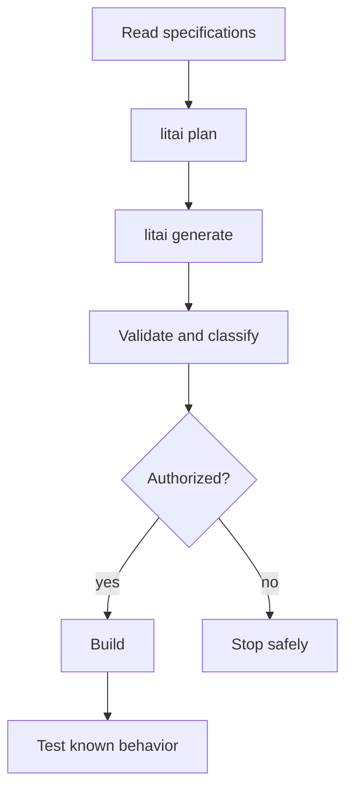

# Framework flow

[Project guide](../README.md) → framework flow

The Component `local/identifier-tools` defines portable identifier behavior. The
selected `identifier-tools-host-v1` target combines JavaScript, the macOS host
selection and the Node identifier resource binding. Its package is also checked
on Linux. The target removes the scaffold's Bazel preference.

Exact skills guide source conversion; workflows and routing constrain model work.
Generated source stays replaceable. Inspect `litai plan components/identifier-tools
--target identifier-tools-host-v1` before an authorized rebuild. The private
qualification profile and library oracle check behavior independently of generated
tests. Actual parent consumers and operator assembly have separate integration
gates, recorded in [active work](../roadmap/active-work.md).

Use the [project map](project-layout.md) to change the owning artifact, and read
[security](security.md) before compiling or running generated code.
