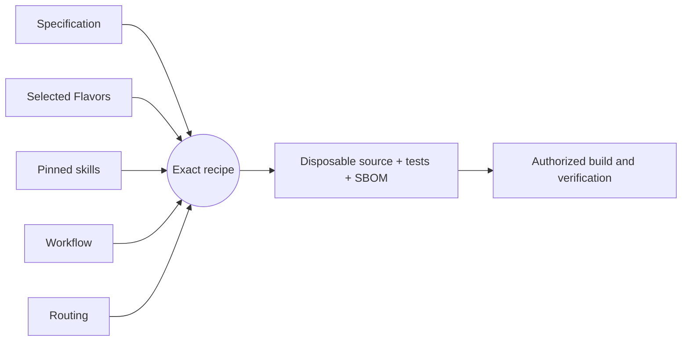

# Getting started

[Project guide](../README.md) → getting started

## What is this project?

Align manages shared goals and the coding sessions working toward them. People
approve and launch goal changes; connected sessions receive the launched version.
The app also shows session usage and estimated spend for each goal.

## Installation

The public tester deployment remains open under DEPLOY-001 in the
[active work queue](../roadmap/active-work.md).
For a local installation with Node 24 or later, follow
the README in the [application directory](../../components/legacy-project-wrapper/implementation).
The application guide covers the loopback server, sign-in codes, persistent data,
optional settings and local agent pairing. Its Hosted section links the separate
configuration and persistence requirements.

## Usage

After signing in, create a workspace and goal in the web app. The Apps tab gives
the connection commands for an MCP client. Pair the local agent and choose which
coding sessions share usage with a goal using the
README in the [agent directory](../../components/legacy-project-wrapper/implementation/packages/align-agent).
Goal changes take effect for connected sessions after an authorized person launches
them. The [active work queue](../roadmap/active-work.md) records remaining release
and deployment work.

---

## Development workflow

This project uses [Literate AI](https://github.com/jordanhubbard/literate-ai) to
keep specifications as durable authority and generate source, current tests, and a
CycloneDX source SBOM into a disposable workspace. The commands below are for
contributors, not end users.

Validate the project and inspect the exact recipe (planning does not invoke a
model or execute generated code):

```console
litai project validate
litai lock --check
litai plan samples/hello-component
```

Every non-empty initialized project begins with a portable hello Component. With an
authenticated coding CLI and the selected host toolchain, prove the complete local
lifecycle before changing it:

```console
litai rebuild samples/hello-component --project . \
  --allow-host-execution --update-receipt
```

The rebuild generates source and current tests from the specification, builds a
runnable artifact, runs both generated and independent acceptance tests, executes the
application, and commits the compact current passing receipt. Modify
`samples/hello-component/component.md` to begin the first application, or use
`litai init --empty` when no starter is wanted.

Invoke the `Execute:` command printed by rebuild with `{"name":"LitAI"}` as its one
argument. The known output is exactly
`{"greeting":"Hello, LitAI!","name":"LitAI"}`.



`+flavor` selects a variation and `-flavor` removes one. Explicit Component and
Flavor requirements outrank defaults, so `-bazel` removes the scaffold's Bazel
preference before prompt assembly. Read the [framework flow](framework-flow.md) before
adding a lifecycle driver that compiles or runs generated source, and use the
[project map](project-layout.md) to change the owning artifact.
