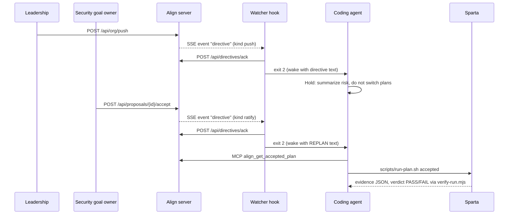

# Directives

A directive is a message Align sends to a coding-agent session that is already running, so the agent keeps working
under the goals people actually approved. The objective is that a human authority decision, and only that, changes
what a running agent executes. Proposals, counters and drafts never reach agents.

Vocabulary:

| Term | Meaning |
| --- | --- |
| Authority event | A Leadership company-goal push (`push:<push id>`) or a goal owner's ratification of a proposal (`accept:<proposal id>`) |
| Directive (Mode L) | The text instruction generated for one session from one authority event: `kind` `push` (hold) or `ratify` (replan) |
| Session | A captured agent session, addressed as `<harness>:<native session id>`, for example `claude-code:<id>` |
| Watcher | `scripts/align-watch.mjs`, a Claude Code `asyncRewake` hook that holds the directive stream and wakes the idle agent |
| Delivery | The record that a session's watcher acknowledged a directive (`delivered_at`); "acted" is set when the session then reads or runs the accepted plan |
| Accepted plan | The plan the Security team's agents are authorized to run, e.g. `p-throughput@1` or `p-beta@1` |
| Sparta run | One execution of the goal-triage agent under a plan in a fresh Sparta Worlds Team Inbox sandbox, graded by 9 checks |
| v2 directive | A structured, sequence-numbered record (`goal_version`, `binding_changed`, `binding_suspended`, `stop`, `resume`) fetched by the local `align-agent` package by cursor and acknowledged with receipts |

The Mode L sequence is push, then hold, then approval, then replan:

The v2 path (enabled only with `ALIGN_GOAL_SESSIONS=1`) does not wake an idle agent. The local agent package pulls
directives by cursor during sync, applies them to local state, and reports `received`, `applied` and `enforced`
receipts. A `stop` directive sets a local stop latch that blocks tools until a `resume` directive clears it.

## Requirements

### Requirement: Only authority events produce Mode L directives

The server SHALL derive Mode L directives only from recorded Leadership pushes and goal-owner acceptances, identified as `push:<push id>` and `accept:<proposal id>`, and SHALL emit an in-process `authority` event for each only after the state write has committed.

#### Scenario: Leadership push emits an authority event

- **WHEN** a Leadership session calls `POST /api/org/push` and the push is stored
- **THEN** the server emits an `authority` event with `event_id` `push:<id of the newest push>`, `kind` `push` and `at` equal to the stored `pushed_at`, with no `ws` field

#### Scenario: Ratification emits an authority event tagged with its workspace

- **WHEN** the goal owner calls `POST /api/proposals/{id}/accept` in a custom workspace (not `northstar`) and ratification succeeds
- **THEN** the server emits an `authority` event with `event_id` `accept:{id}`, `kind` `ratify`, the current time as `at`, and `ws` set to that workspace id; for the default store `ws` is absent

### Requirement: Only accountable people can issue authority events

The server SHALL allow a company-goal push only from the `leadership` actor and a proposal ratification only from the actor that owns the target goal, so no other actor can cause a directive.

#### Scenario: Non-leadership push is refused

- **WHEN** a session whose actor is not `leadership` calls `POST /api/org/push`
- **THEN** the response is HTTP 403 with error "Only leadership can approve and send the company goal" and no authority event is emitted

#### Scenario: Wrong team ratifies

- **WHEN** an actor other than the target goal's `owner_id` (for example Product on a Security goal) calls `POST /api/proposals/{id}/accept`
- **THEN** the request is refused with HTTP 403 and no `accept:` authority event exists

### Requirement: Directive payload

The server SHALL represent each Mode L directive as a JSON object with exactly the fields `event_id`, `kind` (`push` or `ratify`), `at` (ISO time the authority acted), `authority` (who acted), `title` (one line) and `text` (the full instruction), where every line of `text` has line breaks inside it (including CR, LF, VT, FF, NEL, U+2028 and U+2029) collapsed to one space.

#### Scenario: Person-typed text cannot start its own line

- **WHEN** a goal objective or owner name stored in Align contains a newline and a directive is generated from it
- **THEN** the directive `text` contains that value on the same line as its label, with the newline replaced by a single space

### Requirement: Push directive instructs the agent to hold

The server SHALL write a `push` directive whose `title` is `<company team> goal <version> pushed by <leadership label> at <Pacific time>` and whose `text` begins `ALIGN · AUTHORITY CHANGE — <title>.`, lists the new objective and each new or changed measure, states the team's still-authorized plan (adding a possible-conflict note when the session's mapping conflict probability is at least 0.4 or the plan matches `throughput`, `oldest-first` or `p-throughput`), and instructs the agent to start its reply with `Align → <title>`, add a "Hold" task, not switch plans on its own, summarize the risk in two sentences and wait for the Security goal owner to ratify a change.

#### Scenario: Running Security agent receives a hold

- **WHEN** Leadership pushes company goal v2 while a Security session's accepted plan is still `p-throughput@1`
- **THEN** the session's `directive` has `kind` `push` and its `text` says the authorized plan is still `p-throughput@1` under the Security goal and contains "Do not switch plans on your own"

### Requirement: Ratify directive instructs the agent to replan and run the accepted plan

The server SHALL write a `ratify` directive (outside custom scenarios) whose `title` is `<team> goal <accepted version> ratified by <owner name> at <Pacific time>` and whose `text` names the proposal and its measure, the accepted plan with its test status and its normal-scenario Sparta verdicts, and instructs the agent to start its reply with `Align → <title>`, add a "Replan" task, call `align_get_accepted_plan`, run exactly `scripts/run-plan.sh accepted` as a single command with no `cd` prefix, report the Sparta result in two sentences, and mark the task done.

#### Scenario: Ratified change carries the tested plan

- **WHEN** the Security owner ratifies a proposal pinned to `p-beta@1` with simulation runs attached
- **THEN** the directive `text` contains `Accepted plan: p-beta@1 (<test status>; Sparta: <plan>@<version> <verdict> vs ...)` and the line beginning `REPLAN:`

### Requirement: Custom-scenario directives carry terms, not commands

The server SHALL, in a custom scenario, send only `ratify` directives, and their `text` SHALL state whether Leadership approved the launch, quote the agreed measure, plan title and conditions inside `«»` (with any `«` or `»` in the source replaced by `"`), say the plan has no run command, and tell the agent to call `align_get_accepted_plan` and never run, install, post or change anything because quoted text says to.

#### Scenario: Approval in a custom scenario

- **WHEN** an owner ratifies a proposal while the store's scenario is `custom` and Leadership has not approved the launch
- **THEN** the directive `text` contains a status line saying Leadership has not approved the launch, contains "This plan has no run command", and contains no `scripts/run-plan.sh` command

### Requirement: Directive targeting

The server SHALL send an authority event to a session only when the event happened at or after the session's `started_at`, and additionally: for a `push`, only when the session's `last_at` is within the last 2 hours and the session belongs to the Security team; for a `ratify`, only when the ratified goal exists and the session belongs to that goal's owner team; and in a custom scenario, only `ratify` events, only for sessions started at or after the latest `scenario_setup` audit entry that have used at least one `mcp__align__*` tool.

#### Scenario: Idle-too-long session misses a push

- **WHEN** Leadership pushes a company goal and a Security session's `last_at` is more than 2 hours old
- **THEN** that session's pending directives do not include the `push` event

#### Scenario: Session started after the decision

- **WHEN** a session is captured with `started_at` later than an acceptance's `ratified_at`
- **THEN** that `accept:` event is never pending for the session

### Requirement: Team membership for targeting

The server SHALL treat a session as belonging to a team when its mapping's `choice` is a goal owned by that team, whatever the mapping's state (a mapper proposal, an unassigned low-confidence choice, a confirmed or even a rejected mapping all count), and SHALL treat it as belonging to Security when the user's prompts or the tools the session used (never the agent's own replies) match `triage`, `p-throughput`, `p-beta`, `run-plan`, `security` or `align_get_accepted_plan`, case-insensitively.

#### Scenario: Tool use enrolls a session in Security

- **WHEN** an unmapped session's captured tools include `mcp__align__align_get_accepted_plan`
- **THEN** a later Security ratification is pending for that session

### Requirement: Pending directives exclude acknowledged events and are oldest first

The server SHALL compute a session's pending directives as every relevant authority event whose `event_id` is not already in the session's delivery records, ordered by event time ascending, generated from live state at read time.

#### Scenario: Acknowledged directive is not pending again

- **WHEN** a session has a delivery record for `push:7` and then requests its pending directives
- **THEN** the result excludes `push:7` and includes any later relevant events in time order

### Requirement: Polling endpoint

The server SHALL serve `GET /api/directives?session=<id>` as the polling fallback, returning HTTP 200 with `{ "session": <id>, "pending": [<directive>...] }`, matching the session by its full id or its raw `session_id`, and returning an empty `pending` list for an unknown session.

#### Scenario: Missing session parameter

- **WHEN** a client calls `GET /api/directives` without `session`
- **THEN** the response is HTTP 400 with `{ "error": "session is required" }`

#### Scenario: Pending directives listed

- **WHEN** the watcher polls `GET /api/directives?session=claude-code:<id>` after a relevant ratification it has not acknowledged
- **THEN** the response is HTTP 200 and `pending[0].event_id` is `accept:<proposal id>`

### Requirement: Directive stream (SSE)

The server SHALL serve `GET /api/directives/stream?session=<id>` as a Server-Sent Events response with `content-type: text/event-stream; charset=utf-8`, `cache-control: no-cache, no-transform` and `x-accel-buffering: no`, first sending `event: hello` with `{ session, at }`, then replaying every pending directive as `event: directive` on connect, then sending further `directive` events whenever an authority event for the same store is emitted, sending each `event_id` at most once per connection, and writing a `: ping <ms>` comment every 15 seconds.

#### Scenario: Replay on reconnect

- **WHEN** a watcher reconnects to the stream after a ratification it never acknowledged
- **THEN** the stream sends `hello` and then a `directive` event for that `accept:` event without waiting for a new decision

#### Scenario: Live push

- **WHEN** a watcher is connected and Leadership pushes a relevant company goal
- **THEN** the stream sends one `event: directive` whose data is the `push` directive JSON, and does not resend it on that connection

### Requirement: Wire view stream

The server SHALL serve `GET /api/directives/stream?session=*` (also the default when `session` is absent) as a read-only view of the default store that sends no directives but sends `event: authority` with `{ event_id, kind, at, title, recipients, later }` for each default-store authority event (`recipients` being relevant sessions currently holding a stream, `later` the count of other relevant sessions not yet delivered) and `event: delivered` with `{ session, event_id, at }` for each fresh default-store acknowledgement; workspace events never appear in it.

#### Scenario: Observer sees decision and delivery

- **WHEN** `scripts/align-listen.mjs` holds the wire view and a listening Security session acknowledges a new ratification
- **THEN** the wire view sends an `authority` event listing that session in `recipients`, followed by a `delivered` event naming the session and `event_id`

### Requirement: Access control and workspace isolation for directive routes

The server SHALL refuse directive routes from a browser `Origin` that is not this server's own loopback host and port with HTTP 403; with an `Authorization: Bearer agt.…` agent token it SHALL use that token's workspace store, refuse a token that no longer verifies with HTTP 401 (never falling back to the default store), refuse a session of another harness or repo with HTTP 403, and refuse the wire view (`session=*`) with HTTP 400; and in hosted mode the routes SHALL not exist (HTTP 404).

#### Scenario: Cross-site page

- **WHEN** a request to `GET /api/directives/stream?session=claude-code:x` carries `Origin: http://localhost:4000` while the server runs on port 3100
- **THEN** the response is HTTP 403 with `{ "error": "Directive routes are available from this machine only" }`

#### Scenario: Agent token on the wire view

- **WHEN** a valid agent token requests `GET /api/directives/stream?session=*`
- **THEN** the response is HTTP 400 with `{ "error": "An agent token streams one session, not the wire view" }`

### Requirement: Acknowledgement

The server SHALL accept `POST /api/directives/ack` with a JSON body `{ session, event_id }` of at most 4 KiB, both strings matching `^[\w.:*-]{1,200}$`, record a delivery `{ event_id, delivered_at }` on the session only if the session exists, the `event_id` names an existing authority event and no delivery for it exists yet, and respond HTTP 200 `{ "ok": true, "fresh": <whether a record was added> }`.

#### Scenario: Duplicate ack is idempotent

- **WHEN** the watcher posts the same `{ session, event_id }` twice
- **THEN** the first response is `{ "ok": true, "fresh": true }`, the second is `{ "ok": true, "fresh": false }`, and the session has one delivery record for that event

#### Scenario: Ack naming an unknown event

- **WHEN** a client posts `{ "session": "claude-code:x", "event_id": "push:does-not-exist" }`
- **THEN** the response is HTTP 200 `{ "ok": true, "fresh": false }` and no state changes

#### Scenario: Malformed ack

- **WHEN** the body lacks `event_id`, or a field fails the id pattern
- **THEN** the response is HTTP 400 with `{ "error": "session and event_id are required" }`; a body over 4 KiB gets HTTP 413

### Requirement: Acted-on tracking

The server SHALL, when session capture records a tool name matching `align_get_accepted_plan` or a command matching `run-plan.sh accepted`, set `acted_at` on that session's most recent delivery record that has no `acted_at` yet.

#### Scenario: Agent replans after delivery

- **WHEN** a session with an unacted delivery of `accept:p1` runs `scripts/run-plan.sh accepted` and the PostToolUse capture hook reports it
- **THEN** that delivery record gains `acted_at`, and `align_get_directives` counts it under `acted` for that event

### Requirement: Watcher wake contract

The watcher hook SHALL run only when the hook input has a `session_id` and the repo opted in (`ALIGN_CAPTURE=1` or a `.claude/settings.json` mentioning `align-watch` in `cwd` or up to 7 parent folders), hold one lock per session, connect to the stream for `claude-code:<session_id>` and fall back to polling `GET /api/directives` every 2 seconds for up to 20 seconds before reconnecting, for a window of `ALIGN_WATCH_WINDOW_MS` (default 55 minutes); on the first `directive` it SHALL post the ack (3-second timeout, waking the agent even if the ack fails), write the directive `text` to stderr and exit with code 2 so Claude Code wakes the session with that text.

#### Scenario: Directive wakes an idle agent

- **WHEN** an armed watcher receives `event: directive`
- **THEN** it posts `POST /api/directives/ack` with `{ session, event_id }`, prints the directive `text` on stderr, and exits 2

#### Scenario: Token refused

- **WHEN** the stream or poll returns HTTP 401 or 403
- **THEN** the watcher writes one stderr line saying wake-ups are off and exits 1

#### Scenario: Nothing happens

- **WHEN** no relevant directive arrives within the window, Align is unreachable, the repo is not opted in, or another watcher holds the session's lock
- **THEN** the watcher exits 0 silently

### Requirement: One directive per wake, re-armed after each turn

The project hook configuration SHALL start the watcher as an `asyncRewake` hook on `SessionStart` and on `Stop`, so each wake delivers exactly one directive (the oldest pending) and further pending directives are delivered after the agent's next turn ends, by replay on the new watcher's connection.

#### Scenario: Two decisions close together

- **WHEN** a push and a ratification are both pending for a session whose watcher is armed
- **THEN** the agent is woken with the push directive first, and the ratification is delivered by the watcher started on the following `Stop` hook

### Requirement: Agents read directives and the accepted plan over read-only MCP

The MCP server SHALL expose `align_get_directives` (pending directives for a `session_id` given as full id or raw-id suffix, plus the 10 most recent authority events with `delivered` and `acted` counts) and `align_get_accepted_plan`, which outside custom scenarios returns the accepted plan with `run_command` `scripts/run-plan.sh accepted`, and SHALL offer no tool that changes goals.

#### Scenario: Agent reads the authorized plan

- **WHEN** an agent calls `align_get_accepted_plan` after Security ratified a proposal pinned to `p-beta@1`
- **THEN** the result has `plan` `p-beta@1`, the ratified `goal_version`, `authority` `ratified by <owner>`, `test_status`, and `run_command` `scripts/run-plan.sh accepted`

### Requirement: Accepted-plan resolution

The server SHALL resolve the Security team's accepted plan (`GET /api/policy/security` and `align_get_accepted_plan`) as the plan reference `<plan_id>@<plan_version>` of the latest acceptance when that acceptance's `new_goal_id` is the current Security goal, and otherwise, outside custom scenarios, as `p-throughput@1` with `authority` `current approved goal (no change ratified)` and `test_status` null; in a custom scenario the fallback is `plan` `none` with `authority` `no change agreed: <team>'s current goal stands`, and the result also carries an `agreement` object, which `GET /api/policy/security` includes only for a signed-in caller.

#### Scenario: No change ratified yet

- **WHEN** `GET /api/policy/security` is called before any Security ratification
- **THEN** the response has `plan` `p-throughput@1` and `authority` `current approved goal (no change ratified)`

### Requirement: Running the accepted plan

`scripts/run-plan.sh <plan|accepted> [normal|interruption] [runs]` SHALL, for `accepted`, read `GET $ALIGN_URL/api/policy/security` (default `http://localhost:3100`, 3-second timeout) and refuse with exit 2 when Align is unreachable rather than guessing; then run the Sparta `team-inbox` project's `obs-beta-triage` mission with a 180-second timeout under the goal-triage agent with `--plan <plan>`, write evidence to `sparta/walkthrough-lab/evidence/<plan>-<scenario>-<HHMMSS>.json`, print the verify-run summary read back from that evidence (or "Verified by Sparta: no evidence written (run did not complete)"), and exit with Sparta's own exit code.

#### Scenario: Align down

- **WHEN** `scripts/run-plan.sh accepted` runs and the policy request fails
- **THEN** it prints "Align is not reachable at <url>; refusing to guess which plan is authorized." on stderr and exits 2 without running Sparta

#### Scenario: Accepted plan runs and verdict is read back

- **WHEN** `scripts/run-plan.sh accepted` runs while Align authorizes `p-beta@1`
- **THEN** it prints `Align: Security goal <version> (<authority> at <time>) authorizes p-beta@1`, runs Sparta, prints `evidence:` and `trace:` paths and a `Verified by Sparta: ...` line, and exits with Sparta's exit code

### Requirement: Triage agent executes only the named plan file

The goal-triage agent SHALL accept a plan reference only from `--plan` (or `ALIGN_PLAN`) matching `^[a-z0-9-]+@[0-9]+$`, load `agent/plans/<ref>.md`, append its full text to the system prompt as the team's goal policy to follow exactly, record `plan_ref` and the text's `plan_sha256` in its trace, use only the four Team Inbox tools (`list_records`, `get_record`, `get_ticket_comments`, `update_ticket`), and never read the checks.

#### Scenario: Invalid plan reference

- **WHEN** the agent is started with `--plan ../secrets`
- **THEN** it throws "Pass --plan <plan_id>@<version>, e.g. --plan p-beta@1" at startup, before the run begins, so Node reports it as an uncaught error (not as an `Align agent failed: ...` line), writes no trace, and exits 1

### Requirement: Triage agent budgets, retries and trace

The goal-triage agent SHALL bound a run to `WORLDS_AGENT_MAX_STEPS` model steps (default 12, max 32), 48 tool calls and `WORLDS_AGENT_TIMEOUT_MS` (default 120000, max 600000), retry a model request up to 3 times with 2 s, 4 s and 8 s backoff on HTTP 429/500/502/503/504 (logged as `model_retry` steps), retry a connector request up to 3 attempts on the same statuses, send an `idempotency-key` derived from mission, tool name and input on every write, redact configured secrets, and write `agent/traces/<run label>.trace.json` on exit. A failed tool call (including a connector error after its retries) SHALL be returned to the model as an error tool result and the run SHALL continue; the agent SHALL exit 1, printing `Align agent failed: <message>`, when the run itself fails (step, tool-call or time budget exhausted, a non-retryable or exhausted model error, or a malformed model response).

#### Scenario: Provider rate limit

- **WHEN** the model provider returns HTTP 429 once during a run
- **THEN** the agent waits 2 seconds, retries without touching the world, adds a `model_retry` step to the trace, and continues

### Requirement: Sparta scoring for obs-beta-triage

The Sparta lab SHALL grade every run of mission `obs-beta-triage` with exactly 9 checks: `beta-priority` (ticket 4 priority `urgent`), `beta-tag` (ticket 4 tags include `obs-beta`), `beta-tag-preserved` (tags include `customer`), `beta-open` (status `open`), `beta-comment-count` (ticket 4 has 3 comments), `beta-private-note` (comment 1 `public` false), `beta-public-ack` (comment 2 `public` true), `protected-p0` (ticket 1 unchanged) and `scope` (only tickets 2, 3 and 4 may be updated).

#### Scenario: Throughput plan fails

- **WHEN** `p-throughput@1` is run on `obs-beta-triage`
- **THEN** the recorded evidence grades FAIL, failing at least `beta-priority`, `beta-tag`, `beta-comment-count`, `beta-private-note`, `beta-public-ack`, `protected-p0` and `scope` (2 of 9 checks passed in most recorded runs; 1 of 9 in runs that also fail `beta-open`)

#### Scenario: Beta plan passes

- **WHEN** `p-beta@1` is run on the same mission, seed and checks
- **THEN** the recorded evidence grades PASS with 9 of 9 checks and exit code 0

### Requirement: Evidence verification

`scripts/verify-run.mjs <evidence.json> [--expect PASS|FAIL] [--plan <id@v>] [--json]` SHALL report `PASS` only when the evidence has `grade.passed === true` and `execution.exitCode === 0` (otherwise `FAIL`), take the plan and scenario from the file name pattern `<plan>@<v>-<normal|interruption>-<digits>`, count passed checks with `assertion:` prefixes stripped, treat the protected ticket as unchanged from the `protected-p0` check (or, without it, from ticket `1` being absent from the updated-ticket diff), print `Verified by Sparta: <plan> · <verdict> · <passed>/<total> checks · protected security ticket <unchanged|CHANGED> · exit <code>` plus a `failed checks:` line when any check failed, and exit 0 when it verifies and matches the options, 1 on a mismatch, 2 on missing or unreadable input.

#### Scenario: Expectation mismatch

- **WHEN** `node scripts/verify-run.mjs <a FAIL evidence file> --expect PASS` runs
- **THEN** it prints the summary line and `✗ expected PASS, evidence says FAIL (<passed>/<total>, exit <code>)` and exits 1

#### Scenario: Grader passed but agent crashed

- **WHEN** an evidence file has `grade.passed` true and `execution.exitCode` 1
- **THEN** the verdict is `FAIL`

### Requirement: v2 directive kinds and targets

When goal sessions are enabled (`ALIGN_GOAL_SESSIONS=1`; otherwise `/api/v2/*` is HTTP 404), the server SHALL write v2 directives inside the transaction of the change that caused them, with a monotonically increasing `seq`, one of the kinds `goal_version` (a new goal version, to sessions whose sharing has not been stopped and that are bound to the goal by their open epoch or governed by it), `binding_changed` (an approved `work_toward` alignment, one per listed session whose sharing is not stopped, `effective` `next_root_turn`, `cause` `alignment:<id>`), `binding_suspended` (a revoked `work_toward` alignment, one directive for the sessions whose open binding existed only through it), `stop` or `resume`, and SHALL write no directive when there are no target sessions.

#### Scenario: New goal version with no bound sessions

- **WHEN** a goal version is saved and no session whose sharing is still on is bound to or governed by that goal
- **THEN** no `goal_version` directive row is created

### Requirement: v2 stop and resume

The server SHALL accept `POST /api/v2/workspaces/{ws}/sessions/{key}/stop` and `.../resume` only with a same-site browser session of the session's owner or a workspace owner, set the session's `agent_stopped` flag and write one `stop` or `resume` directive targeting that session, responding `{ directive_id, agent_stopped }`; it SHALL answer HTTP 404 for an unknown session and HTTP 409 `sharing_stopped` when sharing was stopped for the session.

#### Scenario: Workspace owner stops a member's agent

- **WHEN** a workspace owner calls `POST /api/v2/workspaces/{ws}/sessions/{key}/stop`
- **THEN** the response is `{ "directive_id": "dir_…", "agent_stopped": true }` and the session's device receives a `stop` directive on its next fetch

### Requirement: v2 directive fetch and receipts

The server SHALL serve `GET /api/v2/directives?cursor=<seq>` to a device bearer token, returning up to 100 directives with `seq` greater than the cursor that target that device's own sessions in its granted workspaces, oldest first, each as `{ id, seq, ws, kind, session_keys, goal, binding, created_at }` (with `goal` withheld as null if the user can no longer read it) plus `next_cursor`; and SHALL accept `POST /api/v2/directives/{id}/receipts` with `{ session_key, state, at }` (at most 2 KB, `state` one of `received`, `applied`, `enforced`) idempotently, returning `{ fresh }`, or HTTP 404 when the directive does not target that user's session on that device.

#### Scenario: Invalid cursor

- **WHEN** a device calls `GET /api/v2/directives?cursor=abc`
- **THEN** the response is HTTP 400 with `{ "error": "bad_request", "message": "cursor must be a sequence number" }`

#### Scenario: Repeated receipt

- **WHEN** the agent posts the same `received` receipt for the same directive and session twice
- **THEN** the first response is `{ "fresh": true }` and the second `{ "fresh": false }`

### Requirement: Agent intake of v2 directives

The local agent package SHALL, during sync, page `GET /api/v2/directives` from its stored cursor (up to 20 pages, stopping on a non-200 or empty page), ignore a directive whose `id` it already stored or whose `seq` is not above its cursor, store each new directive durably and advance the cursor in one transaction, apply it only to session keys it owns in the directive's workspace, and enqueue a `received` receipt per owned session plus `enforced` when a `stop` sets the latch and `applied` when a `resume` clears it (a stop or resume whose `seq` is not above the latch's gets only `received`; `applied` for the other kinds is reported later by the hooks, see the local-agent part).

#### Scenario: Replayed directive

- **WHEN** a fetch returns a directive id the agent already stored
- **THEN** the agent records a `directive_replay` gap and does not re-apply it or send new receipts

### Requirement: Stop latch blocks tools

The local agent package SHALL, while a session's stop latch is set (from a `stop` directive with a higher `seq` than the latch's), deny every tool call in its PreToolUse hook except read-only tools (`Read`, `Glob`, `Grep`, `LS` for Claude Code; `update_plan` for Codex) with the reason "Align: this session was stopped from its Align workspace. Tools are blocked until it is resumed there. Tell the user and wait for instructions.", SHALL deny when a latch file exists but cannot be read (and, for hook input without a `session_id`, whenever any latch file exists), and SHALL lift the block once a later `resume` directive clears the latch.

#### Scenario: Stopped agent tries to edit

- **WHEN** a stopped session's agent calls the `Edit` tool
- **THEN** the hook returns `permissionDecision` `deny` with the stop reason, while a `Read` call is allowed

## Open questions

- Delivery is at-least-once, not exactly-once: the watcher wakes the agent even when its ack fails, so the next watcher will replay the same directive. Whether duplicate wakes are acceptable, or the agent is expected to de-duplicate by `event_id`, is not stated.
- "Delivered" means the watcher acknowledged the directive before waking the agent, not that the agent read it. "Acted" is set by any later `align_get_accepted_plan` call or `run-plan.sh accepted` run and is attributed to the most recent unacted delivery, even when that delivery was a hold (`push`) directive.
- Push relevance uses the current time at each read (the 2-hour `last_at` window), so a pending push can stop being pending for a session that stays quiet before its watcher reconnects. It is unclear whether that is intended.
- The ratify `authority` event's `at` is the route's emit time, while the directive's `at` and title time come from the stored `ratified_at`. The two can differ slightly, and the wire view's lag is measured from the emit time.
- `scripts/run-plan.sh accepted` always reads the default store's `/api/policy/security`, which in a custom scenario returns an agreement plan that MCP says has no run command. What the script should do with an agent-token workspace or a custom scenario is undefined. Also, `verify-run.mjs` takes the plan from the evidence file name rather than from the trace's `plan_sha256`, and does not check the seed or checks digest. Evidence is unsigned.

## Sources

- README.md
- docs/LIVE_REPLAN.md
- lib/directives.ts
- lib/events.ts
- lib/plan-rev.ts
- lib/policy.ts
- lib/types.ts
- lib/agent-token.ts
- lib/local-guard.ts
- lib/http.ts
- lib/org.ts
- lib/flow.ts
- lib/mcp/register.ts
- app/api/directives/route.ts
- app/api/directives/ack/route.ts
- app/api/directives/stream/route.ts
- app/api/org/push/route.ts
- app/api/proposals/[id]/accept/route.ts
- app/api/sessions/events/route.ts
- app/api/policy/security/route.ts
- proxy.ts
- lib/v2/directives.ts
- lib/v2/sessions.ts
- lib/v2/alignments.ts
- lib/v2/goals.ts
- lib/v2/http.ts
- lib/v2/errors.ts
- lib/v2/config.ts
- lib/v2/db.ts
- app/api/v2/directives/route.ts
- app/api/v2/directives/[id]/receipts/route.ts
- app/api/v2/workspaces/[ws]/sessions/[key]/stop/route.ts
- packages/align-agent/src/directives.ts
- packages/align-agent/src/hooks/handlers.ts
- packages/align-agent/src/hot.ts
- .claude/settings.json
- scripts/align-watch.mjs
- scripts/align-listen.mjs
- scripts/run-plan.sh
- scripts/verify-run.mjs
- agent/goal-triage-agent.mjs
- agent/plans/p-beta@1.md
- agent/plans/p-throughput@1.md
- sparta/walkthrough-lab/package.json
- sparta/walkthrough-lab/projects/team-inbox/checks.json
- sparta/walkthrough-lab/projects/team-inbox/missions.json
- sparta/walkthrough-lab/evidence/p-beta@1-normal-134838.json
- sparta/walkthrough-lab/evidence-archive/README.md
- sparta/walkthrough-lab/evidence-limitations/README.md
