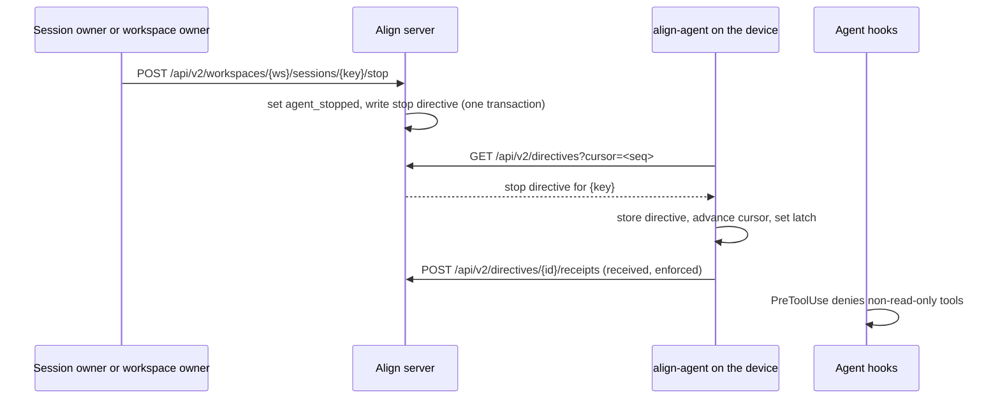

# Directives

A directive is a structured record that Align writes for one or more shared agent sessions when a human decision
changes what those sessions work under. The objective is that a recorded decision by an accountable person, and only
that, changes what a running agent sees: a saved goal version (published by its owner, or by the launch of an
approved change request), an approved or revoked alignment, a stop or resume by the session's owner or a workspace owner, or a
request or goal hold from someone who can approve for the goal. Change requests in flight, counters and their
conditions, approved change requests that nobody has launched, alignment notes and drafts never reach agents.

Align reaches agents at three levels (owner decision, 2026-10-30). **Inform**: facts the agent works under (goal
versions with their limits, bindings, accepted asks). **Request**: one of a fixed set of typed requests (`replan`,
`checkpoint`, `switch_goal`) from someone who can approve for the goal or a workspace owner; Align writes the wording,
the sender is named, and their note is passed on quoted, as data. Safe requests run on their own: a checkpoint, or
drafting an updated plan for a replan, reaches the agent without waiting for the developer, who can still decline,
and the machine reports such a request as delivered and not declined (never as done: Align has no agent-reported
completion); anything
that changes direction asks first, so a replan's new plan and a `switch_goal` take effect only when the developer
accepts. The developer is always told, and every answer is a receipt. **Enforce**: Align blocks tools itself without
asking the model: the per-session `stop`, and a goal hold that pauses every session on a goal until it is released.
The request and hold routes are specified in the goals part.

Directives are always on: there is no feature flag, and they work the same in Mode L and when hosted. Align does not
wake an idle agent. The local `align-agent` package pulls directives by cursor whenever a hook starts a sync,
applies them to its local state and reports receipts. The local agent's hook mechanics (context injection, notices,
the latch file and the `PreToolUse` denial) are specified in the local-agent part; the `align_get_directives` MCP
tool is specified in the MCP part.

Vocabulary:

| Term | Meaning |
| --- | --- |
| Directive | A row in `v2_directives` with an id `dir_<24 base32 chars>`, a workspace, a `kind`, a monotonically increasing `seq`, an optional goal snapshot and an optional binding, plus one target row per session key |
| Kind | One of `goal_version`, `binding_changed`, `binding_suspended`, `stop`, `resume`, `request`, `hold`, `release` |
| Request | A typed request to the agents on a goal (`v2_requests`, `rq_<24 base32 chars>`): `replan`, `checkpoint` or `switch_goal`, with its sender, an optional quoted note of at most 280 characters, and a state per targeted session (`sent`, `received`, `accepted`, `declined`, `expired`) |
| Goal hold | A goal whose agents are paused (`v2_goal_holds`) until someone who can approve for it releases it |
| Session key | The 43-character key of a shared session (`v2_sessions.session_key`), owned by one person on one device |
| Goal snapshot | The goal's core fields as of the saved version that caused the directive: `id`, `version`, `title`, `measures`, `status`, `visibility`, `level`, `owner` `{id, name}`, `team` `{id, name}` or null, `anchors`, `depends_on`, `limits` (the version's limits, each `{id, type, text, source}`; `[]` for a snapshot stored before limits existed) |
| Binding | `{ goal_id, effective, cause }`, where `effective` is `next_root_turn` and `cause` is `alignment:<alignment id>` |
| Cursor | The highest `seq` a device has already taken; a fetch returns directives with a larger `seq` |
| Receipt | A per-directive, per-session report from the device: `received`, `applied` or `enforced` for delivery, and `accepted` or `declined` answering a request |
| Stop latch | The local agent's per-session record that the session was stopped; while set, the agent's hooks block every tool except read-only ones |

The stop path, end to end:

## Requirements

### Requirement: Directives carry only structured decision content

The server SHALL put into a directive only its kind, the goal snapshot of a saved goal version, a binding object, a request's typed fields (its type, goal, target goal, sender and the sender's quoted note) or a hold's (its goal, who held or released it, the reason and the time), and the enumerated fields of the fetch response, and never alignment notes, change-request reasons, approval or rejection notes, counter-proposals, goal drafts or any instruction text other than a request's quoted note; the wording that tells an agent what a request asks is Align's, fixed per type.

#### Scenario: A countered change request reaches no agent

- **WHEN** an approver counters a pending change request on a goal that has bound sessions, with a `note`
- **THEN** no directive row is written, and the bound sessions' next fetch returns nothing new

#### Scenario: Approval note stays on the decision record

- **WHEN** an approver approves a change request with `note` "Agreed for Q3", someone launches it, and a bound session then fetches its directives
- **THEN** the `goal_version` directive's `goal` holds the new version's fields and no field of the directive contains the request's `reason` or the approver's `note`

### Requirement: Limit text reaches agents only in a saved version's snapshot

The server SHALL put a limit's text into a directive only inside the goal snapshot of a saved goal version (the `limits` of a version its owner saved or that the launch of an approved change request wrote), and never from a limit suggestion, a change request that is pending, countered or approved but not launched, or an ask.

#### Scenario: Proposed limit waits for approval

- **WHEN** a member proposes a change request adding a limit to a goal with a bound session, and an approver counters it
- **THEN** no directive is written, nor when the approver approves it; once someone launches it, the bound session's `goal_version` directive has the limit in `goal.limits` with its `id`, `type`, `text` and `source`, and no field holds the request's reason

#### Scenario: Suggestions are not delivered

- **WHEN** a member pastes notes into `POST /api/v2/workspaces/{ws}/limits/suggest` and gets suggestions for a goal with bound sessions
- **THEN** no directive is written and the goal's limits are unchanged

### Requirement: Target shares reach agents only in a launched version

The server SHALL put a goal's target share into a directive only as `target_share` inside the goal snapshot of a saved goal version (one its owner saved, or one the launch of an approved change request or reallocation wrote; `null` for no target, and for snapshots stored before targets existed), and SHALL write no directive for proposing, approving, countering, accepting, rejecting, withdrawing, saying not yet to or superseding a reallocation, for turning steering on or off, or for a steering report. What a steering line tells an agent is decided on the device from the goals feed (launched targets, 7-day shares, holds and the switch; see `local-agent`), not by a directive.

#### Scenario: Approved, then launched

- **WHEN** both approvers approve a reallocation that lowers goal G's target from 25 to 15 while session S is bound to G, and later a workspace owner launches it
- **THEN** S's fetch returns nothing new after the approvals; after the launch it returns one `goal_version` directive whose `goal.target_share` is 15

### Requirement: Directives are written in the transaction of the change that caused them

The server SHALL write every directive row and its target rows inside the same database transaction as the goal version, alignment decision or stop/resume that caused it, assign each directive the next `seq` in one sequence shared by all workspaces, and write no directive at all when the change has no target session.

#### Scenario: Refused change leaves no directive

- **WHEN** a goal version save fails with HTTP 409 `stale_version` because the goal changed meanwhile
- **THEN** no new goal version exists and no `goal_version` directive was written

#### Scenario: New goal version with no bound sessions

- **WHEN** a goal version is saved and no session whose sharing is still on is bound to or governed by that goal
- **THEN** no `goal_version` directive row is created

#### Scenario: Sequence numbers only grow

- **WHEN** a stop in one workspace is followed by a goal version in another workspace that reaches a bound session
- **THEN** the second directive's `seq` is greater than the first's

### Requirement: goal_version directives reach bound and governed sessions

The server SHALL, whenever a new version of a goal is saved (by the goal's owner through `POST /api/v2/workspaces/{ws}/goals/{goal}/versions`, or by the launch of an approved change request or reallocation), write one `goal_version` directive whose `goal` is the snapshot of the new version and whose `binding` is null, targeting every session in that workspace whose sharing is not stopped and whose open epoch is bound to the goal or whose governing goal (from an approved `work_toward` alignment) is the goal.

#### Scenario: Owner publishes a new version

- **WHEN** the owner of goal G saves version 3 while session S has an open epoch bound to G and session T is governed by G through an approved alignment
- **THEN** one `goal_version` directive targets both S and T, and its `goal.version` is 3

#### Scenario: Sessions that stopped sharing are skipped

- **WHEN** a new version of goal G is saved and the only session bound to G has stopped sharing
- **THEN** no `goal_version` directive is written

#### Scenario: Snapshot uses team, not pod

- **WHEN** a `goal_version` directive is written for a goal owned by the team "Security"
- **THEN** its goal snapshot has `team` `{ "id": <team id>, "name": "Security" }` and no `pod` key

### Requirement: Launched change requests reach agents as goal versions

The server SHALL, when someone in its launch set launches an approved change request (or an approver approves and launches it in one step), create the goal's next version authored by the approver and write its `goal_version` directive through the same path and in the same transaction as an owner's edit, and write no directive for creating, countering, accepting a counter, acknowledging a condition, rebasing, approving without launching, saying not yet, rejecting, withdrawing or superseding a change request.

#### Scenario: Approval without launch reaches no agent

- **WHEN** an approver approves a pending change request on goal G at version 2 while session S is bound to G, and S's device fetches after its cursor
- **THEN** no directive is returned, G is still at version 2, and S's agent reads version 2 everywhere (feed, MCP)

#### Scenario: Launch updates a running agent

- **WHEN** someone in the launch set then launches that request
- **THEN** G is at version 3 with `created_by` the approver, and S's device receives exactly one `goal_version` directive with `goal.version` 3 on its next fetch; a second fetch from the new cursor returns nothing

#### Scenario: Stale approval writes nothing

- **WHEN** an approver approves a change request whose `base_version` is no longer the goal's current version
- **THEN** the response is HTTP 409 `stale_version`, no goal version is created and no directive is written

#### Scenario: Rejection is not a directive

- **WHEN** an approver rejects a change request with a `reason`
- **THEN** no directive is written for any session

### Requirement: binding_changed on an approved work_toward alignment

The server SHALL, when a `work_toward` alignment becomes approved, for each listed session whose sharing is not stopped (stopped sessions are skipped entirely), set its governing goal to the target goal and write one `binding_changed` directive targeting it, with `goal` the target goal's snapshot and `binding` `{ goal_id: <target goal id>, effective: "next_root_turn", cause: "alignment:<alignment id>" }`, and write no `binding_changed` directive for other alignment choices.

#### Scenario: Two sessions follow a goal

- **WHEN** a `work_toward` alignment listing sessions A and B toward goal G is approved
- **THEN** two `binding_changed` directives are written, one targeting A and one targeting B, each with `binding.goal_id` G and `binding.cause` `alignment:<id>`

#### Scenario: Session already governed elsewhere

- **WHEN** approval would make a listed session follow G while it already follows another goal through a different approved alignment
- **THEN** the approval is refused with HTTP 409 `already_governed` and no directive is written

### Requirement: binding_suspended on a revoked work_toward alignment

The server SHALL, when an approved `work_toward` alignment is revoked, clear the governing goal of the sessions it governed, end the open epoch of every session whose open binding exists only through that alignment, move those sessions from `shared` to `suspended`, and write one `binding_suspended` directive targeting exactly those sessions with `goal` null and `binding` `{ goal_id: <target goal id>, effective: "next_root_turn", cause: "alignment:<alignment id>" }`.

The server SHALL do the same, with `binding.cause` `goal_closed:<alignment id>`, for every approved `work_toward`
alignment whose target goal becomes `achieved` or `dropped`, in the transaction that writes that version and after its
`goal_version` directive (`goals-and-proposals` "An alignment needs active goals until it is decided"; E2E acycle3
A3-cross-2).

#### Scenario: Revocation suspends the binding

- **WHEN** the requester revokes an approved `work_toward` alignment under which session S opened its current epoch
- **THEN** S's open epoch ends, S's state is `suspended`, and one `binding_suspended` directive targets S

#### Scenario: The followed goal is dropped

- **WHEN** session S opened its current epoch under an approved `work_toward` alignment and the alignment's target goal is then dropped (`scripts/test-v2.mjs` "A3-cross-2: an approved work_toward whose target is then dropped ...")
- **THEN** S gets the `goal_version` directive and then one `binding_suspended` whose `binding.cause` is `goal_closed:<alignment id>`, its open epoch ends, and S is `suspended`

#### Scenario: Revocation with no epoch from the alignment

- **WHEN** a revoked `work_toward` alignment governed sessions that never opened an epoch under it
- **THEN** their governing goal is cleared and no `binding_suspended` directive is written

### Requirement: Stop and resume authority

The server SHALL accept `POST /api/v2/workspaces/{ws}/sessions/{key}/stop` and `POST /api/v2/workspaces/{ws}/sessions/{key}/resume` only from a same-site, signed-in browser session of the session's owner or of a workspace owner, and on success set the session's `agent_stopped` flag (true for stop, false for resume) and write one `stop` or `resume` directive targeting only that session in one transaction, responding HTTP 200 `{ "directive_id": "dir_…", "agent_stopped": <bool> }`.

#### Scenario: Workspace owner stops a member's agent

- **WHEN** a workspace owner calls `POST /api/v2/workspaces/{ws}/sessions/{key}/stop` for a member's shared session
- **THEN** the response is `{ "directive_id": "dir_…", "agent_stopped": true }` and the session's device receives a `stop` directive on its next fetch

#### Scenario: Session owner resumes their own agent

- **WHEN** a member calls `.../sessions/{key}/resume` for their own stopped session
- **THEN** the response is `{ "directive_id": "dir_…", "agent_stopped": false }` and a `resume` directive targets that session

#### Scenario: Someone else's session is not found

- **WHEN** a member who is not a workspace owner calls `.../sessions/{key}/stop` for another member's session, or anyone calls it for an unknown key, a key that is not 43 URL-safe characters, or a workspace they are not a member of
- **THEN** the response is HTTP 404 `not_found` and no directive is written

#### Scenario: Sharing already stopped

- **WHEN** the owner calls `.../stop` or `.../resume` for a session whose sharing its person stopped, and the person calls it for their own (`scripts/test-v2.mjs` "c14 W3 (E2E-WEB cycle 14): ...")
- **THEN** the response is HTTP 409 `sharing_stopped` with a sentence that says who stopped it and what shares the work again (`lib/v2/share-again.mts`): "<name> stopped sharing this session, so a stop or resume can't reach it, and it won't be shared again, even if its machine runs ::align share. To share their work again, <name> starts a new session and runs ::align share in it.", to the person "You stopped sharing this session, …, start a new session and run ::align share in it.", and once their account is deleted "<name> stopped sharing this session, so a stop or resume can't reach it. Their account was deleted, so nothing can share it again."; no directive is written (E2E-WEB cycle 14 W3)

#### Scenario: The session's device signed out

- **WHEN** the owner calls `.../stop` or `.../resume` for a session whose device was revoked (`ended_reason` `device_signed_out`) (`scripts/test-v2.mjs` "sessions (E2E-AGENT B4/G2) ...")
- **THEN** the response is HTTP 409 `device_signed_out` with a message saying the machine signed out of Align so a stop or resume can't reach it, that once that machine is signed in again `::align share` in the session shares it again (after which Stop and Resume reach it), and that until then a stopped session stays stopped unless its developer runs `align stop-sharing`, and no directive is written

#### Scenario: The session's person left the workspace

- **WHEN** the owner calls `.../stop` or `.../resume` for a session that ended because its person was removed from the workspace (`ended_reason` `member_removed`) (`scripts/test-v2.mjs` "members (E2E-AGENT cycle 2): removing a member ends their live sessions ...")
- **THEN** the response is HTTP 409 `member_removed`, "This session's sharing ended when <name> left this workspace, so a stop or resume can't reach it." ("you left" to the person themself), followed by what shares it again as things stand, never only `align stop-sharing` (which gives the session up): while they are not a member, "Once <name> is back in the workspace and the machine that shared it has the workspace again, ::align share in that session shares it again, and then Stop and Resume here reach it."; back in the workspace, the very sentence the person's Sessions tab note shows for where that machine stands (`interface` "Workspace Sessions tab", one wording for both: E2E-WEB cycle 13 W1), "<name> …" with "their Devices page" to an owner and the tab's own words to the person, then "Then Stop and Resume here reach it.": still paired without the workspace, "To share it again now that <name> is back, <name> gives its machine, <device>, this workspace on their Devices page (Give this device the workspace), then runs ::align share in the session."; given the workspace again, "Its machine, <device>, has this workspace again: to share it again, <name> runs ::align share in the session." (as the machine itself offers `::align share` then); signed out of Align, "To share it again now that <name> is back, <name> runs align login on that machine (it has signed out of Align) and gives it this workspace, then ::align share in the session." (`scripts/test-v2.mjs` "c12 member_removed (E2E-AGENT cycle 12, section 6; E2E-WEB cycle 13 W1): ..." and "c13 W1 (E2E-WEB cycle 13): ..."); and once their account is deleted (its devices gone, and no other account can share it), "Their account was deleted, so nothing can share it again." in place of any of those (`scripts/test-v2.mjs` "c13 C13-1 (E2E-WEB cycle 13): ..."); no directive is written

#### Scenario: Wrong credential or origin

- **WHEN** the request carries an `Authorization` header, or no signed-in session cookie, or an `Origin` of another site
- **THEN** the response is HTTP 403 `bearer_not_allowed`, HTTP 401 `unauthorized` or HTTP 403 `cross_site` respectively, and nothing changes

#### Scenario: Repeated stop

- **WHEN** a session's agent is already stopped and an authorized person calls `.../stop` again
- **THEN** a new `stop` directive with a higher `seq` is written and the response again has `agent_stopped` true

### Requirement: Stop status on the sessions page

The server SHALL include, for every session returned by `GET /api/v2/workspaces/{ws}/sessions` (the caller's own sessions, and for workspace owners every session whose sharing is not stopped), `agent_stopped` and `stop_status`, which is null or `{ directive_id, kind, created_at, receipts: [{ state, at }] }` for the session's latest `stop` or `resume` directive, with the Sessions tab showing **Stop agent** or **Resume agent** and a status label derived from it: "Stop requested", "Stop sent, not yet received", "Stop received by the machine", "Local stop active", "Resume sent, not yet received" or "Resumed". The caller's own sessions SHALL also carry `ended_reason` (`device_signed_out`, `member_removed` or null); a session that ended because its device signed out or its person left the workspace SHALL never read "sent": its label is "Stopped; can't be resumed from here" when its agent was stopped, and none otherwise, and its state reads "ended: device signed out" or "ended: left the workspace".

#### Scenario: Stop confirmed by the device

- **WHEN** a session's latest directive is a `stop` and the device has posted `received` and `enforced` receipts for it
- **THEN** `stop_status.kind` is `stop`, its `receipts` list both states, and the Sessions tab shows "Local stop active" next to **Resume agent**

#### Scenario: Owner's view of everyone's sessions

- **WHEN** a workspace owner opens the Sessions tab
- **THEN** the card "Everyone's shared sessions (workspace owners)" lists every session in the workspace whose sharing is not stopped, with its owner's name, repository alias, harness, stop status and **Stop agent** or **Resume agent**, without titles or usage

### Requirement: Device fetch of v2 directives by cursor

The server SHALL serve `GET /api/v2/directives?cursor=<seq>` to a v2 device access token (`alnd_…`) only, returning HTTP 200 `{ directives, next_cursor, workspaces, ended_sessions }` with up to 100 directives whose `seq` is greater than the cursor and that target sessions owned by the token's person on the token's device in workspaces the device is still granted, oldest first, each as `{ id, seq, ws, kind, session_keys, goal, binding, created_at }` plus `request` on kind `request` and `hold` on kinds `hold` and `release`, where `session_keys` lists only that device's targeted keys, `goal` is the snapshot plus `bindable` or null when the person can no longer read the goal, and `next_cursor` is the last returned `seq` as a string (or the given cursor when none is returned). `workspaces` SHALL list the ids, sorted, of the workspaces the device reaches now (its grants in live workspaces its person is still a member of), so a device learns at its next pass that it gained a workspace (its person accepted an invite with it ticked) or lost one, without re-reading `/api/v2/me` every pass.
`ended_sessions` SHALL list, newest first and at most 200, `{ws, session_key, ended_reason, stopped_at}` for the
token's person's sessions on any of their devices, in the workspaces the token's device reaches, whose share ended
(state `stopped`) in the last 30 days: stopped with Stop sharing on the web, or by the device that shared it
(`align stop-sharing`, which already knows it) (`ended_reason` null; another device of the person can't stop a
session it does not hold, `sessions` answers it 404), ended while the person was out of the workspace (`member_removed`), or ended when the device
holding it signed out (`device_signed_out`). An end of sharing has no directive, so a device would otherwise learn it
only at the session's next usage upload (refused `sharing_stopped`); with this list it ends its own share at its next
pass (`local-agent` "Directive intake and receipts"). It is not limited to the token's device: a machine that paired
again (after a logout, or replacing its live pairing) holds the sessions of its earlier device and must hear a stop
made while that device held them. Another person's sessions and workspaces the device does not reach are never listed.

#### Scenario: A share stopped on the web is listed

- **WHEN** a device shares a session and its owner presses Stop sharing on the web, and the device then fetches directives (against the real server and the CLI in `scripts/test-agent-live.mjs` "web stop-sharing (E2E-AGENT cycle 8) ...")
- **THEN** the answer's `ended_sessions` lists `{ws, session_key, ended_reason: null, stopped_at}` for it, no other person's session is listed, and the device's next `align sync` ends the share there

#### Scenario: A stop made before a re-pairing is listed to the new device

- **WHEN** a device shares a session, its owner presses Stop sharing on the web, and before the device's next fetch the machine signs out and pairs again as a new device (against the real server and the CLI in `scripts/test-agent-live.mjs` "web stop-sharing before a re-pairing (E2E-AGENT cycle 9 C9-1) ...")
- **THEN** the new device's directives answer lists that session with `ended_reason: null`, and the machine never offers `::align share` for it

#### Scenario: First fetch

- **WHEN** a device calls `GET /api/v2/directives` with no `cursor`
- **THEN** the cursor is treated as 0 and the oldest 100 directives for its sessions are returned

#### Scenario: Invalid cursor

- **WHEN** a device calls `GET /api/v2/directives?cursor=abc`
- **THEN** the response is HTTP 400 with `{ "error": "bad_request", "message": "cursor must be a sequence number" }`

#### Scenario: Goal no longer readable

- **WHEN** a `goal_version` directive was written for a goal whose visibility later excludes the session's owner
- **THEN** the fetched directive has `goal` null

#### Scenario: Browser or bad token

- **WHEN** the request carries an `Origin` header, a cookie, or a missing, unknown, expired or revoked token
- **THEN** the response is HTTP 403 `browser_not_allowed`, HTTP 403 `cookies_not_allowed` or HTTP 401 `invalid_token` respectively

#### Scenario: Another device's sessions are invisible

- **WHEN** the same person shares session A from laptop 1 and session B from laptop 2, and a goal version reaches both
- **THEN** laptop 1's fetch returns the directive with `session_keys` `[A]` only, and laptop 2's with `[B]` only

### Requirement: Leaving a workspace ends directive delivery from it

The server SHALL stop serving a workspace's directives and accepting receipts for them on a device as soon as that device's grant for the workspace is revoked, including when its person leaves or is removed from the workspace, while the person's sessions and their directive history stay in the workspace.

#### Scenario: Removed member's device

- **WHEN** a workspace owner removes a member and a new version of the goal one of that member's sessions was bound to is then saved
- **THEN** no directive targets that ended session, the member's device fetch returns no directive from that workspace, and a receipt it posts for an earlier directive of that workspace is answered HTTP 404 `not_found`

### Requirement: Sessions no device can reach end with their requests

The server SHALL end, in the transaction that makes them unreachable, every live (shared or suspended) session that no device can fetch directives for any more: a revoked device's sessions (`ended_reason` `device_signed_out`), and the sessions of a member removed from a workspace, or leaving it (by their own choice or by deleting their account), in that workspace (`ended_reason` `member_removed`). Each ends as stop-sharing ends a session (state `stopped`, its open epoch closed, no governing goal), its history stays, and every request target of it still `sent` or `received` SHALL become `expired` in the same transaction, keeping the session's `ended_reason`, so a request no device can answer never stays pending and "not observed", and says its sessions ended rather than that its goal closed. Goal versions, requests (`409 no_sessions` when no other session is on the goal) and holds SHALL never target an ended session, and Stop and Resume SHALL be refused (409 `device_signed_out` or `member_removed`). A stop latch or goal hold already set on the machine SHALL stay until the developer runs `align stop-sharing` there; the device learns the end at its next contact (its sync is refused, or `GET /api/v2/me` no longer lists the workspace) and ends its local share with a notice. The same person's machine SHALL be able to share such a session again: a re-paired device after `device_signed_out`, and any of their devices once they are a member again after `member_removed`.

#### Scenario: A request waiting on a signed-out session

- **WHEN** a checkpoint waits on a session and that session's device is revoked, then the owner sends a replan and holds the goal (`scripts/test-v2.mjs` "sessions (E2E-AGENT cycle 2, web F2): revoking a device expires ...")
- **THEN** the session's target reads `expired` and the request `expired` with nothing pending, the replan is refused 409 `no_sessions`, and the hold writes no directive for the ended session

#### Scenario: A member removed while their session is shared and stopped

- **WHEN** a workspace owner stops a member's shared session, a checkpoint waits on it, and the owner removes the member (`scripts/test-v2.mjs` "members (E2E-AGENT cycle 2): removing a member ends their live sessions ..."; against the real server and the CLI in `scripts/test-agent-live.mjs` "member removed (E2E-AGENT cycle 2) ...")
- **THEN** the session is `stopped` with `ended_reason` `member_removed` and no open epoch, the checkpoint's target is `expired`, Stop and Resume answer 409 `member_removed`, the owner's list of everyone's sessions no longer has it, a later hold writes it no directive, and once the person is a member again their re-paired device shares it again

### Requirement: Directive receipts are idempotent

The server SHALL accept `POST /api/v2/directives/{id}/receipts` from a device access token with a JSON body of at most 2048 bytes `{ session_key, state, at, auto_accepted? }`, where `session_key` is a string of at most 43 characters, `state` is one of `received`, `applied`, `enforced`, `accepted` or `declined`, `at` is an ISO 8601 time and `auto_accepted` an optional boolean, record at most one receipt per directive, session and state, and respond HTTP 200 `{ "fresh": <whether a receipt was added> }`, plus `request_state` for a `request` directive.

#### Scenario: Repeated receipt

- **WHEN** the agent posts the same `received` receipt for the same directive and session twice
- **THEN** the first response is `{ "fresh": true }` and the second `{ "fresh": false }`

#### Scenario: Receipt for a directive not sent to this device

- **WHEN** a device posts a receipt naming a directive that does not target one of its person's sessions on that device, or an id that is not a well-formed id
- **THEN** the response is HTTP 404 `not_found` and nothing is recorded

#### Scenario: Malformed or oversized receipt

- **WHEN** `state` is `delivered`, or `at` is not an ISO 8601 time, or the body exceeds 2048 bytes
- **THEN** the response is HTTP 400 `bad_request` for the first two and HTTP 413 `too_large` for the last

### Requirement: Request directives on the device wire

The server SHALL serve a request, and its cancellation, to the targeted sessions as a directive of kind `request` with `goal` and `binding` null and a `request` field `{id, type, cancelled, cancel_reason, goal: {id, title, version}, target_goal: {id, title, version} | null, sender: {id, name, role}, note, created_at}`, where `type` is `replan`, `checkpoint` or `switch_goal`, `cancel_reason` is null on a request that is not cancelled and, on a cancellation, `withdrawn` when its sender or a workspace owner cancelled it or `goal_closed` when its goal, or a `switch_goal`'s target goal, was achieved or dropped while sessions had not answered, `goal.version` is the goal's version when the request was sent, `target_goal` is set only for `switch_goal`, `sender.role` is `approver` when the sender was in the goal's approval set when they sent it and `owner` for a workspace owner outside it, `note` is the sender's quoted note or null, a goal's `title` is null for a person who can no longer read that goal, and `request` is null when the request no longer exists. Directives of the other kinds SHALL carry no `request` or `hold` field.

#### Scenario: Checkpoint reaches the device

- **WHEN** a goal's approver sends a checkpoint with a note while two of a member's sessions on one device are bound to the goal
- **THEN** that device's next fetch returns one `request` directive listing both keys, with `request.type` `checkpoint`, `request.cancelled` false, the goal's id, title and version, the sender's id, name and role `approver` and the note, and no `hold` field

#### Scenario: Cancelled request

- **WHEN** the sender cancels a request one session has not answered
- **THEN** that session's device gets a second `request` directive with the same `request.id`, `request.cancelled` true and `request.cancel_reason` `withdrawn`

#### Scenario: Request whose goal closes

- **WHEN** a goal is achieved while a session has not answered a checkpoint sent to it
- **THEN** that session's device gets a `request` directive with the checkpoint's `request.id`, `request.cancelled` true and `request.cancel_reason` `goal_closed`, and a `received` receipt on it leaves the session `expired`

### Requirement: Request answers move a session's request state

The server SHALL treat receipts `accepted` and `declined` on a `request` directive as the answer for that session (the developer's, or with `auto_accepted: true` the agent's own accept of a safe request: a `checkpoint`, or drafting a `replan`) and update `v2_request_targets` in the receipt's transaction: `received` moves `sent` to `received`; `accepted` moves a pending session (`sent` or `received`) to `accepted` and records `auto_accepted`; the developer's own `accepted` clears `auto_accepted` on an accepted session; `declined` moves a pending session, or one the agent accepted on its own, to `declined`; any other answer, and any answer for an `expired` session, leaves the state unchanged. An answer (`accepted` or `declined`) from a session that is `stopped` (its person stopped sharing it, or it ended) SHALL be refused 409 `request_expired` (`This request expired: this session's sharing was stopped, so it no longer takes answers.`, with the session's `ended_reason`, null for a stop by its person), recording nothing but the expiry of that session's target if it was still pending; a delivery receipt (`received`) is still recorded (E2E-AGENT cycle 13). Receipts SHALL be idempotent per directive, session, state and `auto_accepted`, so the developer's `accepted` after the agent's own is recorded as a receipt of its own (`fresh: true`). Each answer that changes the state SHALL be audited with the session's person as actor and the request id as object: `request.accepted` (the developer's accept, including one that confirms the agent's own), `request.not_declined` (an `auto_accepted` accept: the request reached the agent and the developer did not decline it by the end of that turn, which says nothing about what the agent did) or `request.declined`. The response SHALL add `request_state` (the session's state after the receipt). The server SHALL answer 400 for `accepted` or `declined` on a directive of another kind, for `auto_accepted` with a state other than `accepted` or not a boolean, and for `auto_accepted` on a `switch_goal` request, which takes effect only when the developer accepts; a refused receipt SHALL record nothing.

#### Scenario: An answer from a session stopped on the web

- **WHEN** a checkpoint waits on a session whose person then stops sharing it, and its device posts `accepted`, `declined` and `received` (`scripts/test-v2.mjs` "requests (E2E-AGENT cycle 13): stopping a session's sharing expires the requests ...")
- **THEN** the request reads `expired` with `expired_reason` `sessions_ended` and the row `expired` with `ended_reason` null, both answers are refused 409 `request_expired` with `ended_reason` null and nothing is recorded, and the `received` receipt is taken

#### Scenario: The agent does a checkpoint, then the developer declines

- **WHEN** the agent posts `accepted` with `auto_accepted: true` for a checkpoint and the developer later declines it
- **THEN** the first response has `request_state` `accepted` and the request shows that session as delivered and not declined, and the second has `request_state` `declined`

#### Scenario: The developer agrees after the agent drafted the plan

- **WHEN** the agent posts `accepted` with `auto_accepted: true` for a replan and the developer later posts `accepted` without it
- **THEN** both receipts are recorded (the second answers `fresh: true`), the session reads accepted by the developer (`auto_accepted` false), and the audit has `request.not_declined` then `request.accepted` by the session's person

#### Scenario: Switch goal is never auto-accepted

- **WHEN** a device posts `accepted` with `auto_accepted: true` for a `switch_goal` request
- **THEN** the response is 400 and no receipt is recorded, while the developer's own `accepted` is recorded and moves the session to `accepted`

#### Scenario: Accepting a switch moves the binding by the existing path

- **WHEN** the developer accepted a `switch_goal` request and the agent opens an epoch toward the target goal with `cause` `directive:<the request directive's id>`
- **THEN** the epoch is accepted under the usual binding rules

### Requirement: Hold and release directives

The server SHALL serve a goal hold as a directive of kind `hold` with `goal` and `binding` null and a `hold` field `{goal: {id, title}, held_by: {id, name}, reason, at}`, and its release as kind `release` with `hold` `{goal: {id, title}, released_by: {id, name}, at}`, where the goal's `title` is null for a person who can no longer read it. A device acknowledges a hold with `received` and then `enforced`, as it does a `stop`, and a release with `received` and then `applied`; the hold and the per-session stop are independent. A release SHALL reach every session the hold reached (the hold directive written when the goal was held and any written for a session that bound to it later) whether or not it is still on the goal, since such a session keeps the hold until a release reaches it, and every session on the goal at that time.

#### Scenario: A session that left the held goal is released too

- **WHEN** a session the hold reached moves to another goal and the goal is then released
- **THEN** the `release` directive lists that session as well as the sessions still on the goal

#### Scenario: Hold reaches a bound session

- **WHEN** an approver holds a goal with reason "Pause for the incident" while one session is bound to it
- **THEN** that session's device fetches a `hold` directive whose `hold` is `{goal: {id, title}, held_by: {id, name}, reason: "Pause for the incident", at}` and whose `goal` is null, and its `received` and `enforced` receipts are each answered `fresh: true`

### Requirement: A held goal holds sessions that join it later

The server SHALL, in the transaction that binds a session to a held goal (opening an epoch toward it) or makes it governed by one (an approved work_toward alignment), write a fresh `hold` directive for that session carrying the hold's `held_by`, `reason` and `at`, unless a hold directive of the current hold already reached that session.

#### Scenario: New session binds to a held goal

- **WHEN** a member opens an epoch toward a held goal for a session the hold has not reached, and later opens another epoch toward it
- **THEN** the first epoch's transaction writes one `hold` directive for that session and the second writes none

### Requirement: Deleting shared history deletes its directive deliveries

The server SHALL, when a session owner deletes a session's shared history, delete that session's directive targets, receipts and request states in the same transaction and delete every directive in the workspace left with no target.

#### Scenario: Stop directive removed with the session

- **WHEN** the owner deletes the history of a session whose only directive was a `stop`
- **THEN** the `stop` directive, its target and its receipts no longer exist, and the Sessions tab no longer lists the session

### Requirement: Local agent applies each v2 directive once and in sequence order

The local agent SHALL, during a sync, page `GET /api/v2/directives` from its stored cursor (at most 20 pages, stopping on a non-200 page, a page of fewer than 100 directives, or one after which the cursor did not move), skip a malformed directive, one whose `id` it already stored or one whose `seq` is not above its cursor (counting `directive_malformed`, `directive_replay` or `directive_out_of_order`), store each new directive and advance the cursor in one local transaction, apply it only to session keys this device shares in the directive's workspace, and queue a `received` receipt for each such session. A replay SHALL still move the cursor past its `seq`, and after each page the cursor SHALL move to the answer's `next_cursor` when that is higher, so a page of already-stored directives is never fetched again.

#### Scenario: Replayed directive

- **WHEN** a fetch returns a directive id the agent already stored
- **THEN** the agent records a `directive_replay` gap and does not re-apply it or send new receipts, and its cursor moves past it

#### Scenario: Directive for a session this device does not share

- **WHEN** a directive lists a session key that is not among this device's shares in that workspace
- **THEN** the agent stores the directive and advances its cursor but applies nothing and sends no receipt for that key

### Requirement: Stop latch follows the latest stop or resume by sequence

The local agent SHALL treat a session's stop latch as set by a `stop` directive and cleared by a `resume` directive only when that directive's `seq` is greater than the `seq` of the directive that last changed the latch, report `enforced` when a `stop` sets it and `applied` when a `resume` clears it (an older stop or resume gets only `received`), and while the latch is set block every tool except read-only ones without needing the network, as the local-agent part's "Stop latch fails closed" requirement specifies.

#### Scenario: Stop then resume in one fetch

- **WHEN** one fetch returns a `stop` at `seq` 40 and a `resume` at `seq` 41 for the same session
- **THEN** the latch is set and then cleared, the agent queues `received` and `enforced` for the stop and `received` and `applied` for the resume, and tools are allowed afterwards

#### Scenario: Stopped agent tries to edit

- **WHEN** a stopped session's agent calls the `Edit` tool
- **THEN** the hook denies it with the reason beginning "Align: this session was stopped from its Align workspace.", while a `Read` call is allowed

### Requirement: Only v2 directive routes exist

The server SHALL serve directives only through `/api/v2/directives`, `/api/v2/directives/{id}/receipts` and the stop and resume routes under `/api/v2/workspaces/{ws}/sessions/{key}`, in Mode L and hosted alike with no feature flag, and answer HTTP 404 for the retired `/api/directives`, `/api/directives/ack` and `/api/directives/stream` paths.

#### Scenario: No flag needed

- **WHEN** the server starts in Mode L with no `ALIGN_GOAL_SESSIONS` variable set and a paired device calls `GET /api/v2/directives`
- **THEN** the response is HTTP 200 with a `directives` list

#### Scenario: Retired stream

- **WHEN** a client calls `GET /api/directives/stream?session=claude-code:x`
- **THEN** the response is HTTP 404

## Open questions

- Waking idle agents is out of scope (Owner decision 2026-10-30 keeps it open): a stop or a new goal version takes effect only when the session's next hook starts a sync, so an idle agent learns nothing until someone uses it again, and the Sessions tab shows "Stop sent, not yet received" until then.

## Sources

- lib/v2/directives.ts
- lib/v2/requests.ts
- lib/v2/sessions.ts
- lib/v2/goals.ts
- lib/v2/changes.ts
- lib/v2/reallocations.ts
- lib/v2/steering.ts
- lib/v2/alignments.ts
- lib/v2/workspaces.ts
- lib/v2/lifecycle.ts
- lib/v2/devices.ts
- lib/v2/policy.ts
- lib/v2/http.ts
- lib/v2/errors.ts
- lib/v2/validate.ts
- lib/v2/ids.ts
- lib/v2/db.ts
- app/api/v2/directives/route.ts
- app/api/v2/directives/[id]/receipts/route.ts
- app/api/v2/workspaces/[ws]/sessions/route.ts
- app/api/v2/workspaces/[ws]/sessions/[key]/route.ts
- app/api/v2/workspaces/[ws]/sessions/[key]/stop/route.ts
- app/api/v2/workspaces/[ws]/sessions/[key]/resume/route.ts
- app/api/v2/workspaces/[ws]/sessions/[key]/stop-sharing/route.ts
- app/api/v2/workspaces/[ws]/goals/[goal]/versions/route.ts
- app/api/v2/workspaces/[ws]/alignments/[id]/[action]/route.ts
- app/api/v2/workspaces/[ws]/goals/[goal]/change-requests/[id]/[action]/route.ts
- app/app/w/[ws]/sessions/view.tsx
- packages/align-agent/src/directives.ts
- packages/align-agent/src/hot.ts
- packages/align-agent/src/hooks/handlers.ts
- proxy.ts
