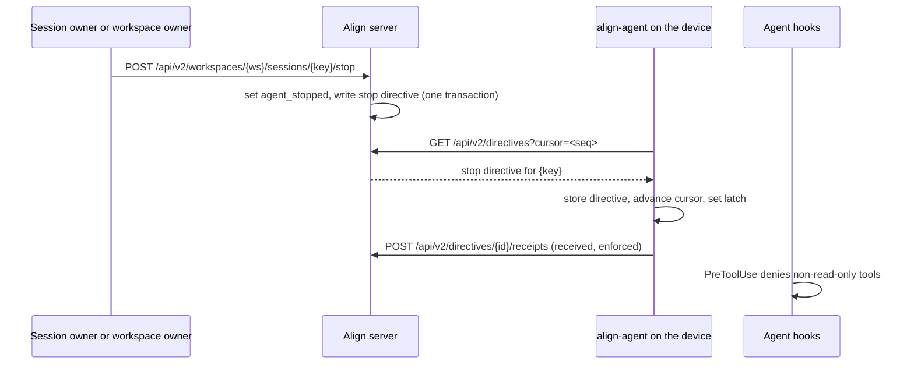

# Directives

A directive is a structured record that Align writes for one or more shared agent sessions when a human decision
changes what those sessions work under. The objective is that a recorded decision by an accountable person, and only
that, changes what a running agent sees: a saved goal version (published by its owner or by an approver of a change
request), an approved or revoked alignment, or a stop or resume by the session's owner or a workspace owner. Change
requests in flight, counters, alignment notes and drafts never reach agents.

Directives are always on: there is no feature flag, and they work the same in Mode L and when hosted. Align does not
wake an idle agent. The local `align-agent` package pulls directives by cursor whenever a hook starts a sync,
applies them to its local state and reports receipts. The local agent's hook mechanics (context injection, notices,
the latch file and the `PreToolUse` denial) are specified in the local-agent part; the `align_get_directives` MCP
tool is specified in the MCP part.

Vocabulary:

| Term | Meaning |
| --- | --- |
| Directive | A row in `v2_directives` with an id `dir_<24 base32 chars>`, a workspace, a `kind`, a monotonically increasing `seq`, an optional goal snapshot and an optional binding, plus one target row per session key |
| Kind | One of `goal_version`, `binding_changed`, `binding_suspended`, `stop`, `resume` |
| Session key | The 43-character key of a shared session (`v2_sessions.session_key`), owned by one person on one device |
| Goal snapshot | The goal's core fields as of the saved version that caused the directive: `id`, `version`, `title`, `measures`, `status`, `visibility`, `level`, `owner` `{id, name}`, `team` `{id, name}` or null, `anchors`, `depends_on` |
| Binding | `{ goal_id, effective, cause }`, where `effective` is `next_root_turn` and `cause` is `alignment:<alignment id>` |
| Cursor | The highest `seq` a device has already taken; a fetch returns directives with a larger `seq` |
| Receipt | A per-directive, per-session delivery report from the device: `received`, `applied` or `enforced` |
| Stop latch | The local agent's per-session record that the session was stopped; while set, the agent's hooks block every tool except read-only ones |

The stop path, end to end:

## Requirements

### Requirement: Directives carry only structured decision content

The server SHALL put into a directive only its kind, the goal snapshot of a saved goal version, a binding object and the enumerated fields of the fetch response, and never alignment notes, change-request reasons, approval or rejection notes, counter-proposals, goal drafts or any free-form instruction to the agent.

#### Scenario: A countered change request reaches no agent

- **WHEN** an approver counters a pending change request on a goal that has bound sessions, with a `note`
- **THEN** no directive row is written, and the bound sessions' next fetch returns nothing new

#### Scenario: Approval note stays on the decision record

- **WHEN** an approver approves a change request with `note` "Agreed for Q3" and a bound session then fetches its directives
- **THEN** the `goal_version` directive's `goal` holds the new version's fields and no field of the directive contains the request's `reason` or the approver's `note`

### Requirement: Directives are written in the transaction of the change that caused them

The server SHALL write every directive row and its target rows inside the same database transaction as the goal version, alignment decision or stop/resume that caused it, assign each directive the next `seq` in one sequence shared by all workspaces, and write no directive at all when the change has no target session.

#### Scenario: Refused change leaves no directive

- **WHEN** a goal version save fails with HTTP 409 `stale_version` because the goal changed meanwhile
- **THEN** no new goal version exists and no `goal_version` directive was written

#### Scenario: New goal version with no bound sessions

- **WHEN** a goal version is saved and no session whose sharing is still on is bound to or governed by that goal
- **THEN** no `goal_version` directive row is created

#### Scenario: Sequence numbers only grow

- **WHEN** a stop in one workspace is followed by a goal version in another workspace that reaches a bound session
- **THEN** the second directive's `seq` is greater than the first's

### Requirement: goal_version directives reach bound and governed sessions

The server SHALL, whenever a new version of a goal is saved (by the goal's owner through `POST /api/v2/workspaces/{ws}/goals/{goal}/versions`, or by the approval of a change request), write one `goal_version` directive whose `goal` is the snapshot of the new version and whose `binding` is null, targeting every session in that workspace whose sharing is not stopped and whose open epoch is bound to the goal or whose governing goal (from an approved `work_toward` alignment) is the goal.

#### Scenario: Owner publishes a new version

- **WHEN** the owner of goal G saves version 3 while session S has an open epoch bound to G and session T is governed by G through an approved alignment
- **THEN** one `goal_version` directive targets both S and T, and its `goal.version` is 3

#### Scenario: Sessions that stopped sharing are skipped

- **WHEN** a new version of goal G is saved and the only session bound to G has stopped sharing
- **THEN** no `goal_version` directive is written

#### Scenario: Snapshot uses team, not pod

- **WHEN** a `goal_version` directive is written for a goal owned by the team "Security"
- **THEN** its goal snapshot has `team` `{ "id": <team id>, "name": "Security" }` and no `pod` key

### Requirement: Approved change requests reach agents as goal versions

The server SHALL, when an approver approves a change request, create the goal's next version authored by the approver and write its `goal_version` directive through the same path and in the same transaction as an owner's edit, and write no directive for creating, countering, accepting a counter, rebasing, rejecting, withdrawing or superseding a change request.

#### Scenario: Approval updates a running agent

- **WHEN** an approver approves a pending change request on goal G at version 2 while session S is bound to G
- **THEN** G is at version 3 with `created_by` the approver, and S's device receives a `goal_version` directive with `goal.version` 3 on its next fetch

#### Scenario: Stale approval writes nothing

- **WHEN** an approver approves a change request whose `base_version` is no longer the goal's current version
- **THEN** the response is HTTP 409 `stale_version`, no goal version is created and no directive is written

#### Scenario: Rejection is not a directive

- **WHEN** an approver rejects a change request with a `reason`
- **THEN** no directive is written for any session

### Requirement: binding_changed on an approved work_toward alignment

The server SHALL, when a `work_toward` alignment becomes approved, for each listed session whose sharing is not stopped (stopped sessions are skipped entirely), set its governing goal to the target goal and write one `binding_changed` directive targeting it, with `goal` the target goal's snapshot and `binding` `{ goal_id: <target goal id>, effective: "next_root_turn", cause: "alignment:<alignment id>" }`, and write no `binding_changed` directive for other alignment choices.

#### Scenario: Two sessions follow a goal

- **WHEN** a `work_toward` alignment listing sessions A and B toward goal G is approved
- **THEN** two `binding_changed` directives are written, one targeting A and one targeting B, each with `binding.goal_id` G and `binding.cause` `alignment:<id>`

#### Scenario: Session already governed elsewhere

- **WHEN** approval would make a listed session follow G while it already follows another goal through a different approved alignment
- **THEN** the approval is refused with HTTP 409 `already_governed` and no directive is written

### Requirement: binding_suspended on a revoked work_toward alignment

The server SHALL, when an approved `work_toward` alignment is revoked, clear the governing goal of the sessions it governed, end the open epoch of every session whose open binding exists only through that alignment, move those sessions from `shared` to `suspended`, and write one `binding_suspended` directive targeting exactly those sessions with `goal` null and `binding` `{ goal_id: <target goal id>, effective: "next_root_turn", cause: "alignment:<alignment id>" }`.

#### Scenario: Revocation suspends the binding

- **WHEN** the requester revokes an approved `work_toward` alignment under which session S opened its current epoch
- **THEN** S's open epoch ends, S's state is `suspended`, and one `binding_suspended` directive targets S

#### Scenario: Revocation with no epoch from the alignment

- **WHEN** a revoked `work_toward` alignment governed sessions that never opened an epoch under it
- **THEN** their governing goal is cleared and no `binding_suspended` directive is written

### Requirement: Stop and resume authority

The server SHALL accept `POST /api/v2/workspaces/{ws}/sessions/{key}/stop` and `POST /api/v2/workspaces/{ws}/sessions/{key}/resume` only from a same-site, signed-in browser session of the session's owner or of a workspace owner, and on success set the session's `agent_stopped` flag (true for stop, false for resume) and write one `stop` or `resume` directive targeting only that session in one transaction, responding HTTP 200 `{ "directive_id": "dir_…", "agent_stopped": <bool> }`.

#### Scenario: Workspace owner stops a member's agent

- **WHEN** a workspace owner calls `POST /api/v2/workspaces/{ws}/sessions/{key}/stop` for a member's shared session
- **THEN** the response is `{ "directive_id": "dir_…", "agent_stopped": true }` and the session's device receives a `stop` directive on its next fetch

#### Scenario: Session owner resumes their own agent

- **WHEN** a member calls `.../sessions/{key}/resume` for their own stopped session
- **THEN** the response is `{ "directive_id": "dir_…", "agent_stopped": false }` and a `resume` directive targets that session

#### Scenario: Someone else's session is not found

- **WHEN** a member who is not a workspace owner calls `.../sessions/{key}/stop` for another member's session, or anyone calls it for an unknown key, a key that is not 43 URL-safe characters, or a workspace they are not a member of
- **THEN** the response is HTTP 404 `not_found` and no directive is written

#### Scenario: Sharing already stopped

- **WHEN** the owner calls `.../stop` or `.../resume` for a session whose sharing was stopped
- **THEN** the response is HTTP 409 `sharing_stopped` with message "Sharing was stopped for this session"

#### Scenario: Wrong credential or origin

- **WHEN** the request carries an `Authorization` header, or no signed-in session cookie, or an `Origin` of another site
- **THEN** the response is HTTP 403 `bearer_not_allowed`, HTTP 401 `unauthorized` or HTTP 403 `cross_site` respectively, and nothing changes

#### Scenario: Repeated stop

- **WHEN** a session's agent is already stopped and an authorized person calls `.../stop` again
- **THEN** a new `stop` directive with a higher `seq` is written and the response again has `agent_stopped` true

### Requirement: Stop status on the sessions page

The server SHALL include, for every session returned by `GET /api/v2/workspaces/{ws}/sessions` (the caller's own sessions, and for workspace owners every session whose sharing is not stopped), `agent_stopped` and `stop_status`, which is null or `{ directive_id, kind, created_at, receipts: [{ state, at }] }` for the session's latest `stop` or `resume` directive, with the Sessions tab showing **Stop agent** or **Resume agent** and a status label derived from it: "Stop requested", "Stop sent, not yet received", "Stop received by the machine", "Local stop active", "Resume sent, not yet received" or "Resumed".

#### Scenario: Stop confirmed by the device

- **WHEN** a session's latest directive is a `stop` and the device has posted `received` and `enforced` receipts for it
- **THEN** `stop_status.kind` is `stop`, its `receipts` list both states, and the Sessions tab shows "Local stop active" next to **Resume agent**

#### Scenario: Owner's view of everyone's sessions

- **WHEN** a workspace owner opens the Sessions tab
- **THEN** the card "Everyone's shared sessions (workspace owners)" lists every session in the workspace whose sharing is not stopped, with its owner's name, repository alias, harness, stop status and **Stop agent** or **Resume agent**, without titles or usage

### Requirement: Device fetch of v2 directives by cursor

The server SHALL serve `GET /api/v2/directives?cursor=<seq>` to a v2 device access token (`alnd_…`) only, returning HTTP 200 `{ directives, next_cursor }` with up to 100 directives whose `seq` is greater than the cursor and that target sessions owned by the token's person on the token's device in workspaces the device is still granted, oldest first, each as `{ id, seq, ws, kind, session_keys, goal, binding, created_at }`, where `session_keys` lists only that device's targeted keys, `goal` is the snapshot plus `bindable` or null when the person can no longer read the goal, and `next_cursor` is the last returned `seq` as a string (or the given cursor when none is returned).

#### Scenario: First fetch

- **WHEN** a device calls `GET /api/v2/directives` with no `cursor`
- **THEN** the cursor is treated as 0 and the oldest 100 directives for its sessions are returned

#### Scenario: Invalid cursor

- **WHEN** a device calls `GET /api/v2/directives?cursor=abc`
- **THEN** the response is HTTP 400 with `{ "error": "bad_request", "message": "cursor must be a sequence number" }`

#### Scenario: Goal no longer readable

- **WHEN** a `goal_version` directive was written for a goal whose visibility later excludes the session's owner
- **THEN** the fetched directive has `goal` null

#### Scenario: Browser or bad token

- **WHEN** the request carries an `Origin` header, a cookie, or a missing, unknown, expired or revoked token
- **THEN** the response is HTTP 403 `browser_not_allowed`, HTTP 403 `cookies_not_allowed` or HTTP 401 `invalid_token` respectively

#### Scenario: Another device's sessions are invisible

- **WHEN** the same person shares session A from laptop 1 and session B from laptop 2, and a goal version reaches both
- **THEN** laptop 1's fetch returns the directive with `session_keys` `[A]` only, and laptop 2's with `[B]` only

### Requirement: Leaving a workspace ends directive delivery from it

The server SHALL stop serving a workspace's directives and accepting receipts for them on a device as soon as that device's grant for the workspace is revoked, including when its person leaves or is removed from the workspace, while the person's sessions and their directive history stay in the workspace.

#### Scenario: Removed member's device

- **WHEN** a workspace owner removes a member and a goal version then reaches one of that member's still-recorded sessions
- **THEN** the member's device fetch returns no directive from that workspace, and a receipt it posts for an earlier directive of that workspace is answered HTTP 404 `not_found`

### Requirement: Directive receipts are idempotent

The server SHALL accept `POST /api/v2/directives/{id}/receipts` from a device access token with a JSON body of at most 2048 bytes `{ session_key, state, at }`, where `session_key` is a string of at most 43 characters, `state` is one of `received`, `applied` or `enforced` and `at` is an ISO 8601 time, record at most one receipt per directive, session and state, and respond HTTP 200 `{ "fresh": <whether a receipt was added> }`.

#### Scenario: Repeated receipt

- **WHEN** the agent posts the same `received` receipt for the same directive and session twice
- **THEN** the first response is `{ "fresh": true }` and the second `{ "fresh": false }`

#### Scenario: Receipt for a directive not sent to this device

- **WHEN** a device posts a receipt naming a directive that does not target one of its person's sessions on that device, or an id that is not a well-formed id
- **THEN** the response is HTTP 404 `not_found` and nothing is recorded

#### Scenario: Malformed or oversized receipt

- **WHEN** `state` is `delivered`, or `at` is not an ISO 8601 time, or the body exceeds 2048 bytes
- **THEN** the response is HTTP 400 `bad_request` for the first two and HTTP 413 `too_large` for the last

### Requirement: Deleting shared history deletes its directive deliveries

The server SHALL, when a session owner deletes a session's shared history, delete that session's directive targets and receipts in the same transaction and delete every directive in the workspace left with no target.

#### Scenario: Stop directive removed with the session

- **WHEN** the owner deletes the history of a session whose only directive was a `stop`
- **THEN** the `stop` directive, its target and its receipts no longer exist, and the Sessions tab no longer lists the session

### Requirement: Local agent applies each v2 directive once and in sequence order

The local agent SHALL, during a sync, page `GET /api/v2/directives` from its stored cursor (at most 20 pages, stopping on a non-200 or empty page), skip a malformed directive, one whose `id` it already stored or one whose `seq` is not above its cursor (counting `directive_malformed`, `directive_replay` or `directive_out_of_order`), store each new directive and advance the cursor in one local transaction, apply it only to session keys this device shares in the directive's workspace, and queue a `received` receipt for each such session.

#### Scenario: Replayed directive

- **WHEN** a fetch returns a directive id the agent already stored
- **THEN** the agent records a `directive_replay` gap and does not re-apply it or send new receipts

#### Scenario: Directive for a session this device does not share

- **WHEN** a directive lists a session key that is not among this device's shares in that workspace
- **THEN** the agent stores the directive and advances its cursor but applies nothing and sends no receipt for that key

### Requirement: Stop latch follows the latest stop or resume by sequence

The local agent SHALL treat a session's stop latch as set by a `stop` directive and cleared by a `resume` directive only when that directive's `seq` is greater than the `seq` of the directive that last changed the latch, report `enforced` when a `stop` sets it and `applied` when a `resume` clears it (an older stop or resume gets only `received`), and while the latch is set block every tool except read-only ones without needing the network, as the local-agent part's "Stop latch fails closed" requirement specifies.

#### Scenario: Stop then resume in one fetch

- **WHEN** one fetch returns a `stop` at `seq` 40 and a `resume` at `seq` 41 for the same session
- **THEN** the latch is set and then cleared, the agent queues `received` and `enforced` for the stop and `received` and `applied` for the resume, and tools are allowed afterwards

#### Scenario: Stopped agent tries to edit

- **WHEN** a stopped session's agent calls the `Edit` tool
- **THEN** the hook denies it with the reason beginning "Align: this session was stopped from its Align workspace.", while a `Read` call is allowed

### Requirement: Only v2 directive routes exist

The server SHALL serve directives only through `/api/v2/directives`, `/api/v2/directives/{id}/receipts` and the stop and resume routes under `/api/v2/workspaces/{ws}/sessions/{key}`, in Mode L and hosted alike with no feature flag, and answer HTTP 404 for the retired `/api/directives`, `/api/directives/ack` and `/api/directives/stream` paths.

#### Scenario: No flag needed

- **WHEN** the server starts in Mode L with no `ALIGN_GOAL_SESSIONS` variable set and a paired device calls `GET /api/v2/directives`
- **THEN** the response is HTTP 200 with a `directives` list

#### Scenario: Retired stream

- **WHEN** a client calls `GET /api/directives/stream?session=claude-code:x`
- **THEN** the response is HTTP 404

## Open questions

- Whether directives may instruct agents (Owner decision 2026-10-30 keeps it open): today a directive carries only goal and binding state, and the agent decides what to do with it. A `stop` blocks tools locally but tells the agent nothing beyond the fixed stop reason.
- Waking idle agents is out of scope (Owner decision 2026-10-30 keeps it open): a stop or a new goal version takes effect only when the session's next hook starts a sync, so an idle agent learns nothing until someone uses it again, and the Sessions tab shows "Stop sent, not yet received" until then.
- A removed member's sessions stay recorded and keep their `shared` state, so goal versions and an owner's stop still write directives for them that no device can fetch any more. Whether removal should stop sharing for those sessions (and so write nothing) is not decided.

## Sources

- lib/v2/directives.ts
- lib/v2/sessions.ts
- lib/v2/goals.ts
- lib/v2/changes.ts
- lib/v2/alignments.ts
- lib/v2/workspaces.ts
- lib/v2/lifecycle.ts
- lib/v2/devices.ts
- lib/v2/policy.ts
- lib/v2/http.ts
- lib/v2/errors.ts
- lib/v2/validate.ts
- lib/v2/ids.ts
- lib/v2/db.ts
- app/api/v2/directives/route.ts
- app/api/v2/directives/[id]/receipts/route.ts
- app/api/v2/workspaces/[ws]/sessions/route.ts
- app/api/v2/workspaces/[ws]/sessions/[key]/route.ts
- app/api/v2/workspaces/[ws]/sessions/[key]/stop/route.ts
- app/api/v2/workspaces/[ws]/sessions/[key]/resume/route.ts
- app/api/v2/workspaces/[ws]/sessions/[key]/stop-sharing/route.ts
- app/api/v2/workspaces/[ws]/goals/[goal]/versions/route.ts
- app/api/v2/workspaces/[ws]/alignments/[id]/[action]/route.ts
- app/api/v2/workspaces/[ws]/goals/[goal]/change-requests/[id]/[action]/route.ts
- app/app/w/[ws]/sessions/view.tsx
- packages/align-agent/src/directives.ts
- packages/align-agent/src/hot.ts
- packages/align-agent/src/hooks/handlers.ts
- proxy.ts
