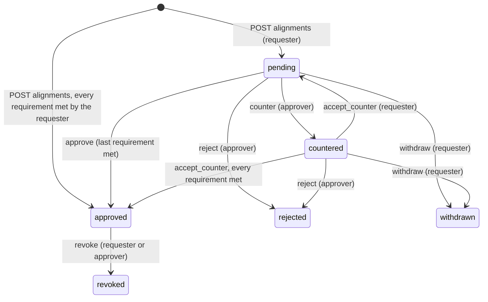
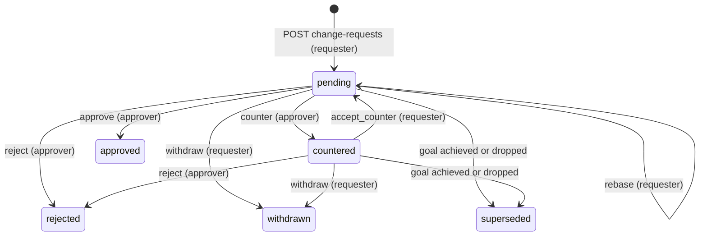

# Goals, alignments and change requests

This part specifies Align's core domain inside a workspace (`ws_…`): goals and their immutable versions, the
goal tree (parents through approved alignments, dependencies through `depends_on`), the approval set that may
consent on a goal's behalf, alignment requests, change requests, and the Northstar sample workspace that any
signed-in person can create to see these flows.

Every route here is under `/api/v2/workspaces/{ws}` and follows the common rules of the `workspaces` part:
a browser session cookie (or, where stated, a device token), same-origin writes, JSON bodies, error bodies
`{error:<code>, message}`, 404 for anything the caller may not see, and 403 with a code for a visible action
the caller's role does not allow (a viewer always gets 403 `read_only` for a change). Workspaces, members,
roles, teams and invites are specified in `workspaces`; directives delivered to running agents in
`directives`; the MCP tools that read goals and decision records in `mcp`; the pages under `/app` in
`interface`. Storage keeps the name `pod` for teams (`pod_id`, visibility value `pod`); everything a person
or agent sees says "team".

## Vocabulary

| Term | Meaning in code |
| --- | --- |
| Goal | A row of `v2_goals` (`g_…`) with its current content; every version, including the first, is also a row of `v2_goal_versions` with a content hash |
| Level | `company` or `team` (default `team`); fixed at creation |
| Goal owner | The one accountable person, `owner_id` |
| Owning team | The optional team of a goal, `team_id` on the wire, `pod_id` in storage; fixed at creation |
| Visibility | `private`, `team` (stored `pod`) or `workspace`; fixed at creation |
| Status | `active`, `achieved` or `dropped`. There is no separate archived status |
| Parent | A goal this goal contributes to: the target of an approved alignment whose source is this goal (`contributes_to`) |
| Dependency | A goal whose output this goal consumes (`depends_on`, at most 5) |
| Approval set | The people any one of whom may approve on a goal's behalf: its owner, its owning team's leads, and for a company goal every workspace owner |
| Alignment | A request (`al_…`) to link a source goal or chosen sessions to a target goal, with revisions, approval requirements and effects |
| Approval requirement | `{for, set}` on an alignment revision: `for` is a goal id or `sessions:<user id>`, `set` the user ids any one of whom satisfies it |
| Change request | A proposed new version (`cr_…`) of a goal the requester does not own, decided by the goal's approval set |
| Decision record | A change request once it is `approved` or `rejected` |
| Sample workspace | "Northstar (sample)", ordinary data created by `POST /api/v2/workspaces/sample` |

## Alignment state model

## Change request state model

### Requirement: Creating a company or team goal

The server SHALL create a goal on `POST /api/v2/workspaces/{ws}/goals` (browser session; workspace owners and members, viewers 403 `read_only`) from `{title, level?, team_id?, visibility?, measures?, anchors?, depends_on?}`, owned by the caller, at version 1 with status `active`, responding 201 with the goal. `level` SHALL default to `team`; only a workspace owner may create a `company` goal (403 `owner_only` otherwise), and a company goal SHALL have no team (400 when `team_id` is sent) and visibility `workspace` (400 when another `visibility` is sent). A team goal's `visibility` SHALL default to `workspace`; a `team` goal SHALL name a team (400 otherwise), an unknown `team_id` SHALL be 404, and naming a team the caller is not in SHALL be 403 `not_in_team`. A workspace already holding 1,000 goals SHALL answer 409 `too_many_goals`. Creating a goal SHALL write audit action `goal.created` with the caller as actor. Level, owning team and visibility never change after creation.

#### Scenario: Owner creates a company goal

- **WHEN** a workspace owner POSTs `{title:"Expand to regulated customers", level:"company"}`
- **THEN** the response is 201 with `level: "company"`, `team: null`, `visibility: "workspace"`, `version: 1`, `status: "active"` and `owner` naming the caller

#### Scenario: Member cannot create a company goal

- **WHEN** a member POSTs `{title:"…", level:"company"}`
- **THEN** the response is 403 `owner_only` and no goal is created

#### Scenario: Company goal with a team

- **WHEN** a workspace owner POSTs `{title:"…", level:"company", team_id:"<team>"}` or `{title:"…", level:"company", visibility:"private"}`
- **THEN** the response is 400 and no goal is created

#### Scenario: Team goal in a team the caller is not in

- **WHEN** a member POSTs `{title:"…", visibility:"team", team_id:"<a team they are not in>"}`
- **THEN** the response is 403 `not_in_team`; the same body without `team_id` is 400

### Requirement: Goal content validation

The server SHALL validate goal content the same way on creation, on a new version and in a change request: `title` 1 to 300 characters after trimming; `measures` a list of at most 10 objects with `text` (1 to 300 characters) and optional `target` (at most 100), each keeping a sent `id` only when the previous version had a measure with that id (otherwise a new `m_…` id); `anchors` an object of `repos`, `branch_patterns` and `issues` lists of at most 20 strings of at most 200 characters each, trimmed and de-duplicated; `depends_on` a list of at most 5 goal ids, none equal to the goal itself; and `status` one of `active`, `achieved`, `dropped`. A violation SHALL be 400 naming the field, and a `depends_on` id that does not exist or that the caller may not read SHALL be 404.

#### Scenario: Too many dependencies

- **WHEN** a goal is created with six ids in `depends_on`
- **THEN** the response is 400 `depends_on: at most 5`

#### Scenario: Dependency on a hidden goal

- **WHEN** `depends_on` names another person's `private` goal
- **THEN** the response is 404 and nothing is written

### Requirement: Who reads a goal

The server SHALL let a goal's owner always read it, and otherwise decide by visibility: a `private` goal is read by its owner only (workspace owners do not read another person's private goals); a `team` goal by the members and leads of its owning team and by workspace owners; a `workspace` goal (every company goal) by every workspace member, viewers included. A goal the caller may not read SHALL be answered 404 `not_found` on every route, and SHALL be left out of, or unnamed in, every list and view that would otherwise mention it.

#### Scenario: Team goal of another team

- **WHEN** a member who is not in team Security requests a `team` goal owned by team Security
- **THEN** the server responds 404 `not_found`

#### Scenario: Company goal read by a viewer

- **WHEN** a viewer requests the goals feed
- **THEN** every company goal of the workspace is in it

### Requirement: Goals feed with ETag

The server SHALL serve the goals the caller may read on `GET /api/v2/workspaces/{ws}/goals` (device token with a grant for the workspace, or browser session) as `{version, goals}`, oldest first, where `version` is the first 16 hex characters of the sha256 of the serialized goals and is also sent as a quoted `ETag` with `cache-control: private, no-cache`, and SHALL answer 304 with no body when `If-None-Match` matches it (or is `*`). Each goal SHALL be `{id, version, title, measures, status, level, visibility, owner:{id,name}, team:{id,name}|null, anchors, depends_on, bindable, contributes_to}`, where `visibility` shows `team` for a stored `pod` and `depends_on` lists only goals the caller may read.

#### Scenario: Conditional feed

- **WHEN** a client sends `If-None-Match` equal to the current feed `ETag`
- **THEN** the server responds 304 with no body

#### Scenario: Team naming on the wire

- **WHEN** a member reads a goal created with `visibility: "team"` for team Product
- **THEN** the goal has `visibility: "team"` and `team: {id, name: "Product"}`, and has no `pod` key

### Requirement: Immutable goal versions

The server SHALL record each change to a goal as a new immutable version on `POST /api/v2/workspaces/{ws}/goals/{goal}/versions` (browser session) from `{version?, title?, measures?, anchors?, depends_on?, status?}`, accepted only from the goal's owner (403 `not_goal_owner` for another reader, 403 `read_only` for a viewer, 404 for a goal the caller may not read). A sent `version` other than the current one, or a concurrent write, SHALL be 409 `stale_version`, and a body whose resulting content (title, measures, anchors, status, sorted `depends_on`) hashes the same as the current version SHALL be 409 `no_change`. On success the server SHALL, in one transaction, raise the version by one, keep the previous versions unchanged, store the new version with its content hash and author, write audit action `goal.versioned`, record the goal as reviewed against its parents' current versions, and write one `goal_version` directive, carrying a snapshot of the goal with its `team` and `level`, for every non-stopped session whose open epoch is bound to the goal or that the goal governs; the response is 201 with the goal.

#### Scenario: New version

- **WHEN** the owner POSTs `{version: 2, title: "Pass the security review by March"}` to a goal at version 2
- **THEN** the response is 201 with `version: 3`, version 2 is still listed unchanged on the goal's page, and every bound session gets a `goal_version` directive

#### Scenario: Stale or empty change

- **WHEN** the owner POSTs `{version: 1, …}` to a goal at version 3, or POSTs the current content again
- **THEN** the response is 409 `stale_version` or 409 `no_change` respectively, and no version or directive is written

#### Scenario: Someone else edits

- **WHEN** a member who can read the goal but does not own it POSTs a new version
- **THEN** the response is 403 `not_goal_owner`; they can propose a change request instead

### Requirement: Dependency cycles are refused

The server SHALL refuse with 409 `cycle` any write that would make a goal depend on itself through `depends_on` (directly or through other goals, whether or not the caller can read them): a new goal version, and the creation, counter, rebase or approval of a change request whose `depends_on` would close a cycle. The refusal message SHALL NOT name goals the caller may not read, and nothing SHALL be written.

#### Scenario: Two goals depending on each other

- **WHEN** goal A depends on goal B and B's owner saves a version of B with `depends_on: ["<A>"]`
- **THEN** the response is 409 `cycle` and B stays at its current version

### Requirement: One goal with its versions and contributions

The server SHALL serve one goal on `GET /api/v2/workspaces/{ws}/goals/{goal}` (browser session) as `{goal, versions, contributions, can_edit}`: `goal` as in the feed, `versions` every version newest first as `{version, title, status, content_hash, created_at}`, `contributions` the readable source goals of approved alignments targeting this goal as `{goal:{id, title}}`, and `can_edit` true only for the goal's owner when not a viewer. A goal the caller may not read SHALL be 404.

#### Scenario: Owner opens their goal

- **WHEN** the owner of a goal at version 3 opens it
- **THEN** the response has three `versions` (3, 2, 1) and `can_edit: true`; a member reading the same goal gets `can_edit: false`

### Requirement: Parents come from approved alignments

The server SHALL derive a goal's parents only from approved alignments whose source is that goal, and SHALL report each readable parent in `contributes_to` as `{id, title, version, reviewed_version, stale}`, where `reviewed_version` is the parent version the child's owner last reviewed the child against (null if never) and `stale` is true while `reviewed_version` is null or below the parent's current version. Approving an alignment with a source goal SHALL record the source as reviewed against the target's version at approval; saving a new version of the child SHALL record it as reviewed against every parent's current version. A parent that is revoked stops being a parent.

#### Scenario: Parent changes

- **WHEN** a company goal gets a new version
- **THEN** each child's `contributes_to` entry for it shows `stale: true` with `reviewed_version` below `version`, until the child's owner reviews it or saves a new version of the child

### Requirement: Stale-parent review

The server SHALL let only a goal's owner confirm the goal still fits a parent's current version on `POST /api/v2/workspaces/{ws}/goals/{goal}/review {parent_id}` (browser session, body at most 4 KB), record the review against the parent's current version, write audit action `goal.parent_reviewed`, and respond with the goal. A goal the caller may not read, or a `parent_id` that is not a current parent, SHALL be 404; another reader SHALL get 403 `not_goal_owner` and a viewer 403 `read_only`.

#### Scenario: Owner confirms

- **WHEN** the owner of a child whose parent moved to version 4 POSTs `{parent_id}`
- **THEN** the response is the goal with that parent's `reviewed_version: 4` and `stale: false`

#### Scenario: Review refused

- **WHEN** a member who does not own the child POSTs `{parent_id}`, or the owner names a goal that is not its parent
- **THEN** the server responds 403 `not_goal_owner` or 404 respectively

### Requirement: Bindable goals

The server SHALL mark a goal `bindable` for the caller only when it is `active`, the caller is not a viewer, and the goal is the caller's own, belongs to a team the caller is in, or is the target of an approved `work_toward` alignment whose current revision lists one of the caller's sessions. Binding a session to a goal that is not bindable for its owner SHALL be refused with 403 `alignment_required` (the epoch route is specified in `workspaces`).

#### Scenario: Teammate's goal

- **WHEN** a member of team Product reads an active goal owned by another member of team Product
- **THEN** the goal has `bindable: true`; a company goal owned by someone else has `bindable: false` until an approved `work_toward` alignment covers one of the caller's sessions

### Requirement: Approval set of a goal

The server SHALL compute a goal's approval set, at the time it is needed, as the goal's owner, every lead of the goal's owning team, and for a company goal every workspace owner, keeping only people who are current workspace members with role `owner` or `member`. Viewers and people who left or were removed SHALL never be in an approval set.

#### Scenario: Team goal

- **WHEN** the goal "Pass the security review" is owned by Sam and team Security has leads Sam and Lee
- **THEN** its approval set is Sam and Lee

#### Scenario: Owner who left

- **WHEN** the owner of a team goal has been removed from the workspace and the team has one lead
- **THEN** the approval set is that lead only; the goal keeps naming its former owner

### Requirement: Requester rule and workspace-owner fallback

Wherever a goal's consent is needed (an alignment requirement or a change request), the server SHALL treat one approval from the goal's approval set as that goal's consent, SHALL count the requester toward the set only when the requester is the goal's owner, and, when the requester is not the goal's owner and the set holds no one other than the requester, SHALL use the workspace owners other than the requester as the set. If even that set is empty, the request SHALL stay open until someone eligible exists or the requester withdraws it.

#### Scenario: Lead asks against their own team's goal

- **WHEN** Lee, a lead of team Security, requests an alignment targeting a goal owned by Sam in team Security
- **THEN** Lee's request does not satisfy that goal's requirement; Sam (or another lead) must approve

#### Scenario: Nobody else in the set

- **WHEN** the requester is the only remaining lead of a goal whose owner left
- **THEN** the requirement's set is the workspace owners other than the requester, and one of them must approve

### Requirement: Requesting an alignment

The server SHALL let a workspace owner or member (viewers 403 `read_only`) request an alignment on `POST /api/v2/workspaces/{ws}/alignments {target_goal_id, source_goal_id?, choice, session_keys?, note?}` (browser session, body at most 16 KB), with `choice` `contribution` (effect `contributes_to`) or `work_toward` (effects `contributes_to`, `governing_goal` and `allocation_transfer`), and respond 201 with the alignment view. It SHALL answer 404 for a target or source goal the caller may not read and for a session key that is unknown or not the caller's own; 409 `goal_not_active` for a target that is not `active`; 400 when the source is the target, `choice` is invalid, `note` exceeds 1000 characters, `session_keys` exceeds 50, a `work_toward` request lists no session, or a `contribution` request has neither a source nor a session; 403 `source_not_yours` when the source goal is not bindable for the caller; 409 `sharing_stopped` for a stopped session; and 409 `already_governed` when a `work_toward` session already follows another goal through an alignment. Creating writes audit action `alignment.requested`.

#### Scenario: Contribution of my team's goal to a company goal

- **WHEN** a member POSTs `{target_goal_id:"<company goal>", source_goal_id:"<their team goal>", choice:"contribution"}`
- **THEN** the response is 201 with `state: "pending"`, `revision: 1` and one `contributes_to` effect

#### Scenario: Invalid request

- **WHEN** a request lists another person's session, a stopped session, an inactive target, no session for `work_toward`, or a session already governed through another alignment
- **THEN** the server responds 404, 409 `sharing_stopped`, 409 `goal_not_active`, 400, or 409 `already_governed` respectively

### Requirement: Alignment approval requirements

The server SHALL compute, for each alignment revision, a list of approval requirements `{for, set}`, one per distinct `for`: the target goal's approval set (`for` the target id); when there is a source goal, the source goal's approval set (`for` the source id); and for a revision with the `allocation_transfer` effect, for each listed session's owner a singleton set (`for` `sessions:<user id>`) and, for each listed session currently bound to a goal, that goal's approval set (`for` that goal id). Each goal set SHALL be the effective set after the requester rule and workspace-owner fallback. Each requirement needs one approval from its set.

#### Scenario: Work toward another team's goal

- **WHEN** Ana, whose session is bound to her own goal G1, requests `work_toward` the goal G2 owned by Sam in team Security
- **THEN** the revision has requirements for G2 (Sam and team Security's leads), `sessions:<Ana>` (Ana) and G1 (Ana, as G1's owner)

### Requirement: Approval requirement storage

The server SHALL store a revision's requirements in `approvers_json` as `[{for, set:[user ids]}]` and SHALL read an older row holding a plain array of user ids as one requirement per user id with that user as a singleton set and `for: null`. An approval by a user SHALL satisfy every requirement of that revision whose set contains them, and each requirement SHALL record the first person who satisfied it as `approved_by`.

#### Scenario: Legacy row

- **WHEN** an alignment created before this change has `approvers_json` `["u1","u2"]`
- **THEN** it reads as two requirements `{for:null, set:["u1"]}` and `{for:null, set:["u2"]}`, and approves once u1 and u2 have both approved

#### Scenario: One person satisfies two goals

- **WHEN** Lee leads both the target's and the source's owning teams and approves
- **THEN** both requirements record `approved_by` Lee

### Requirement: Alignment approval and its effects

The server SHALL approve an alignment, in the transaction of the action that completes it, when every requirement of its current revision is satisfied, and SHALL make creation instant only when the requester alone satisfies every requirement under the requester rule; the revision's author SHALL count as approving it for every requirement whose set contains them. On approval the server SHALL set `state: "approved"`, for `work_toward` set the target as the governing goal of each listed session whose sharing has not stopped and write one `binding_changed` directive per such session (stopped sessions are skipped; a listed session meanwhile governed through another alignment makes the action 409 `already_governed`), record the source goal (if any) as reviewed against the target's current version, and write audit action `alignment.approved` naming the person whose action completed it.

#### Scenario: Never instant against others

- **WHEN** a member requests a `contribution` of their own goal to a company goal owned by a workspace owner
- **THEN** the response is 201 with `state: "pending"`; it becomes `approved` only when someone in the company goal's approval set approves

#### Scenario: Instant when the requester owns both goals

- **WHEN** a workspace owner requests a `contribution` of their own team goal to their own company goal
- **THEN** the response is 201 with `state: "approved"` and the team goal's `contributes_to` lists the company goal with `stale: false`

#### Scenario: Approving work toward a goal

- **WHEN** the last required approver approves a `work_toward` request at its current `revision`
- **THEN** the alignment becomes `approved`, and each listed session whose sharing has not stopped gets the target as its governing goal and one `binding_changed` directive

### Requirement: Alignment actions

The server SHALL accept `POST /api/v2/workspaces/{ws}/alignments/{id}/{action}` (browser session, body at most 16 KB) for `approve`, `counter`, `accept_counter`, `reject`, `withdraw` and `revoke`, from people involved in the alignment (the requester and everyone in any requirement set of any revision; others 404, viewers 403 `read_only`, an unknown action 404). An approver is someone in a requirement set of the current revision. `approve {revision}` SHALL need the current `revision` (409 `stale_revision`), state `pending` (409 `wrong_state`) and an approver (403 `not_an_approver`). `counter {revision?, choice?, keep?|session_keys?, note?}` SHALL come from an approver who is not the requester (403 `not_an_approver`) on a `pending` request, may only keep or drop sessions of the current revision (400 otherwise), SHALL write a new revision with recomputed requirements, void every earlier approval and set `countered`. `accept_counter` SHALL come only from the requester (403 `not_requester`) on a `countered` request and return it to `pending`. `reject` SHALL come from an approver who is not the requester on a `pending` or `countered` request; `withdraw` only from the requester on a `pending` or `countered` request. A request that changed since the caller read it SHALL be 409 `stale_revision`. Each action SHALL write an audit row (`alignment.countered`, `.rejected`, `.withdrawn`, `.revoked`, `.approved`) naming its actor and respond with the alignment view.

#### Scenario: Stale or wrong approval

- **WHEN** an approver approves with an old `revision`, approves a request that is `countered`, or a person whose approval is not needed approves
- **THEN** the server responds 409 `stale_revision`, 409 `wrong_state` or 403 `not_an_approver` respectively

#### Scenario: Counter and accept

- **WHEN** the target's owner counters a `work_toward` request keeping one of two sessions, and the requester then calls `accept_counter`
- **THEN** the alignment is at revision 2 with one session, back in `pending`, and approves once every requirement of revision 2 is satisfied (the counter's author already counts)

### Requirement: Alignment revocation

The server SHALL let the requester or an approver revoke an `approved` alignment (409 `wrong_state` otherwise), set it `revoked`, and, for `work_toward`, remove the governing goal from its sessions and, for each session whose open epoch was bound only through this alignment, end that epoch now, set the session `suspended` and write a `binding_suspended` directive; past usage never moves. A revoked contribution SHALL stop making its source a child of its target.

#### Scenario: Revoking work toward

- **WHEN** the requester revokes an approved `work_toward` alignment
- **THEN** it becomes `revoked`, its sessions lose the governing goal, and sessions whose open binding existed only through it become `suspended` and get a `binding_suspended` directive

### Requirement: Contribution cycles are refused

The server SHALL refuse with 409 `cycle` an alignment with a source goal whose approval would make the contribution tree cyclic, that is, when the source is already reachable from the target by following approved parents: at creation (nothing is written) and at the `approve` or `accept_counter` that would complete it (the alignment stays as it was). The message SHALL NOT name goals the caller may not read.

#### Scenario: Child cannot become its parent's parent

- **WHEN** goal A contributes to goal B through an approved alignment and someone requests that B contribute to A
- **THEN** the response is 409 `cycle` and no alignment is created

### Requirement: Alignment read views

The server SHALL list the alignments the caller is involved in on `GET /api/v2/workspaces/{ws}/alignments` (browser session) as `{waiting_on_me, mine, others}`, newest change first, and serve one on `GET .../alignments/{id}` (404 when the caller is not involved). Each view SHALL hold `id`, `state`, `revision`, `choice`, `requester`, `target_goal`, `source_goal` (a goal the caller may not read shows `id` and `title` null), `sessions` (by `ref`; another person's session has no `session_key`), `effects` in plain words, `requirements` (each `{for, approvers:[{id,name}], approved_by}`, with `for` null for a goal the caller may not read), `approvers` (everyone in any current set, each with `approved`), `note`, `history` of revisions, `waiting_on_me`, `can` flags for exactly the actions the server would allow (all false for a viewer), `created_at` and `updated_at`.

#### Scenario: Alignment list

- **WHEN** a member calls `GET /api/v2/workspaces/{ws}/alignments`
- **THEN** requests where they can approve or accept a counter are under `waiting_on_me`, their other requests under `mine`, and other requests they are part of under `others`

### Requirement: Proposing a change request

The server SHALL let a workspace owner or member who can read a goal but does not own it propose a change on `POST /api/v2/workspaces/{ws}/goals/{goal}/change-requests {base_version, changes, reason}` (browser session, body at most 32 KB) and respond 201 with the change request (`id` `cr_…`, `state: "pending"`, `revision: 1`). It SHALL answer 404 for a goal the caller may not read, 403 `read_only` for a viewer, 403 `own_goal` for the goal's owner (who publishes a version instead), 409 `goal_not_active` for a goal that is `achieved` or `dropped`, 409 `stale_version` when `base_version` is not the goal's current version, and 400 when `reason` is missing or not 1 to 2000 characters after trimming.

#### Scenario: Member proposes

- **WHEN** a member of team Product POSTs `{base_version: 1, changes:{measures:[…]}, reason:"Onboarding needs a pen-test window in May"}` to the Security goal
- **THEN** the response is 201 with `state: "pending"`, `base_version: 1`, `requester` naming the caller, and audit action `change_request.created`

#### Scenario: Owner proposes to their own goal

- **WHEN** the goal's owner POSTs a change request to it
- **THEN** the response is 403 `own_goal`

### Requirement: Change request contents

The server SHALL accept in `changes` only the keys `title`, `measures`, `depends_on` and `status` (400 for any other key, an empty object or a non-object), validate each like a new goal version against the base version, answer 409 `no_change` when applying them to the base version changes nothing, and 409 `cycle` when the resulting `depends_on` would close a dependency cycle. The same rules SHALL apply to `changes` sent with `counter` and `rebase`.

#### Scenario: Anchors are not proposable

- **WHEN** a change request sends `changes: {anchors:{repos:["x"]}}`
- **THEN** the response is 400

### Requirement: One open change request per goal and requester

The server SHALL refuse a second change request from the same person on the same goal while their earlier one is `pending` or `countered`, with 409 `already_open`.

#### Scenario: Second request

- **WHEN** a member with a pending request on a goal POSTs another one to that goal
- **THEN** the response is 409 `already_open`; once the first is withdrawn or decided, a new one is accepted

### Requirement: Approving a change request

The server SHALL accept `POST .../change-requests/{id}/approve {revision, note?}` (`note` at most 2000 characters) only from a member of the goal's approval set under the requester rule (403 `not_an_approver`), only for a `pending` request (409 `wrong_state`) at its current `revision` (409 `stale_revision`), and only while the goal is still at `base_version` (409 `stale_version`; the requester must `rebase`). On success it SHALL, in one transaction, create the goal's next version with the requested changes applied, authored by the approver and written through the same path as an owner's new version (content hash, audit `goal.versioned`, parent review and `goal_version` directives to bound sessions), set the request `approved` with `approved_by`, `note`, `version` (the new goal version) and `decided_at`, write audit action `change_request.approved`, and respond with the request.

#### Scenario: Team lead approves

- **WHEN** a lead of the goal's owning team approves a pending request at its current revision on a goal still at its base version
- **THEN** the goal moves to the next version with the requested changes, the request is `approved` with `approved_by` the lead and `version` the new goal version, and every session bound to the goal gets a `goal_version` directive

#### Scenario: Goal moved meanwhile

- **WHEN** the owner published a new version after the request was made and an approver approves it
- **THEN** the response is 409 `stale_version` and the request stays `pending`

### Requirement: Rejecting and countering a change request

The server SHALL accept `reject {reason}` (reason 1 to 2000 characters, 400 otherwise) from an approver on a `pending` or `countered` request, setting `rejected` with `rejected_by`, `reason` and `decided_at`; and `counter {changes, note, revision?}` (note 1 to 2000 characters) from an approver on a `pending` request, replacing the proposed changes, raising `revision` and setting `countered`. Only the requester SHALL `accept_counter` (403 `not_requester`) a `countered` request, which returns it to `pending` with the countered changes. A caller outside the approval set SHALL get 403 `not_an_approver`, a request in another state 409 `wrong_state`, and a sent `revision` other than the current one 409 `stale_revision`.

#### Scenario: Reject needs a reason

- **WHEN** an approver POSTs `reject {}`
- **THEN** the response is 400 and the request is unchanged

#### Scenario: Counter then accept

- **WHEN** an approver counters with changed measures and the requester calls `accept_counter`
- **THEN** the request is `pending` at revision 2 with the approver's changes, and an approver can then approve revision 2

### Requirement: Withdrawing and rebasing a change request

The server SHALL let only the requester (403 `not_requester`) `withdraw` a `pending` or `countered` request, setting `withdrawn`, and `rebase {base_version, changes?}` a `pending` request (409 `wrong_state` otherwise), where `base_version` must equal the goal's current version (409 `stale_version`); rebase SHALL move the request to that version, replace the changes when sent, re-validate them against it (409 `no_change` when they no longer change anything), and raise `revision`.

#### Scenario: Rebase after the goal moved

- **WHEN** the goal moved from version 2 to 3 and the requester POSTs `rebase {base_version: 3}`
- **THEN** the request has `base_version: 3` and a higher `revision`, and an approver can approve it

### Requirement: Change requests are superseded when the goal is achieved or dropped

The server SHALL, in the transaction that gives a goal status `achieved` or `dropped` (an owner's version or an approved change request), set every other `pending` or `countered` change request on that goal to `superseded` and write audit action `change_request.superseded` for each, with the person whose action changed the goal's status as actor. A new version that leaves the goal `active` SHALL NOT change other open requests: they stay `pending` or `countered`, and approving one answers 409 `stale_version` until its requester rebases it.

#### Scenario: Owner drops the goal

- **WHEN** the owner saves a version with `status: "dropped"` while two requests on the goal are pending
- **THEN** both requests become `superseded` and accept no further action (409 `wrong_state`)

#### Scenario: Another request is approved

- **WHEN** two requests on an active goal are pending and an approver approves one without changing the status
- **THEN** the other stays `pending`, and approving it answers 409 `stale_version` until its requester rebases it

### Requirement: Change request audit

The server SHALL write an audit row naming its actor for every change request action: `change_request.created`, `.approved`, `.rejected`, `.countered`, `.counter_accepted`, `.withdrawn`, `.rebased` and `.superseded`, with the request id as object.

#### Scenario: Audited decision

- **WHEN** a lead rejects a request
- **THEN** the workspace audit has a `change_request.rejected` row whose actor is the lead and whose object is the request id

### Requirement: Reading change requests and decision records

The server SHALL list change requests on `GET /api/v2/workspaces/{ws}/goals/{goal}/change-requests?state=` as `{change_requests}` and across the workspace on `GET /api/v2/workspaces/{ws}/change-requests?state=` as `{waiting_on_me, mine, others}`, including only requests on goals the caller may read (viewers included) and answering 400 for a `state` that is not one of the six states. `GET .../goals/{goal}/change-requests/{id}` SHALL return one request: `id`, `goal:{id, title}`, `state`, `revision`, `base_version`, `requester`, `changes`, `reason`, `revisions` (each `{revision, changes, note, author, created_at}`), a `diff` `{before, after}` of the changed fields (before from the base version, after with the changes applied; after a decision, from the resulting version), `approvers` (the current approval set), `approved_by`, `rejected_by`, decision `note` or `reason`, `version`, `can` flags (all false for a viewer), `created_at`, `updated_at` and `decided_at`. A decided request is its decision record. A request on a goal the caller may not read SHALL be 404, and `depends_on` in a diff SHALL list only goals the caller may read.

#### Scenario: Viewer reads but cannot act

- **WHEN** a viewer opens a pending request on a workspace goal
- **THEN** the response is 200 with every `can` flag false, and a viewer's `approve` is 403 `read_only`

#### Scenario: Waiting on me

- **WHEN** a team lead calls `GET /api/v2/workspaces/{ws}/change-requests`
- **THEN** pending requests on their team's goals are under `waiting_on_me`, their own requests under `mine`, and the rest they can read under `others`

### Requirement: Change request controls in the app

The goal page SHALL offer **Propose a change** to a reader who does not own the goal and is not a viewer, and a "Change requests" list whose approve, reject and counter controls appear only for people in the goal's approval set; the workspace SHALL have a "Requests" tab with the groups waiting on me, mine and others, each control appearing only when the server's `can` flag allows it.

#### Scenario: Non-owner proposes from the goal page

- **WHEN** a member opens a goal they do not own
- **THEN** the page shows **Propose a change**, which posts to `.../goals/<goal>/change-requests` with the current version as `base_version`

### Requirement: Creating the Northstar sample workspace

The server SHALL let any signed-in person (browser session, in Mode L and hosted) call `POST /api/v2/workspaces/sample` and SHALL create, in one transaction, a new workspace named "Northstar (sample)" owned by the caller, responding 201 `{id:"ws_…", name:"Northstar (sample)", role:"owner"}`. It SHALL count toward the same limits as any workspace creation (429 `rate_limited`, 409 `too_many_workspaces`), and the result SHALL be ordinary data that can be renamed or deleted like any workspace.

#### Scenario: Creating the sample twice

- **WHEN** a person calls `POST /api/v2/workspaces/sample` twice
- **THEN** two separate workspaces named "Northstar (sample)" exist, each owned by them

### Requirement: Northstar sample contents

The sample workspace SHALL contain teams Product and Security with the caller as lead of both; a company goal "Expand to regulated customers"; two team goals with visibility `workspace`, "Ship self-serve onboarding" (team Product) and "Pass the security review" (team Security), each contributing to the company goal through an approved `contribution` alignment requested and approved by the caller; "Ship self-serve onboarding" `depends_on` "Pass the security review"; and one pending change request on "Pass the security review" from the caller whose reason explains why the sample shows it. Every goal is owned by the caller and every audit row names the caller. Because the caller owns the Security goal, the sample request is seeded directly rather than through the create route, and the caller can approve, counter, reject, withdraw or rebase it.

#### Scenario: Sample goal tree

- **WHEN** the caller reads the sample's goals feed
- **THEN** both team goals list the company goal in `contributes_to` with `stale: false`, and "Ship self-serve onboarding" lists "Pass the security review" in `depends_on`

#### Scenario: Acting on the sample request

- **WHEN** the caller approves the pending sample change request at its current revision
- **THEN** "Pass the security review" moves to version 2 and the request becomes `approved` with `approved_by` the caller

### Requirement: Sample offer for a person with no workspaces

The `/app` page SHALL offer **Create the Northstar sample** when the signed-in person has no workspaces, calling `POST /api/v2/workspaces/sample` and opening the new workspace.

#### Scenario: First visit

- **WHEN** a person with no workspaces opens `/app`
- **THEN** the page shows **Create the Northstar sample** alongside creating their own workspace

## Open questions

- Evidence (sandbox test results) attached to change requests is out of scope and remains an open product decision.
- Whether directives may instruct agents, beyond delivering goal versions and bindings, remains open.
- When the requester is the only person who could approve a goal's requirement and no other workspace owner exists, the request stays open indefinitely; should it instead be refused up front?
- The sample's pending change request comes from the caller, who also owns the Security goal, although an owner may not propose a change to their own goal through the API; the sample seeds it directly. Should the sample instead show a request from a second (placeholder) person?
- Whether the workspace "Requests" tab also shows alignments, or alignments keep their own tab, is not decided; this part specifies change requests only.

## Sources

- `lib/v2/goals.ts`
- `lib/v2/alignments.ts`
- `lib/v2/changes.ts` (new)
- `lib/v2/policy.ts`
- `lib/v2/validate.ts`
- `lib/v2/directives.ts` (`goalTargets`, `goalVersionDirective` only)
- `lib/v2/sessions.ts` (`sessionRow`, `openEpoch` only)
- `lib/v2/workspaces.ts` (`need`, `memberName`, `createWorkspace` only)
- `lib/v2/db.ts`
- `lib/v2/errors.ts`
- `lib/v2/http.ts`
- `docs/v2/WIRE.md`
- `app/api/v2/workspaces/sample/route.ts` (new)
- `app/api/v2/workspaces/[ws]/goals/route.ts`
- `app/api/v2/workspaces/[ws]/goals/[goal]/route.ts`
- `app/api/v2/workspaces/[ws]/goals/[goal]/versions/route.ts`
- `app/api/v2/workspaces/[ws]/goals/[goal]/review/route.ts`
- `app/api/v2/workspaces/[ws]/goals/[goal]/change-requests/route.ts` (new)
- `app/api/v2/workspaces/[ws]/goals/[goal]/change-requests/[id]/route.ts` (new)
- `app/api/v2/workspaces/[ws]/goals/[goal]/change-requests/[id]/[action]/route.ts` (new)
- `app/api/v2/workspaces/[ws]/change-requests/route.ts` (new)
- `app/api/v2/workspaces/[ws]/alignments/route.ts`
- `app/api/v2/workspaces/[ws]/alignments/[id]/route.ts`
- `app/api/v2/workspaces/[ws]/alignments/[id]/[action]/route.ts`
