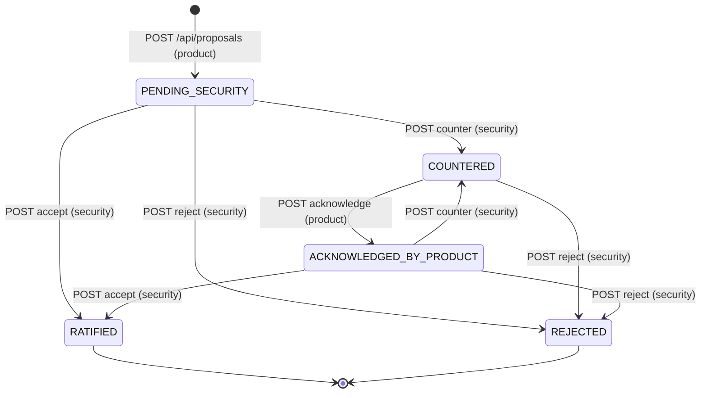

# Goals and proposals

This part specifies Align's core domain: how goals are stored and versioned, how a
leadership push exposes a cross-team dependency, and how the team that needs a change
(the asking team, slot `product`) gets the team that owns the goal (the owning team,
slot `security`) to approve a new goal version, with a plan and sandbox evidence pinned
to the request. It also covers the decision record, the plan agents are authorized to
run, evidence ingestion, the review timer, reset, and custom scenarios.

All state lives in one JSON document (`AppState`): the default store `data/state.json`
(seeded from `data/fixture.json`, the "Northstar" demo, or replaced by a leadership
`/setup` custom scenario), or one state file per custom workspace. Workspaces, sign-in,
directives, MCP and captured agent sessions are specified in their own parts
(`workspaces`, `directives`, `mcp`) and are only referenced here.

## Vocabulary

| Term | Meaning in code |
| --- | --- |
| Owner slot | `ceo`, `product` or `security`: who owns a goal (`Goal.owner_id`) |
| Actor | Signed-in role: `product`, `security` or `leadership`. `leadership` speaks for the `ceo` slot |
| Goal version | An immutable `Goal` row. The current goal of an owner is the one no other goal names in `supersedes` |
| Relation | `GoalRelation` between goals; the cross-team dependency is `r-product-security` (`depends_on`) |
| Plan | `Plan` with `plan_id`, `plan_version`, executable `params` and a sha256 `hash` |
| Simulation run | `SimulationRun` ingested from Sparta evidence, with `verdict` `PASS` or `FAIL` |
| Proposal | A request from `product` to change `security`'s current goal, pinned to a `plan_ref` |
| Counter version | An edit by the owner (`counter_versions[]`), versioned `vX.N` |
| Acceptance | The decision record written when the owner approves (`acceptances[]`) |
| Test status | `TESTED`, `STALE` or `UNTESTED` on a proposal and its acceptance |
| Scenario | `northstar` (default, `scenario` key absent) or `custom` (`scenario: "custom"`) |

## Proposal state model

`ProposalState` also declares `DRAFT`, but no code path creates it.

In a custom scenario, a `RATIFIED` proposal additionally carries leadership's launch
decision (`approved` or `not_yet`) on its acceptance record.

### Requirement: Goal versions are append-only

The server SHALL never edit an approved goal version's content (objective, measures, version) to change it: approving a change or pushing a company goal appends a new `Goal` whose `supersedes` names the previous version's `id`, and the current goal of an owner is the goal of that owner that no other goal supersedes. The only in-place goal edit is a company-goal push rewriting the `parent_ids` of current team goals to the new company goal; reset and custom scenario setup replace the whole goal list.

#### Scenario: Prior Security goal survives approval

- **WHEN** Security approves a proposal against `g-security-v1` via `POST /api/proposals/{id}/accept`
- **THEN** `GET /api/state` returns both `g-security-v1` (version `v1`) and a new Security goal whose `supersedes` is `g-security-v1`, and only the new one is treated as current

#### Scenario: Company goal push keeps v1

- **WHEN** leadership pushes the drafted company goal via `POST /api/org/push`
- **THEN** `goals` contains `g-ceo-v1` and `g-ceo-v2` with `supersedes: "g-ceo-v1"`

### Requirement: Leadership pushes the company goal

The server SHALL let only the `leadership` actor approve and send the drafted company goal (`org_draft`) through `POST /api/org/push`, merging non-empty body fields (`objective`, `success_criteria`, `measures`) over the draft, creating goal `g-ceo-v{N+1}` (version `v{N+1}`, `approved_by: "ceo"`, `changed: true`, `supersedes` the previous company goal), re-parenting current team goals and relations from the previous company goal to the new one, recording a `pushes[]` entry (`pushed_to: ["product","security"]`), clearing `org_draft`, writing audit action `ratify_and_push_company_goal`, and responding with `goal_id`, `version`, `pushed_at`, `registry_version` and `event_id` (`push:<push id>`). After the write it SHALL emit an in-process authority event with that `event_id`, `kind: "push"` and `at` equal to `pushed_at` (delivery is specified in the `directives` part).

#### Scenario: Non-leadership push is refused

- **WHEN** a Product session calls `POST /api/org/push` with `{}`
- **THEN** the response is HTTP 403 with an `error` message and nothing is written

#### Scenario: Push without a draft or with an empty draft

- **WHEN** leadership calls `POST /api/org/push` after the draft was already sent (`org_draft` is null), or the merged draft has no objective or no measures
- **THEN** the response is HTTP 409 (no draft, or `g-ceo-v{N+1}` already exists) or HTTP 400 (missing objective or measures) respectively

### Requirement: Org push is a default-store, same-origin route

The server SHALL accept `POST /api/org/push` only from a default-store (Northstar) session cookie and only from the same origin: no session gives HTTP 401, a custom-workspace session gives HTTP 403, an `Origin` header whose host differs from `Host` gives HTTP 403, and a request body whose content type is not `application/json` gives HTTP 415.

#### Scenario: Custom workspace session cannot push

- **WHEN** a session signed in to a custom workspace calls `POST /api/org/push`
- **THEN** the response is HTTP 403 and the default store is unchanged

### Requirement: Push exposes the Product to Security dependency

The server SHALL, on a successful company-goal push when current Product and Security goals exist and no relation `r-product-security` exists yet, add relation `r-product-security` of `type: "depends_on"` from the current Product goal to the current Security goal with `status: "UNKNOWN"`, and SHALL recompute `registry_version`. This relation (and, in custom scenarios, the one created at setup) is the only server-side record of a conflict or at-risk dependency.

#### Scenario: Dependency created as unknown

- **WHEN** leadership pushes company goal `v2` in the Northstar fixture
- **THEN** `GET /api/state` `relations` includes `{ id: "r-product-security", type: "depends_on", status: "UNKNOWN" }`

### Requirement: Only the asking team proposes

The server SHALL accept `POST /api/proposals` only from the `product` actor of the caller's store: no valid session gives HTTP 401, and any other actor gives HTTP 403.

#### Scenario: Security tries to propose

- **WHEN** a Security session calls `POST /api/proposals` with a complete body
- **THEN** the response is HTTP 403 with an `error` message

#### Scenario: Unauthenticated proposal

- **WHEN** a request with no session cookie calls `POST /api/proposals`
- **THEN** the response is HTTP 401

### Requirement: At most one open proposal

The server SHALL refuse to create a proposal while any existing proposal is in a state other than `RATIFIED` or `REJECTED`, responding HTTP 409.

#### Scenario: Second proposal while one is pending

- **WHEN** Product calls `POST /api/proposals` while an earlier proposal is `PENDING_SECURITY`
- **THEN** the response is HTTP 409 and `proposals` is unchanged

### Requirement: Proposal input validation

The server SHALL resolve the plan from body fields `plan_id` and `plan_version` (falling back, in a custom scenario only, to `scenario_config.plan_id`/`plan_version`) and respond HTTP 400 when no matching plan exists; SHALL respond HTTP 400 when `proposed_measure_text` or `reciprocal_commitment` is empty after trimming; and SHALL silently drop `simulation_refs` entries that do not name an ingested simulation run.

#### Scenario: Unknown plan

- **WHEN** Product calls `POST /api/proposals` in Northstar without `plan_id`, or with a `plan_id`/`plan_version` pair not in `plans`
- **THEN** the response is HTTP 400 and no proposal is created

#### Scenario: Missing reciprocal commitment

- **WHEN** Product calls `POST /api/proposals` with a valid plan and `proposed_measure_text` but an empty `reciprocal_commitment`
- **THEN** the response is HTTP 400

### Requirement: Proposal is pinned to a goal version and plan hash

The server SHALL create the proposal with `proposing_owner: "product"`, `recipient_owner: "security"`, `target_goal_id` and `target_goal_version` of Security's current goal, `plan_ref` `{ plan_id, plan_version, plan_hash }` copied from the stored plan's `hash`, the filtered `simulation_refs`, `source_refs` (Northstar: `g-ceo-v2#KR2`, `<target goal id>#S-M1`, and `alike:<decision_id>` or `alike:unavailable`), empty `counter_versions`, `state: "PENDING_SECURITY"`, a computed `test_status`, and `created_at`; SHALL append audit action `propose`; and SHALL return the proposal as the response body with HTTP 200.

#### Scenario: Product proposes the beta plan

- **WHEN** Product calls `POST /api/proposals` with `plan_id: "p-beta"`, `plan_version: 1`, `simulation_refs`, `proposed_measure_text`, `rationale` and `reciprocal_commitment`
- **THEN** the response is HTTP 200 with `state: "PENDING_SECURITY"`, `target_goal_id` equal to Security's current goal id, and `plan_ref.plan_hash` equal to the `hash` of plan `p-beta@1` in `GET /api/state`

### Requirement: Plan hashes identify executable plans

The server SHALL set each file-backed plan's `hash` to the sha256 of `agent/plans/<plan_id>@<plan_version>.md` when the state is seeded (empty string if the file is missing), and each inline custom plan's `hash` to the sha256 of its text with line endings normalized to `\n` and surrounding whitespace trimmed.

#### Scenario: Custom inline plan hash

- **WHEN** leadership sets up a custom scenario with `plan.text` containing CRLF line endings
- **THEN** plan `p-custom@1` has `goal_text_ref: "inline:p-custom@1"`, `source: "inline"`, and `hash` equal to the sha256 of the LF-normalized, trimmed text

### Requirement: Strict test status

The server SHALL set a proposal's `test_status` to `TESTED` only when its referenced runs include a `PASS` run whose `plan_id`, `plan_version` and `plan_hash` all equal the proposal's `plan_ref`, and also a `FAIL` run of a different `plan_id` with the same `mission_id`, `seed_version` and `checks_version` as that PASS run; otherwise it SHALL be `UNTESTED`.

#### Scenario: PASS without a comparable baseline

- **WHEN** Product proposes `p-beta@1` with `simulation_refs` naming only a PASS run of `p-beta@1`
- **THEN** the created proposal has `test_status: "UNTESTED"`

#### Scenario: PASS plus failing baseline

- **WHEN** Product proposes `p-beta@1` with a PASS run of `p-beta@1` and a FAIL run of `p-throughput@1` on the same mission, seed and checks
- **THEN** the created proposal has `test_status: "TESTED"`

### Requirement: Only the owner edits a proposal

The server SHALL accept `POST /api/proposals/{id}/counter` only from the proposal's `recipient_owner` (`security`), responding HTTP 404 for an unknown proposal id, HTTP 403 for any other actor, HTTP 409 unless the proposal is `PENDING_SECURITY` or `ACKNOWLEDGED_BY_PRODUCT`, and HTTP 400 when `proposed_measure_text` is empty. In a custom scenario only, an optional `conditions` field SHALL be text (HTTP 400 otherwise) of at most 1000 characters after trimming (HTTP 400 otherwise); in Northstar the field is ignored.

#### Scenario: Product cannot edit

- **WHEN** Product calls `POST /api/proposals/{id}/counter` with `proposed_measure_text`
- **THEN** the response is HTTP 403

#### Scenario: Second edit before Product accepted the first

- **WHEN** Security calls `POST /api/proposals/{id}/counter` while the proposal is `COUNTERED`
- **THEN** the response is HTTP 409 and no counter version is added

### Requirement: Owner edits are versioned and can stale the evidence

The server SHALL append a counter version `{ version, by: "security", at, proposed_measure_text, rationale, changes_plan, plan_params?, conditions? }` whose `version` is the next goal version plus `.N` (`N` = counter count; Northstar `v2.1`, `v2.2`, ...), set `state: "COUNTERED"`, clear `product_ack_at`, and append audit action `counter`. `changes_plan` SHALL be true when the body sends `changes_plan: true` or sends `plan_params` whose normalized hash (keys sorted, list items sorted, scalar values trimmed and lower-cased) differs from the proposed plan's `params`. When `changes_plan` is true the server SHALL set `test_status` to `STALE`, except in a custom scenario where an `UNTESTED` proposal stays `UNTESTED`. No route writes a counter version's `plan_text` or `plan_hash`, so the custom policy agreement's `plan_text` is always the scenario plan's text.

#### Scenario: Declared wording-only edit that changes parameters

- **WHEN** Security calls `POST /api/proposals/{id}/counter` with `changes_plan: false` and `plan_params` whose `protected_set` has an extra entry compared with `p-beta@1`
- **THEN** the response is HTTP 200 with `state: "COUNTERED"` and `test_status: "STALE"`

#### Scenario: Edit carrying the tested parameters

- **WHEN** Security counters with `changes_plan: false` and `plan_params` equal to the tested plan's `params` (in any key or list order)
- **THEN** `test_status` is unchanged and the counter version has `changes_plan: false`

### Requirement: Asking team accepts the owner's edits

The server SHALL accept `POST /api/proposals/{id}/acknowledge` only from the proposal's `proposing_owner` (`product`), responding HTTP 404 for an unknown id, HTTP 403 for any other actor, and HTTP 409 unless the proposal is `COUNTERED`; on success it SHALL set `state: "ACKNOWLEDGED_BY_PRODUCT"` and `product_ack_at`, append audit action `acknowledge`, and return the proposal.

#### Scenario: Security cannot acknowledge

- **WHEN** Security calls `POST /api/proposals/{id}/acknowledge` on a `COUNTERED` proposal
- **THEN** the response is HTTP 403

#### Scenario: Product accepts the edits

- **WHEN** Product calls `POST /api/proposals/{id}/acknowledge` on a `COUNTERED` proposal
- **THEN** the response is HTTP 200 with `state: "ACKNOWLEDGED_BY_PRODUCT"`

### Requirement: Only the goal owner approves

The server SHALL accept `POST /api/proposals/{id}/accept` only from the actor equal to the target goal's `owner_id` (`security`), responding HTTP 404 for an unknown proposal or a missing target goal, HTTP 403 for any other actor (including `leadership`), and HTTP 409 unless the proposal is `PENDING_SECURITY` or `ACKNOWLEDGED_BY_PRODUCT` (a `COUNTERED` proposal is refused with a message that the asking team must first accept the changes).

#### Scenario: Product tries to approve

- **WHEN** Product calls `POST /api/proposals/{id}/accept`
- **THEN** the response is HTTP 403 and no goal version is added

#### Scenario: Owner approves before edits are accepted

- **WHEN** Security calls `POST /api/proposals/{id}/accept` while the proposal is `COUNTERED`
- **THEN** the response is HTTP 409

### Requirement: Untested approval must be explicit

The server SHALL refuse with HTTP 409 to approve a `STALE` proposal unless the body has `accept_untested: true`; in a custom scenario it SHALL also refuse any proposal whose `test_status` is not `TESTED` unless `accept_untested: true`. The server SHALL record audit action `ratify_untested` instead of `ratify` when it approves a `STALE` proposal (Northstar) or any proposal not `TESTED` (custom); a Northstar `UNTESTED` proposal needs no acknowledgement and records `ratify` even if `accept_untested: true` is sent. A `STALE` status SHALL become `UNTESTED` on the proposal and its acceptance.

#### Scenario: Stale evidence

- **WHEN** Security calls `POST /api/proposals/{id}/accept` with `{ "rationale": "..." }` on an `ACKNOWLEDGED_BY_PRODUCT` proposal whose `test_status` is `STALE`
- **THEN** the response is HTTP 409 and the proposal stays `ACKNOWLEDGED_BY_PRODUCT`

#### Scenario: Knowingly approved untested

- **WHEN** Security repeats the call with `accept_untested: true`
- **THEN** the response is HTTP 200 with `state: "RATIFIED"`, the acceptance has `test_status: "UNTESTED"`, and the audit log has a `ratify_untested` row targeting the proposal id

### Requirement: Approval creates the owner's next goal version

The server SHALL, on approval, append a copy of the target goal with `version` equal to the latest counter version's `version` (or, with no counter, Northstar `v2` / custom `v{major+1}`), `id` `g-security-<version with "." replaced by "_">`, `approved_at`, `approved_by: "security"`, `supersedes` the target goal id and `changed: false`, and set the proposal `state: "RATIFIED"`. In Northstar the new measures SHALL drop the old `S-M1`, add `S-M3` with the final measure text (latest counter text, else the proposal's) and `verifiable_by: "sparta"`, `inherited_from: "KR2"`, and re-add `S-M1` reworded to come after beta issues. In a custom scenario the configured owner measure SHALL be replaced in place by a new measure with the next free `S-M<n>` id (across all goal versions), `verifiable_by: "none"` and `inherited_from` the configured company measure; when the target goal no longer has that measure (for example after an earlier approval), the new measure is appended instead and no measure is replaced.

#### Scenario: Approval after two edits

- **WHEN** Security approves a Northstar proposal that has two counter versions
- **THEN** the current Security goal has `id: "g-security-v2_2"`, `version: "v2.2"`, `supersedes: "g-security-v1"`

#### Scenario: Approval without edits

- **WHEN** Security approves a Northstar proposal directly from `PENDING_SECURITY`
- **THEN** the new Security goal has `id: "g-security-v2"` and `version: "v2"`

### Requirement: Approval moves dependents to the new version

The server SHALL, on approval, set the dependency relation (`r-product-security`, or the custom `scenario_config.dependency_id`) to `status: "ACCEPTED"` with `target_goal` the new goal and an "Agreed" `label` and `provenance` naming the version, retarget every other relation and every work item that pointed at the old goal to the new goal, and apply scenario work-item updates (Northstar: `w-s3` gets `priority_rank: 0`, status `next up, approved in goal <version>` and a task saying beta customers' issues come first using the tested new plan, `w-p3` gets status `deferred (Product commitment)`). In a custom scenario the profile would update the work items named by `scenario_config.unblocks_work_item_id` and `deferred_work_item_id`, but scenario setup never writes those fields, so a custom approval changes no work item's priority or status beyond retargeting its goal.

#### Scenario: Dependency becomes agreed

- **WHEN** Security approves the open proposal
- **THEN** `relations` entry `r-product-security` has `status: "ACCEPTED"` and `target_goal` equal to the new Security goal id

### Requirement: Approval writes a decision record

The server SHALL append an `acceptances[]` record with `proposal_id`, `accepted_version`, `new_goal_id`, `ratified_by: "security"`, `acknowledged_by: "product"`, `rationale` (from the body), `next_work`, `plan_ref`, `test_status`, `evidence_version` (the proposal's `simulation_refs`), `ratified_at`, `acknowledged_at` and `acknowledged_via` (`explicit` when Product acknowledged, else `authored_in_proposal` with `acknowledged_at` equal to the proposal's `created_at`); in a custom scenario it SHALL also record `replaced_measure_id` (when a measure was replaced), `new_measure_id`, `owning_work_item_ids` and `asking_work_item_ids`.

#### Scenario: Approval straight from pending

- **WHEN** Security approves a proposal that was never countered
- **THEN** the acceptance has `acknowledged_via: "authored_in_proposal"` and `acknowledged_at` equal to the proposal's `created_at`

### Requirement: Approval notifies running agents

The server SHALL, after a successful `POST /api/proposals/{id}/accept`, emit an in-process authority event with `event_id: "accept:<proposal id>"`, `kind: "ratify"` and, for a custom workspace, its `ws` id; delivery to agent sessions is specified in the `directives` part.

#### Scenario: Refused approval emits nothing

- **WHEN** `POST /api/proposals/{id}/accept` fails with HTTP 403 or 409
- **THEN** no authority event is emitted

### Requirement: Owner may decline

The server SHALL accept `POST /api/proposals/{id}/reject` only from the `recipient_owner` (`security`), responding HTTP 404 for an unknown id, HTTP 403 for any other actor, and HTTP 409 when the proposal is already `RATIFIED` or `REJECTED`; on success it SHALL set `state: "REJECTED"`, append audit action `reject`, and leave goals, relations and work items unchanged.

#### Scenario: Product cannot decline

- **WHEN** Product calls `POST /api/proposals/{id}/reject`
- **THEN** the response is HTTP 403

#### Scenario: Declined proposal frees the slot

- **WHEN** Security rejects the open proposal and Product then calls `POST /api/proposals` with a valid body
- **THEN** the reject returns `state: "REJECTED"` and the new proposal is created with HTTP 200

### Requirement: Leadership launch decision in custom scenarios

The server SHALL accept `POST /api/proposals/{id}/launch` only in a custom scenario (HTTP 404 otherwise) and only from `leadership` (HTTP 403 otherwise), responding HTTP 404 for an unknown proposal id, only for a `RATIFIED` proposal with an acceptance (HTTP 409 otherwise), with body `decision` exactly `approved` or `not_yet` (HTTP 400 otherwise) and an optional text `note` of at most 500 characters (HTTP 400 otherwise). Approving the launch of a proposal whose `test_status` is not `TESTED` SHALL require `accept_untested: true` (HTTP 409 otherwise). On success the server SHALL replace the acceptance's `launch_decision` with `{ decision, note?, untested?: true, by: "leadership", at }`, append audit action `launch_approved` or `launch_not_yet` (never the note text), and return the `launch_decision`.

#### Scenario: Launch in Northstar

- **WHEN** leadership calls `POST /api/proposals/{id}/launch` with `{ "decision": "approved" }` in the Northstar scenario
- **THEN** the response is HTTP 404

#### Scenario: Untested launch approval

- **WHEN** leadership calls `POST /api/proposals/{id}/launch` with `{ "decision": "approved", "accept_untested": true }` on a ratified custom proposal whose `test_status` is `UNTESTED`
- **THEN** the response is HTTP 200 with `decision: "approved"` and `untested: true`, and the acceptance's `launch_decision` holds that value with `by: "leadership"`

### Requirement: Launch request hygiene and rate limit

The server SHALL require the launch request to be same-origin JSON (HTTP 415 for another content type, HTTP 403 for a foreign origin; a non-loopback `Host`, or when hosted a host outside the allowed list, is answered HTTP 421 at the request edge before the route runs, see the `workspaces` part), cap its body at 4 KB (HTTP 413) and reject invalid JSON with HTTP 400, and SHALL count only decisions that would be written against a per-workspace limit of 10 per minute, responding HTTP 429 beyond it.

#### Scenario: Eleventh decision in a minute

- **WHEN** leadership sends an eleventh valid launch decision for the same workspace within 60 seconds
- **THEN** the response is HTTP 429 and `launch_decision` keeps the previous value

### Requirement: Authorized plan for Security's agents

The server SHALL answer `GET /api/policy/security` (no session required) from the default store with `team`, `goal_id`, `goal_version`, `plan`, `plan_hash`, `authority`, `ratified_at` and `test_status`. In Northstar, when the latest acceptance's `new_goal_id` is Security's current goal, `plan` SHALL be `<plan_id>@<plan_version>` and `plan_hash` the acceptance's `plan_ref`, with `authority` `ratified by <owner name>`; otherwise `plan` SHALL be `p-throughput@1` with that plan's hash, `authority: "current approved goal (no change ratified)"` and `test_status: null`.

#### Scenario: Before any approval

- **WHEN** a client calls `GET /api/policy/security` after a reset
- **THEN** the response has `plan: "p-throughput@1"` and `test_status: null`

#### Scenario: After approval

- **WHEN** Security has approved a proposal for `p-beta@1` and a client calls `GET /api/policy/security`
- **THEN** the response has `plan: "p-beta@1"`, `goal_id` equal to the new Security goal id, and `test_status` equal to the acceptance's

### Requirement: Custom agreement is shown only to signed-in callers

The server SHALL, in a custom scenario, report `plan: "none"` and `plan_hash: ""` until an acceptance targets the owning team's current goal, and SHALL include the `agreement` object (`status` `agreed`/`not_agreed`, `launch` `pending`/`approved`/`not_applicable`, plan title and text, owning measures, agreed measure, conditions, asking commitment) only when the request carries a valid default-store session cookie.

#### Scenario: Anonymous read of a custom scenario

- **WHEN** a request without a session calls `GET /api/policy/security` while the default store holds a custom scenario
- **THEN** the response has no `agreement` key

### Requirement: Alike decision reference is recorded on the brief

The server SHALL accept `POST /api/alike` only from a default-store (Northstar) session of any role (HTTP 401 without a session, HTTP 403 for a custom-workspace session, which never reaches the default store) and a same-origin request (HTTP 403 for a foreign `Origin`, HTTP 415 for a non-JSON body; an unparseable JSON body is treated as `{}`), SHALL write to the default store, SHALL require non-blank `decision_id`, `summary`, `recorded_at`, `retrieved_in_session`, `plan_before` and `plan_after` (HTTP 400 `Missing <field>` otherwise), and SHALL store them, trimmed and with `summary`, `plan_before` and `plan_after` cut to 600 characters, as `brief.alike_ref`, set `brief.alike_status` to `retrieved`, append audit action `alike_ref_recorded` with the decision id, and return the brief. It SHALL store only these fields, never a transcript.

#### Scenario: Recording a retrieved decision

- **WHEN** a Northstar session posts all six fields to `POST /api/alike` from the app's own origin
- **THEN** the brief's `alike_status` becomes `retrieved`, `alike_ref.decision_id` equals the posted id, and a later Northstar proposal's `source_refs` include `alike:<decision_id>`

#### Scenario: Custom workspace session cannot record a reference

- **WHEN** a session signed in to a custom workspace calls `POST /api/alike`
- **THEN** the response is HTTP 403 and the default store is unchanged

#### Scenario: Missing field

- **WHEN** the request omits `plan_after`
- **THEN** the response is HTTP 400 `Missing plan_after` and the brief is unchanged

### Requirement: Sparta evidence ingestion

The server SHALL ingest JSON files from `sparta/walkthrough-lab/evidence/` whose basename matches `<plan_id>@<version>-(normal|interruption)-<digits>`, skipping any file whose sha256 equals an ingested run's `report_sha256`, creating one run per file (or per element of a `runs` array) with `id` `sim-<first 10 hex of file sha256>[-<index>]`, `verdict: "PASS"` only when the evidence grade passed and the exit code is 0, `plan_hash` from the agent trace's `plan_sha256` (else the plan's hash), `seed_version` as the first 12 characters of the evidence `seedHash` and `checks_version` as the first 12 hex of the sha256 of the mission's canonicalized checks, and protected ticket `1` marked unchanged unless updated. In a custom scenario ingestion SHALL add nothing. `GET /api/simulations` SHALL run this ingestion against the default store without requiring a session (whatever the caller's workspace) and return `{ added, simulations }`, where `added` is the number of runs added by this call.

#### Scenario: Idempotent ingestion

- **WHEN** a client calls `GET /api/simulations` twice with no new evidence files
- **THEN** both responses are HTTP 200, the second has `added: 0`, and both `simulations` lists have the same length

### Requirement: Evidence lookup

The server SHALL answer `GET /api/evidence/{id}` (no session required) with `{ run, report, trace }` for an ingested run of the default store, where `report` is the raw evidence JSON only if its path resolves inside the evidence directory (else null) and `trace` is the agent trace or null, and SHALL respond HTTP 404 with `error: "Evidence not found"` for an unknown id.

#### Scenario: Unknown run id

- **WHEN** a client calls `GET /api/evidence/does-not-exist`
- **THEN** the response is HTTP 404

### Requirement: State view is projected per role

The server SHALL answer `GET /api/state` for an anonymous caller with only `company`, `scenario` and `teams` when set, custom `company_note` when set, and `me: null`; and for a signed-in caller with an allowlisted projection plus `me`, in which goals that are not `shared` and belong to another owner slot are removed (with relations and work items that reference them), `private_constraints` contain only rows owned by the caller, `org_draft` is present only for `leadership`, and `ingest_errors` have absolute paths reduced to file names. A custom-workspace session SHALL also receive `workspace`. When hosted, an anonymous `GET /api/state` SHALL respond HTTP 404 `Not found`, and the default-store-only routes (`/api/policy/security`, `/api/simulations`, `/api/evidence/{id}`, `/api/alike`, `/api/org/push`, `/api/scenario`) SHALL respond HTTP 404 at the request edge because they are not on the hosted allowlist.

#### Scenario: Anonymous state read when hosted

- **WHEN** a hosted server receives `GET /api/state` with no session cookie
- **THEN** the response is HTTP 404 `Not found`

#### Scenario: Private constraints stay private

- **WHEN** Product and Security each call `GET /api/state`
- **THEN** every `private_constraints` row in Product's response has `owner: "product"` and every row in Security's has `owner: "security"`

#### Scenario: Draft hidden from teams

- **WHEN** Product calls `GET /api/state` while `org_draft` is set
- **THEN** the response has no `org_draft` key

### Requirement: State polling ingests evidence without failing

The server SHALL, on each default-store `GET /api/state`, ingest new evidence, record each run's measured trace duration once in `timer.excluded_prep` as `Sparta sandbox run <label> (prep, excluded)`, and on an ingestion error store the error text in `ingest_errors` and still return HTTP 200; a successful ingestion SHALL reset `ingest_errors` to an empty list.

#### Scenario: Malformed evidence file

- **WHEN** a new `.json` file in the evidence directory does not parse as JSON and a signed-in default-store session calls `GET /api/state`
- **THEN** the response is HTTP 200 and `ingest_errors` has one message (an anonymous caller also gets HTTP 200, but its view carries no `ingest_errors`)

### Requirement: Audit log is attributed and survives resets

The server SHALL take the actor and session id for every flow action from the signed session (never the body) and append an audit row `{ id, actor, session_id, action, target, at }` for `propose`, `counter`, `acknowledge`, `ratify`/`ratify_untested`, `reject`, `launch_approved`/`launch_not_yet`, `ratify_and_push_company_goal`, `alike_ref_recorded`, timer review actions, `saw_accepted_version`, `scenario_setup` and `reset`; reset and scenario setup SHALL keep all prior audit rows. The default store's audit log is never trimmed; a custom workspace keeps its last 1000 rows in state and moves older rows to a bounded archive (see Serialized writes), so its oldest rows can eventually be dropped.

#### Scenario: Actors match roles

- **WHEN** the full flow (propose, counter, acknowledge, approve) completes
- **THEN** every `propose` and `acknowledge` audit row has `actor: "product"` and every `counter` and `ratify*` row has `actor: "security"`

### Requirement: Review timer

The server SHALL accept `POST /api/timer` from any signed-in session with `action` one of `ceo_change_viewed`, `brief_reviewed`, `scenario_reviewed`, `evidence_opened`, `saw_accepted_version` (HTTP 400 otherwise) and return `timer`. The timer SHALL start only on `ceo_change_viewed`; before it starts and after it ends touchpoints are not recorded; each review action SHALL be recorded at most once per actor; flow actions (`propose`, `counter`, `acknowledge`, `ratify`, `reject`, `push_company_goal`) add touchpoints while it runs. `saw_accepted_version` SHALL count only once an acceptance exists, records the actor once in `acked_by`, and SHALL set `ended_at` when both `product` and `security` have sent it.

#### Scenario: Timer ends on the second viewer

- **WHEN** the timer was started with `ceo_change_viewed` and, after an approval, Product and then Security call `POST /api/timer` with `saw_accepted_version`
- **THEN** Product's response has `ended_at: null` and Security's has a non-null `ended_at`

#### Scenario: Unknown action

- **WHEN** a signed-in session calls `POST /api/timer` with `{ "action": "not_a_real_action" }`
- **THEN** the response is HTTP 400

### Requirement: Reset

The server SHALL accept `POST /api/reset` only with body `{"confirm":"reset"}` (HTTP 400 otherwise). In Northstar any signed-in role SHALL reset the default store to the fixture while keeping ingested simulations, consented captured sessions (with directives cleared) and the audit log plus a `reset` row; when the default store holds a custom scenario only `leadership` may reset (HTTP 403 otherwise) and the reset also drops simulations; in a custom workspace only `leadership` may restart (HTTP 403 otherwise), restarts are limited to 10 per minute (HTTP 429), and the state is rebuilt from the saved setup input. Success returns `{ "ok": true }`.

#### Scenario: Demo reset keeps evidence

- **WHEN** Product calls `POST /api/reset` with `{"confirm":"reset"}` in Northstar after a ratification
- **THEN** the response is `{ "ok": true }`, `proposals` and `acceptances` are empty, the current Security goal is `g-security-v1`, and `simulations` are unchanged

#### Scenario: Missing confirmation

- **WHEN** a signed-in session calls `POST /api/reset` with `{}`
- **THEN** the response is HTTP 400

### Requirement: Custom scenario setup

The server SHALL accept `POST /api/scenario` only from a default-store `leadership` session (HTTP 401 without a session, HTTP 403 for other roles or a custom-workspace session), as JSON (HTTP 415) with no foreign `Origin` (HTTP 403 otherwise; a non-loopback `Host` is answered HTTP 421 at the request edge, and when hosted the route does not exist, so every call gets HTTP 404 at the request edge), of at most 64 KB (HTTP 413), parse it (HTTP 400 for invalid JSON or reserved keys `__proto__`, `constructor`, `prototype`), validate it strictly (`confirm: "replace"`, company, company goal, asking and owning teams, dependency, 2 to 6 work items with 1 to 3 per team, plan text of 20 to 4000 characters) responding HTTP 400 `{ error, issues: [{ path, message }] }` on failure, and refuse with HTTP 409 while a proposal is open. On success it SHALL replace the default store with goals `g-ceo-v1`, `g-product-v1`, `g-security-v1` (all `shared`), relation `r-product-security` (`UNKNOWN`), plan `p-custom@1`, `scenario: "custom"`, keeping capture consents, consented sessions and the audit log plus a `scenario_setup` row whose target is `sha256:<input hash>`.

#### Scenario: Invalid setup

- **WHEN** leadership posts a setup whose `owner_measure` index is outside `owning.measures`
- **THEN** the response is HTTP 400 with `issues` containing path `owner_measure`

#### Scenario: Valid setup

- **WHEN** leadership posts a valid setup with no open proposal
- **THEN** the response has `ok: true`, `scenario: "custom"`, `goal_ids` `["g-ceo-v1","g-product-v1","g-security-v1"]`, `dependency_id: "r-product-security"` and `plan.plan_id: "p-custom"`

### Requirement: Serialized writes

The server SHALL serialize every read-modify-write of the default store through one in-process single-writer queue, and of each custom workspace through a per-workspace lock, write state by atomic temp-file rename with owner-only permissions, skip the write when the state is unchanged, and for a custom workspace refuse a write whose state (excluding audit) exceeds 1 MB with HTTP 413 while trimming the audit log to its last 1000 rows, appending older rows to `audit-archive.jsonl`; once that file would pass 1 MB it is renamed to `audit-archive.1.jsonl` (replacing any earlier one), so at most two archive files exist and the oldest archived rows are discarded.

#### Scenario: Concurrent proposals

- **WHEN** Product sends two valid `POST /api/proposals` requests concurrently to one server process with no open proposal
- **THEN** exactly one returns HTTP 200 and the other HTTP 409

### Requirement: Flow request bodies and workspace binding

The server SHALL, for propose, counter, acknowledge, accept, reject, launch, timer and reset requests, bind the action to the session's own store and refuse with HTTP 409 and `code: "workspace_mismatch"` when an `x-align-workspace` header names another workspace. Apart from launch (whose body rules are in Launch request hygiene), for the default store it SHALL refuse a foreign `Origin` (HTTP 403) or a non-JSON body (HTTP 415) and treat an unparseable JSON body as `{}`; for a custom workspace it SHALL require JSON from an allowed host and a same-origin `Origin` (HTTP 403 when a sent `Origin`'s `host:port` differs from `Host`; when hosted, an `Origin` of exactly `https://<Host>` is required, so a missing one is also HTTP 403), cap the body at 64 KB (HTTP 413), reject invalid JSON or reserved keys (HTTP 400), and cap each string at 300 characters (fields named `text` or `plan_text` 4000, `conditions` 1000), responding HTTP 400 when exceeded. Error responses SHALL have the shape `{ "error": <message> }` (plus `code` when set), and unexpected failures HTTP 500 `{ "error": "Server error" }`.

#### Scenario: Cross-port write to the default store

- **WHEN** a request to `POST /api/proposals/{id}/accept` carries a Security cookie and `Origin: http://localhost:9999` while `Host` is `localhost:3100`
- **THEN** the response is HTTP 403 and the proposal is unchanged

### Requirement: Plan revision fingerprint

The server SHALL compute a 16-hex plan revision from the goals (`id`, `version`, `approved_at`), proposals (`id`, `state`, counter count, `product_ack_at`) and acceptances (`proposal_id`, `accepted_version`, launch decision and time), so that every propose, counter, acknowledge, approve, reject or launch decision changes it, and SHALL report the latest of those timestamps as the plan's last change; both are exposed through the workspace connections and MCP grant features specified in the `workspaces` and `mcp` parts.

#### Scenario: Counter changes the revision

- **WHEN** Security counters an open proposal
- **THEN** the plan revision computed for that state differs from the one computed before the counter

## Open questions

- Northstar's next owner-goal version is the literal `v2` (`NORTHSTAR_PROFILE.nextVersion`). A second approved proposal in the same Northstar state would again produce `v2` or `v2.N`, which could duplicate an earlier goal id (for example `g-security-v2`); there is no guard. It is unclear whether repeated approvals in Northstar are meant to be supported.
- `POST /api/proposals` in Northstar does not require leadership's company-goal push to have happened first, yet `source_refs` always names `g-ceo-v2#KR2`, which can reference a goal that does not exist yet.
- The server never computes conflicts or at-risk work. The only conflict record is the `depends_on` relation `r-product-security` with status `UNKNOWN`. The `conflicts_with` relation type and the `DRAFT` proposal state are declared but never produced, and conflict or "old plan" displays are computed in client components. Should any of this be a server guarantee?
- `CounterVersion.plan_text` and `plan_hash` are declared in the type and the policy agreement reads `plan_text` from the latest counter, but no route writes either field. Custom plans have empty `params`, so any non-empty `plan_params` sent in a custom counter counts as a plan change. Is a counter that revises the plan text meant to exist?
- Locking is per Node process (a global promise queue and lock map). Behavior with several server processes sharing one store is not defined.
- `GET /api/simulations` and `GET /api/evidence/{id}` need no session, and `GET /api/simulations` writes state (it ingests evidence). Both always use the default store, even for a custom-workspace caller. Northstar `POST /api/reset` is allowed for any signed-in role, Product included, with no rate limit. These may be intentional demo conveniences.

## Sources

- `README.md`
- `lib/flow.ts`
- `lib/store.ts`
- `lib/types.ts`
- `lib/org.ts`
- `lib/policy.ts`
- `lib/plan-rev.ts`
- `lib/evidence.ts`
- `lib/scenario.ts`
- `lib/scenario-profile.ts`
- `lib/registry.ts`
- `lib/locks.ts`
- `lib/errors.ts`
- `lib/labels.ts`
- `lib/http.ts`
- `lib/events.ts`
- `lib/auth.ts` (session helpers `requireSession`, `requireWsSession`, `sessionFrom` only)
- `lib/ratelimit.ts` (`takeWorkspaceAction` only)
- `lib/workspace-setup.ts` (`resetWorkspace` only)
- `data/fixture.json`
- `app/api/proposals/route.ts`
- `app/api/proposals/[id]/accept/route.ts`
- `app/api/proposals/[id]/acknowledge/route.ts`
- `app/api/proposals/[id]/counter/route.ts`
- `app/api/proposals/[id]/launch/route.ts`
- `app/api/proposals/[id]/reject/route.ts`
- `app/api/state/route.ts`
- `app/api/scenario/route.ts`
- `app/api/simulations/route.ts`
- `app/api/evidence/[id]/route.ts`
- `app/api/timer/route.ts`
- `app/api/reset/route.ts`
- `app/api/org/push/route.ts`
- `app/api/policy/security/route.ts`
- `app/api/alike/route.ts`
- `scripts/test-flow.mjs`
