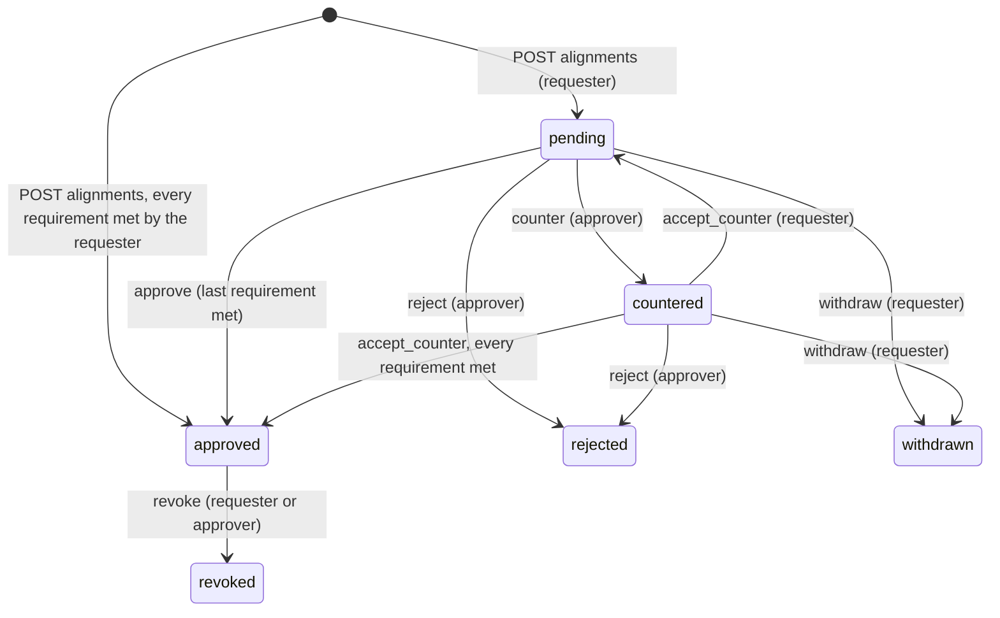
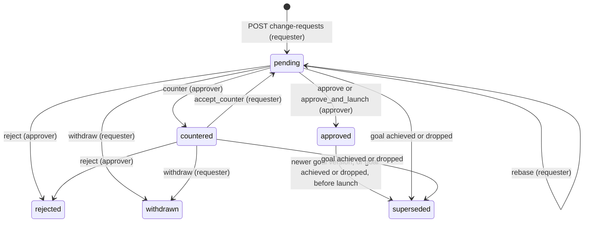
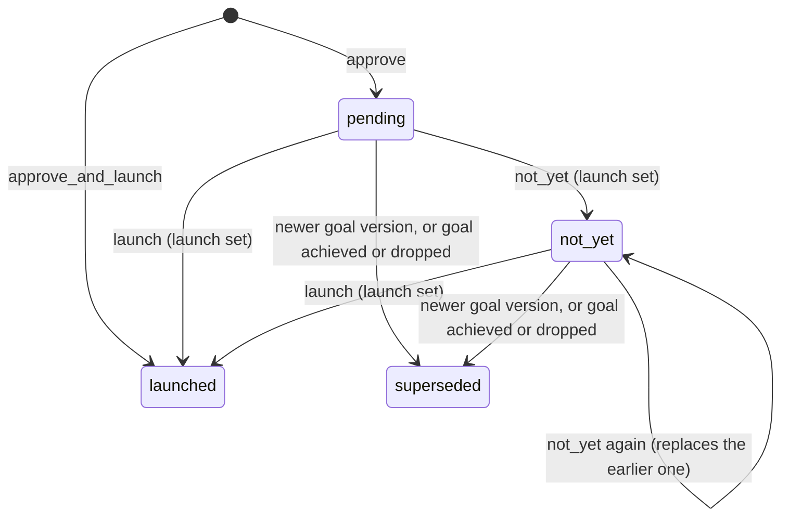

# Goals, alignments and change requests

This part specifies Align's core domain inside a workspace (`ws_…`): goals and their immutable versions, the
goal tree (parents through approved alignments, dependencies through `depends_on`), the approval set that may
consent on a goal's behalf, alignment requests, change requests, and the Northstar sample workspace that any
signed-in person can create to see these flows.

Evidence on change requests is advisory. Each revision carries a snapshot that Align records itself, and the
requester and approvers can attach typed links, each labelled by who reported it. Approving without evidence is
allowed and recorded. Align never marks a link verified; checking CI results against their source (for example
GitHub check runs) is later work, not part of this contract.

Approving and launching are two decisions (founder ruling LIM-2454 33ad545d, owner answers 2026-10-31). Approving a
change request records the decision and keeps the resulting version approved but unlaunched, stored on the request;
the goal, its versions and what agents read stay at the last launched version. **Launch** publishes it, through the
same write path as an owner's new version, and only then do bound and governed sessions get it. **Not yet** records
that the change waits, and a later launch or not yet replaces it. A person who may both approve and launch can do both
in one step. An approved change that the goal outruns before launch (a newer version, or the goal achieved or
dropped) is superseded before launch: it never reaches agents, and the requester can propose again. Proposed is not
approved, approved is not launched, and launched (a version delivered to agents) is not an observed outcome: Align
records delivery receipts, never that an agent did anything.

A counter may carry an "Accept if…" condition (ruling LIM-2454 35376283). The requester acknowledges it as a step of
its own, separate from accepting the counter; the acknowledgement records who and when, never gates approval or
launch, and is never called verified.

Every route here is under `/api/v2/workspaces/{ws}` and follows the common rules of the `workspaces` part:
a browser session cookie (or, where stated, a device token), same-origin writes, JSON bodies, error bodies
`{error:<code>, message}`, 404 for anything the caller may not see, and 403 with a code for a visible action
the caller's role does not allow (a viewer always gets 403 `read_only` for a change). Workspaces, members,
roles, teams and invites are specified in `workspaces`; directives delivered to running agents in
`directives`; the MCP tools that read goals and decision records in `mcp`; the pages under `/app` in
`interface`. Storage keeps the name `pod` for teams (`pod_id`, visibility value `pod`); everything a person
or agent sees says "team".

## Vocabulary

| Term | Meaning in code |
| --- | --- |
| Goal | A row of `v2_goals` (`g_…`) with its current content; every version, including the first, is also a row of `v2_goal_versions` with a content hash |
| Level | `company` or `team` (default `team`); fixed at creation |
| Goal owner | The one accountable person, `owner_id` |
| Owning team | The optional team of a goal, `team_id` on the wire, `pod_id` in storage; fixed at creation |
| Visibility | `private`, `team` (stored `pod`) or `workspace`; fixed at creation |
| Status | `active`, `achieved` or `dropped`. There is no separate archived status |
| Parent | A goal this goal contributes to: the target of an approved alignment whose source is this goal (`contributes_to`) |
| Dependency | A goal whose output this goal consumes (`depends_on`, at most 5) |
| Limit | Goal content (`limits`, at most 5 per version): `{id: "lim_…", type: must\|must_not\|out_of_scope, text, source:{kind: meeting\|manual, title, date}\|null}`, what work toward the goal must do, must not do, or leaves out of scope. It names no person: who confirmed it is the author of the version that carries it |
| Limit suggestion | A rule-shaped sentence of pasted notes matched to a goal by `POST …/limits/suggest`; stored nowhere until it becomes part of a version |
| Approval set | The people any one of whom may approve on a goal's behalf: its owner, its owning team's leads, and for a company goal every workspace owner |
| Alignment | A request (`al_…`) to link a source goal or chosen sessions to a target goal, with revisions, approval requirements and effects |
| Approval requirement | `{for, set}` on an alignment revision: `for` is a goal id or `sessions:<user id>`, `set` the user ids any one of whom satisfies it |
| Change request | A proposed new version (`cr_…`) of a goal the requester does not own, decided by the goal's approval set |
| Decision record | A change request once it is `approved` or `rejected`, or `superseded` after its approval (superseded before launch) |
| Launch | The decision that publishes an approved change request's version to the goal and its agents; `launch` on a request is `pending` (approved, no launch decision yet), `not_yet`, `launched` or `superseded` (superseded before launch), and `null` before approval |
| Launch set | The people who may launch an approved change request: the goal's effective approval set for that request (owner, team leads and, on a company goal, workspace owners, after the requester rule) plus every workspace owner |
| Condition | An "Accept if…" text (1 to 2000 characters) an approver puts on a counter revision, separate from its note; the requester acknowledges it, which is never a verification |
| Evidence link | A typed link (`ev_…`: `pr`, `ci_run`, `incident`, `dashboard`, `doc` or `other`) on one change request revision, self-reported by a person or agent-reported by an agent; Align never marks one verified |
| Align snapshot | What the server recorded about the goal when a change request revision was written: its 30-day spend, bound sessions and last activity |
| Sample workspace | "Northstar (sample)", ordinary data created by `POST /api/v2/workspaces/sample` |

## Alignment state model

## Change request state model

The launch of an approved request (`launch` on the request; `null` until it is approved):

### Requirement: Creating a company or team goal

The server SHALL create a goal on `POST /api/v2/workspaces/{ws}/goals` (browser session; workspace owners and members, viewers 403 `read_only`) from `{title, level?, team_id?, visibility?, measures?, anchors?, depends_on?}`, owned by the caller, at version 1 with status `active`, responding 201 with the goal. `level` SHALL default to `team`; only a workspace owner may create a `company` goal (403 `owner_only` otherwise), and a company goal SHALL have no team (400 when `team_id` is sent) and visibility `workspace` (400 when another `visibility` is sent). A team goal's `visibility` SHALL default to `workspace`; a goal with visibility `team` SHALL name a team (400 otherwise), an unknown `team_id` SHALL be 404, and naming a team the caller is not in SHALL be 403 `not_in_team`. A workspace already holding 1,000 goals SHALL answer 409 `too_many_goals`. Creating a goal SHALL write audit action `goal.created` with the caller as actor. Level, owning team and visibility never change after creation.

#### Scenario: Owner creates a company goal

- **WHEN** a workspace owner POSTs `{title:"Expand to regulated customers", level:"company"}`
- **THEN** the response is 201 with `level: "company"`, `team: null`, `visibility: "workspace"`, `version: 1`, `status: "active"` and `owner` naming the caller

#### Scenario: Member cannot create a company goal

- **WHEN** a member POSTs `{title:"…", level:"company"}`
- **THEN** the response is 403 `owner_only` and no goal is created

#### Scenario: Company goal with a team

- **WHEN** a workspace owner POSTs `{title:"…", level:"company", team_id:"<team>"}` or `{title:"…", level:"company", visibility:"private"}`
- **THEN** the response is 400 and no goal is created

#### Scenario: Team goal in a team the caller is not in

- **WHEN** a member POSTs `{title:"…", visibility:"team", team_id:"<a team they are not in>"}`
- **THEN** the response is 403 `not_in_team`; the same body without `team_id` is 400

### Requirement: Goal content validation

The server SHALL validate goal content the same way on creation, on a new version and in a change request: `title` 1 to 300 characters after trimming; `measures` a list of at most 10 objects with `text` (1 to 300 characters) and optional `target` (at most 100), each keeping a sent `id` only when the previous version had a measure with that id (otherwise a new `m_…` id); `anchors` an object of `repos`, `branch_patterns` and `issues` lists of at most 20 strings of at most 200 characters each, trimmed and de-duplicated; `depends_on` a list of at most 5 goal ids, none equal to the goal itself; `status` one of `active`, `achieved`, `dropped`; and `limits` a list of at most 5 objects with `type` one of `must`, `must_not`, `out_of_scope`, `text` (1 to 160 characters after control characters become spaces and runs of spaces one), and optional `source` (null, or `{kind: meeting|manual, title: at most 120 characters, date: YYYY-MM-DD}`), each keeping a sent `id` only when the previous version had a limit with that id, else reusing the id of a previous limit it repeats word for word (type, text and source), else a new `lim_<12 base32>` id. A violation SHALL be 400 naming the field (`limits: at most 5`, `limits[i].text`, `limits[i].type`, `limits[i].source.date`), and a `depends_on` id that does not exist or that the caller may not read SHALL be 404.

#### Scenario: Too many dependencies

- **WHEN** a goal is created with six ids in `depends_on`
- **THEN** the response is 400 `depends_on: at most 5`

#### Scenario: Dependency on a hidden goal

- **WHEN** `depends_on` names another person's `private` goal
- **THEN** the response is 404 and nothing is written

#### Scenario: Limit ids

- **WHEN** the owner saves a version sending the previous version's limit with its id and a new limit with an id the goal never had
- **THEN** the first keeps its id and the second gets a new `lim_…` id; six limits, a 161-character text, an unknown type or a date like `2026-13-01` are 400

### Requirement: Who reads a goal

The server SHALL let a goal's owner always read it, and otherwise decide by visibility: a `private` goal is read by its owner only (workspace owners do not read another person's private goals); a `team` goal by the members and leads of its owning team and by workspace owners; a `workspace` goal (every company goal) by every workspace member, viewers included. A goal the caller may not read SHALL be answered 404 `not_found` on every route, and SHALL be left out of, or unnamed in, every list and view that would otherwise mention it.

#### Scenario: Team goal of another team

- **WHEN** a member who is not in team Security requests a `team` goal owned by team Security
- **THEN** the server responds 404 `not_found`

#### Scenario: Company goal read by a viewer

- **WHEN** a viewer requests the goals feed
- **THEN** every company goal of the workspace is in it

### Requirement: Goals feed with ETag

The server SHALL serve the goals the caller may read on `GET /api/v2/workspaces/{ws}/goals` (device token with a grant for the workspace, or browser session) as `{version, goals}`, oldest first, where `version` is the first 16 hex characters of the sha256 of the serialized goals and is also sent as a quoted `ETag` with `cache-control: private, no-cache`, and SHALL answer 304 with no body when `If-None-Match` matches it (or is `*`). Each goal SHALL be `{id, version, title, measures, status, level, visibility, owner:{id,name}, team:{id,name}|null, anchors, depends_on, limits, bindable, contributes_to}`, where `limits` is the current version's limits (`[]` when it has none) and is read by whoever reads the goal, where `visibility` shows `team` for a stored `pod` and `depends_on` lists only goals the caller may read. A goal's current version is its last launched (or owner-saved) version: an approved but unlaunched change request SHALL change neither the feed's goals nor its `version`.

#### Scenario: Approval leaves the feed alone

- **WHEN** an approver approves a change request on a goal and nobody launches it
- **THEN** the feed returns the same goals and the same `ETag` as before, and an `If-None-Match` with the earlier `ETag` still answers 304; after the launch the goal has the new version and the `ETag` changes

#### Scenario: Conditional feed

- **WHEN** a client sends `If-None-Match` equal to the current feed `ETag`
- **THEN** the server responds 304 with no body

#### Scenario: Team naming on the wire

- **WHEN** a member reads a goal created with `visibility: "team"` for team Product
- **THEN** the goal has `visibility: "team"` and `team: {id, name: "Product"}`, and has no `pod` key

### Requirement: Immutable goal versions

The server SHALL record each change to a goal as a new immutable version on `POST /api/v2/workspaces/{ws}/goals/{goal}/versions` (browser session) from `{version?, title?, measures?, anchors?, depends_on?, status?, limits?}`, accepted only from the goal's owner (403 `not_goal_owner` for another reader, 403 `read_only` for a viewer, 404 for a goal the caller may not read). A sent `version` other than the current one, or a concurrent write, SHALL be 409 `stale_version`, and a body whose resulting content (title, measures, anchors, status, sorted `depends_on`, limits) hashes the same as the current version SHALL be 409 `no_change`; `depends_on` and `limits` SHALL join the hash only when non-empty, so a version without them hashes as it did before they existed. On success the server SHALL, in one transaction, raise the version by one, keep the previous versions unchanged, store the new version with its content hash and author, write audit action `goal.versioned`, record the goal as reviewed against its parents' current versions, and write one `goal_version` directive, carrying a snapshot of the goal with its `team`, `level` and `limits`, for every non-stopped session whose open epoch is bound to the goal or that the goal governs; the response is 201 with the goal.

#### Scenario: New version

- **WHEN** the owner POSTs `{version: 2, title: "Pass the security review by March"}` to a goal at version 2
- **THEN** the response is 201 with `version: 3`, version 2 is still listed unchanged on the goal's page, and every bound session gets a `goal_version` directive

#### Scenario: Stale or empty change

- **WHEN** the owner POSTs `{version: 1, …}` to a goal at version 3, or POSTs the current content again
- **THEN** the response is 409 `stale_version` or 409 `no_change` respectively, and no version or directive is written

#### Scenario: Adding a limit changes the hash

- **WHEN** a goal without limits gets a version that changes only its title, then one that adds a limit, then the same limits again without their ids
- **THEN** the first version's hash equals the hash of its title, measures, anchors and status alone, the second's differs, and the third is 409 `no_change`

#### Scenario: Someone else edits

- **WHEN** a member who can read the goal but does not own it POSTs a new version
- **THEN** the response is 403 `not_goal_owner`; they can propose a change request instead

### Requirement: Dependency cycles are refused

The server SHALL refuse with 409 `cycle` any write that would make a goal depend on itself through `depends_on` (directly or through other goals, whether or not the caller can read them): a new goal version, and the creation, counter, rebase or approval of a change request whose `depends_on` would close a cycle. The refusal message SHALL NOT name goals the caller may not read, and nothing SHALL be written.

#### Scenario: Two goals depending on each other

- **WHEN** goal A depends on goal B and B's owner saves a version of B with `depends_on: ["<A>"]`
- **THEN** the response is 409 `cycle` and B stays at its current version

### Requirement: Limits are confirmed only by a goal's approval set

The server SHALL make a limit part of a goal only through a saved goal version: one its owner saves (on creation or `POST …/versions`) or one written when a change request whose `changes` include `limits`, approved by a member of its approval set, is launched. A limit SHALL reach agents only inside that version's snapshot (the `directives` part), and nothing else (a suggestion, a pending or countered request, an approved request that is not launched) SHALL change a goal's limits. A request with `limits` is dismissed by rejecting or withdrawing it.

#### Scenario: Proposed by a member, approved by the team lead

- **WHEN** a member in no team proposes `changes:{limits:[…current, {type:"must", text:"Inference must stay inside the EU region"}]}` on a workspace goal of team Alpha and Alpha's lead approves it
- **THEN** the goal's next version carries the three limits, authored by the lead, and the bound sessions' `goal_version` directive snapshot has them in `limits`

#### Scenario: Confirmed limits wait for launch

- **WHEN** the lead approves that request and nobody launches it
- **THEN** the goal and its limits are unchanged and no directive is written; once someone in the launch set launches it, the new version carries the limits and the bound sessions get them

### Requirement: First limit event

The server SHALL record the product event `first_limit` (no props, actor the version's author) for a workspace in the transaction of the first goal version with at least one limit, whether created, saved by the owner or written by the launch of an approved change request; a limit seeded in the sample workspace SHALL record nothing.

#### Scenario: Several versions with limits

- **WHEN** a goal is created with a limit and later versions keep or add limits
- **THEN** the workspace has exactly one `first_limit` event

### Requirement: Suggesting limits from notes

The server SHALL accept `POST /api/v2/workspaces/{ws}/limits/suggest {notes, source:{title?, date}, prefer_goal_id?}` (browser session, same-origin, body at most 32 KB) from workspace owners and members (403 `read_only` for a viewer), with `notes` 1 to 20,000 characters, `source.title` at most 120 characters and `source.date` a real `YYYY-MM-DD` day (400 otherwise), and a `prefer_goal_id` the caller can read (404 otherwise). It SHALL split the notes into at most 200 sentences, keep only rule-shaped ones (4 to 45 words, not a question; "out of scope" phrasing is `out_of_scope`, "ensure", "make sure", "target" and "aim for" are `must`, then `must_not` and `must` wording; a plain "can't" does not count), and place each on the active goal the caller can read whose own words (title and measures, each word weighted by one over the number of goals using it) it uses most, with a score of at least 1; a tie goes to `prefer_goal_id` when it is one of the tied goals and is otherwise dropped, and when the notes are one sentence that matches no goal it goes to `prefer_goal_id` with source kind `manual`. It SHALL respond 200 `{suggestions:[{goal:{id,title,version}, can_edit, can_propose, limits:[{type, text, quote, source:{kind,title,date}, already}]}], dropped}`, where `text` is the sentence without a short heading ("Goal: …"), capitalised and at most 160 characters, `quote` the sentence at most 200, `already` the id of the goal's current limit sharing at least 0.6 of its key words (or null), `can_edit` true for the goal's owner and `can_propose` for anyone else, and `dropped` the rule-shaped sentences placed on no goal or repeating one already suggested. It SHALL store nothing, write no audit row and record no event, SHALL never name a goal the caller cannot read nor use its words, and SHALL allow 20 calls a minute per person and 120 an hour per workspace (429 `rate_limited`).

#### Scenario: Rule-shaped sentences only

- **WHEN** a member pastes "I can't find the GPU node logs.", "Ensure all three models don't fit on the GPU.", a question, a three-word and a 46-word sentence
- **THEN** only "Ensure all three models don't fit on the GPU." is suggested, as `must`, on the goal whose words include "GPU", with `already` naming that goal's limit "All three models must not fit on one GPU"

#### Scenario: Unreadable goal

- **WHEN** a sentence uses a word only another team's `team`-visible goal has
- **THEN** the sentence is dropped and the response names no part of that goal; nothing is stored

#### Scenario: Too many calls

- **WHEN** one person calls it 21 times within a minute
- **THEN** the 21st call is 429 `rate_limited`

### Requirement: One goal with its versions and contributions

The server SHALL serve one goal on `GET /api/v2/workspaces/{ws}/goals/{goal}` (browser session) as `{goal, versions, contributions, can_edit, can_propose}`: `goal` as in the feed, `versions` every version newest first as `{version, title, status, content_hash, created_at}`, `contributions` the readable source goals of approved alignments targeting this goal as `{goal:{id, title}}`, `can_edit` true only for the goal's owner when not a viewer, and `can_propose` true exactly when "Proposing a change request" would not refuse the reader for who they are or the goal's status: not the goal's owner, not a viewer, and the goal `active`. A goal the caller may not read SHALL be 404.

#### Scenario: Owner opens their goal

- **WHEN** the owner of a goal at version 3 opens it
- **THEN** the response has three `versions` (3, 2, 1), `can_edit: true` and `can_propose: false`; a member reading the same goal gets `can_edit: false` and `can_propose: true`, and a viewer gets both false

### Requirement: Parents come from approved alignments

The server SHALL derive a goal's parents only from approved alignments whose source is that goal, and SHALL report each readable parent in `contributes_to` as `{id, title, version, reviewed_version, stale}`, where `reviewed_version` is the parent version the child's owner last reviewed the child against (null if never) and `stale` is true while `reviewed_version` is null or below the parent's current version. Approving an alignment with a source goal SHALL record the source as reviewed against the target's version at approval; saving a new version of the child SHALL record it as reviewed against every parent's current version. A parent that is revoked stops being a parent.

#### Scenario: Parent changes

- **WHEN** a company goal gets a new version
- **THEN** each child's `contributes_to` entry for it shows `stale: true` with `reviewed_version` below `version`, until the child's owner reviews it or saves a new version of the child

### Requirement: Stale-parent review

The server SHALL let only a goal's owner confirm the goal still fits a parent's current version on `POST /api/v2/workspaces/{ws}/goals/{goal}/review {parent_id}` (browser session, body at most 4 KB), record the review against the parent's current version, write audit action `goal.parent_reviewed`, and respond with the goal. A goal the caller may not read, or a `parent_id` that is not a current parent, SHALL be 404; another reader SHALL get 403 `not_goal_owner` and a viewer 403 `read_only`.

#### Scenario: Owner confirms

- **WHEN** the owner of a child whose parent moved to version 4 POSTs `{parent_id}`
- **THEN** the response is the goal with that parent's `reviewed_version: 4` and `stale: false`

#### Scenario: Review refused

- **WHEN** a member who does not own the child POSTs `{parent_id}`, or the owner names a goal that is not its parent
- **THEN** the server responds 403 `not_goal_owner` or 404 respectively

### Requirement: Bindable goals

The server SHALL mark a goal `bindable` for the caller only when it is `active`, the caller is not a viewer, and the goal is the caller's own, belongs to a team the caller is in, or is the target of an approved `work_toward` alignment whose current revision lists one of the caller's sessions. Binding a session to a goal its owner may read but that is not their own, not their team's and not covered by such an alignment SHALL be refused with 403 `alignment_required`, and binding it to a goal that is not `active` with 409 `goal_not_active` (the epoch route is specified in `workspaces`).

#### Scenario: Teammate's goal

- **WHEN** a member of team Product reads an active goal owned by another member of team Product
- **THEN** the goal has `bindable: true`; a company goal owned by someone else has `bindable: false` until an approved `work_toward` alignment covers one of the caller's sessions

### Requirement: Approval set of a goal

The server SHALL compute a goal's approval set, at the time it is needed, as the goal's owner, every lead of the goal's owning team, and for a company goal every workspace owner, keeping only people who are current workspace members with role `owner` or `member`. Viewers and people who left or were removed SHALL never be in an approval set.

#### Scenario: Team goal

- **WHEN** the goal "Pass the security review" is owned by Sam and team Security has leads Sam and Lee
- **THEN** its approval set is Sam and Lee

#### Scenario: Owner who left

- **WHEN** the owner of a team goal has been removed from the workspace and the team has one lead
- **THEN** the approval set is that lead only; the goal keeps naming its former owner

### Requirement: Requester rule and workspace-owner fallback

Wherever a goal's consent is needed (an alignment requirement or a change request), the server SHALL treat one approval from the goal's approval set as that goal's consent, SHALL count the requester toward the set only when the requester is the goal's owner, and, when the requester is not the goal's owner and the set holds no one other than the requester, SHALL use the workspace owners other than the requester as the set. If even that set is empty, the request SHALL stay open until someone eligible exists or the requester withdraws it.

#### Scenario: Lead asks against their own team's goal

- **WHEN** Lee, a lead of team Security, requests an alignment targeting a goal owned by Sam in team Security
- **THEN** Lee's request does not satisfy that goal's requirement; Sam (or another lead) must approve

#### Scenario: Nobody else in the set

- **WHEN** the requester is the only remaining lead of a goal whose owner left
- **THEN** the requirement's set is the workspace owners other than the requester, and one of them must approve

### Requirement: Requesting an alignment

The server SHALL let a workspace owner or member (viewers 403 `read_only`) request an alignment on `POST /api/v2/workspaces/{ws}/alignments {target_goal_id, source_goal_id?, choice, session_keys?, note?}` (browser session, body at most 16 KB), with `choice` `contribution` (effect `contributes_to`) or `work_toward` (effects `contributes_to`, `governing_goal` and `allocation_transfer`), and respond 201 with the alignment view. It SHALL answer 404 for a target or source goal the caller may not read and for a session key that is unknown or not the caller's own; 409 `goal_not_active` for a target that is not `active`; 400 when the source is the target, `choice` is invalid, `note` exceeds 1000 characters, `session_keys` exceeds 50, a `work_toward` request lists no session, or a `contribution` request has neither a source nor a session; 403 `source_not_yours` when the source goal is neither the caller's own nor a goal of a team the caller is in (an approved `work_toward` alignment does not make another goal a valid source, and the source's status is not checked); 409 `sharing_stopped` for a stopped session; and 409 `already_governed` when a `work_toward` session already follows another goal through an alignment. Creating writes audit action `alignment.requested`.

#### Scenario: Contribution of my team's goal to a company goal

- **WHEN** a member POSTs `{target_goal_id:"<company goal>", source_goal_id:"<their team goal>", choice:"contribution"}`
- **THEN** the response is 201 with `state: "pending"`, `revision: 1` and one `contributes_to` effect

#### Scenario: Invalid request

- **WHEN** a request lists another person's session, a stopped session, an inactive target, no session for `work_toward`, or a session already governed through another alignment
- **THEN** the server responds 404, 409 `sharing_stopped`, 409 `goal_not_active`, 400, or 409 `already_governed` respectively

### Requirement: Alignment approval requirements

The server SHALL compute, for each alignment revision, a list of approval requirements `{for, set}`, one per distinct `for`: the target goal's approval set (`for` the target id); when there is a source goal, the source goal's approval set (`for` the source id); and for a revision with the `allocation_transfer` effect, for each listed session's owner a singleton set (`for` `sessions:<user id>`) and, for each listed session currently bound to a goal, that goal's approval set (`for` that goal id). Each goal set SHALL be the effective set after the requester rule and workspace-owner fallback. Each requirement needs one approval from its set.

#### Scenario: Work toward another team's goal

- **WHEN** Ana, whose session is bound to her own goal G1, requests `work_toward` the goal G2 owned by Sam in team Security
- **THEN** the revision has requirements for G2 (Sam and team Security's leads), `sessions:<Ana>` (Ana) and G1 (Ana, as G1's owner)

### Requirement: Approval requirement storage

The server SHALL store a revision's requirements in `approvers_json` as `[{for, set:[user ids]}]` and SHALL read an older row holding a plain array of user ids as one requirement per user id with that user as a singleton set and `for: null`. An approval by a user SHALL satisfy every requirement of that revision whose set contains them, and each requirement SHALL record the first person who satisfied it as `approved_by`.

#### Scenario: Legacy row

- **WHEN** an alignment created before this change has `approvers_json` `["u1","u2"]`
- **THEN** it reads as two requirements `{for:null, set:["u1"]}` and `{for:null, set:["u2"]}`, and approves once u1 and u2 have both approved

#### Scenario: One person satisfies two goals

- **WHEN** Lee leads both the target's and the source's owning teams and approves
- **THEN** both requirements record `approved_by` Lee

### Requirement: Alignment approval and its effects

The server SHALL approve an alignment, in the transaction of the action that completes it, when every requirement of its current revision is satisfied, and SHALL make creation instant only when the requester alone satisfies every requirement under the requester rule; the revision's author SHALL count as approving it for every requirement whose set contains them. On approval the server SHALL set `state: "approved"`, for `work_toward` set the target as the governing goal of each listed session whose sharing has not stopped and write one `binding_changed` directive per such session (stopped sessions are skipped; a listed session meanwhile governed through another alignment makes the action 409 `already_governed`), record the source goal (if any) as reviewed against the target's current version, and write audit action `alignment.approved` naming the person whose action completed it.

#### Scenario: Never instant against others

- **WHEN** a member requests a `contribution` of their own goal to a company goal owned by a workspace owner
- **THEN** the response is 201 with `state: "pending"`; it becomes `approved` only when someone in the company goal's approval set approves

#### Scenario: Instant when the requester owns both goals

- **WHEN** a workspace owner requests a `contribution` of their own team goal to their own company goal
- **THEN** the response is 201 with `state: "approved"` and the team goal's `contributes_to` lists the company goal with `stale: false`

#### Scenario: Approving work toward a goal

- **WHEN** the last required approver approves a `work_toward` request at its current `revision`
- **THEN** the alignment becomes `approved`, and each listed session whose sharing has not stopped gets the target as its governing goal and one `binding_changed` directive

### Requirement: Alignment actions

The server SHALL accept `POST /api/v2/workspaces/{ws}/alignments/{id}/{action}` (browser session, body at most 16 KB) for `approve`, `counter`, `accept_counter`, `reject`, `withdraw` and `revoke`, from people involved in the alignment (the requester and everyone in any requirement set of any revision; others 404, viewers 403 `read_only`, an unknown action 404). An approver is someone in a requirement set of the current revision. `approve {revision}` SHALL need the current `revision` (409 `stale_revision`), state `pending` (409 `wrong_state`) and an approver (403 `not_an_approver`). `counter {revision?, choice?, keep?|session_keys?, note?}` SHALL come from an approver who is not the requester (403 `not_an_approver`) on a `pending` request, may only keep or drop sessions of the current revision (400 otherwise), SHALL write a new revision with recomputed requirements, void every earlier approval and set `countered`. `accept_counter` SHALL come only from the requester (403 `not_requester`) on a `countered` request, count as the requester's approval for every requirement of the current revision whose set contains them, and return it to `pending`. `reject` SHALL come from an approver who is not the requester on a `pending` or `countered` request; `withdraw` only from the requester on a `pending` or `countered` request. A request that changed since the caller read it SHALL be 409 `stale_revision`. `counter`, `reject`, `withdraw` and `revoke` SHALL each write an audit row (`alignment.countered`, `.rejected`, `.withdrawn`, `.revoked`) naming its actor; an `approve` or `accept_counter` SHALL write `alignment.approved` only when it completes the alignment, and otherwise no audit row. Every action SHALL respond with the alignment view.

#### Scenario: Stale or wrong approval

- **WHEN** an approver approves with an old `revision`, approves a request that is `countered`, or a person whose approval is not needed approves
- **THEN** the server responds 409 `stale_revision`, 409 `wrong_state` or 403 `not_an_approver` respectively

#### Scenario: Counter and accept

- **WHEN** the target's owner counters a `work_toward` request keeping one of two sessions, and the requester then calls `accept_counter`
- **THEN** the alignment is at revision 2 with one session, back in `pending`, and approves once every requirement of revision 2 is satisfied (the counter's author already counts)

### Requirement: Alignment revocation

The server SHALL let the requester or an approver revoke an `approved` alignment (409 `wrong_state` otherwise), set it `revoked`, and, for `work_toward`, remove the governing goal from its sessions and, for each session whose open epoch was bound only through this alignment, end that epoch now, set the session `suspended` and write a `binding_suspended` directive; past usage never moves. A revoked contribution SHALL stop making its source a child of its target.

#### Scenario: Revoking work toward

- **WHEN** the requester revokes an approved `work_toward` alignment
- **THEN** it becomes `revoked`, its sessions lose the governing goal, and sessions whose open binding existed only through it become `suspended` and get a `binding_suspended` directive

### Requirement: Contribution cycles are refused

The server SHALL refuse with 409 `cycle` an alignment with a source goal whose approval would make the contribution tree cyclic, that is, when the source is already reachable from the target by following approved parents: at creation (nothing is written) and at the `approve` or `accept_counter` that would complete it (the alignment stays as it was). The message SHALL NOT name goals the caller may not read.

#### Scenario: Child cannot become its parent's parent

- **WHEN** goal A contributes to goal B through an approved alignment and someone requests that B contribute to A
- **THEN** the response is 409 `cycle` and no alignment is created

### Requirement: Alignment read views

The server SHALL list the alignments the caller is involved in on `GET /api/v2/workspaces/{ws}/alignments` (browser session) as `{waiting_on_me, mine, others}`, newest change first, and serve one on `GET .../alignments/{id}` (404 when the caller is not involved). Each view SHALL hold `id`, `state`, `revision`, `choice`, `requester`, `target_goal`, `source_goal` (a goal the caller may not read shows `id` and `title` null), `sessions` (by `ref`; another person's session has no `session_key`), `effects` in plain words, `requirements` (each `{for, approvers:[{id,name}], approved_by}`, with `for` null for a goal the caller may not read), `approvers` (everyone in any current set, each with `approved`), `note`, `history` of revisions, `waiting_on_me`, `can` flags for exactly the actions the server would allow (all false for a viewer), `created_at` and `updated_at`.

#### Scenario: Alignment list

- **WHEN** a member calls `GET /api/v2/workspaces/{ws}/alignments`
- **THEN** requests where they can approve or accept a counter are under `waiting_on_me`, their other requests under `mine`, and other requests they are part of under `others`

### Requirement: Proposing a change request

The server SHALL let a workspace owner or member who can read a goal but does not own it propose a change on `POST /api/v2/workspaces/{ws}/goals/{goal}/change-requests {base_version, changes, reason}` (browser session, body at most 32 KB) and respond 201 with the change request (`id` `cr_…`, `state: "pending"`, `revision: 1`). It SHALL answer 404 for a goal the caller may not read, 403 `read_only` for a viewer, 403 `own_goal` for the goal's owner (who publishes a version instead), 409 `goal_not_active` for a goal that is `achieved` or `dropped`, 409 `stale_version` when `base_version` is not the goal's current version, and 400 when `reason` is missing or not 1 to 2000 characters after trimming.

#### Scenario: Member proposes

- **WHEN** a member of team Product POSTs `{base_version: 1, changes:{measures:[…]}, reason:"Onboarding needs a pen-test window in May"}` to the Security goal
- **THEN** the response is 201 with `state: "pending"`, `base_version: 1`, `requester` naming the caller, and audit action `change_request.created`

#### Scenario: Owner proposes to their own goal

- **WHEN** the goal's owner POSTs a change request to it
- **THEN** the response is 403 `own_goal`

### Requirement: Change request contents

The server SHALL accept in `changes` only the keys `title`, `measures`, `depends_on`, `status` and `limits` (400 for any other key, an empty object or a non-object), validate each like a new goal version against the base version, answer 409 `no_change` when applying them to the base version changes nothing, and 409 `cycle` when the resulting `depends_on` would close a dependency cycle. The same rules SHALL apply to `changes` sent with `counter` and `rebase`, and a request's read view SHALL show `limits` in its `changes` and in `diff.before` / `diff.after` when it changes them.

#### Scenario: Anchors are not proposable

- **WHEN** a change request sends `changes: {anchors:{repos:["x"]}}`
- **THEN** the response is 400

### Requirement: One open change request per goal and requester

The server SHALL refuse a second change request from the same person on the same goal while their earlier one is `pending` or `countered`, with 409 `already_open`.

#### Scenario: Second request

- **WHEN** a member with a pending request on a goal POSTs another one to that goal
- **THEN** the response is 409 `already_open`; once the first is withdrawn or decided, a new one is accepted; an approved request waiting for launch is decided, so the requester may propose again

### Requirement: Approving a change request

The server SHALL accept `POST .../change-requests/{id}/approve {revision, note?}` (`note` at most 2000 characters) only from a member of the goal's approval set under the requester rule (403 `not_an_approver`), only for a `pending` request (409 `wrong_state`) at its current `revision` (409 `stale_revision`), and only while the goal is still at `base_version` (409 `stale_version`; the requester must `rebase`), and 409 `no_change` when the changes no longer change the goal. On success it SHALL, in one transaction, set the request `approved` with `approved_by`, `note`, `decided_at`, `approved_without_evidence` (see "Approving without evidence") and `launch: "pending"`, store the resulting goal content on the request as its approved-unlaunched version, write audit action `change_request.approved`, record `first_approval`, and respond with the request. Approving SHALL write no goal version and no directive, and SHALL NOT change the goal: its version, content, versions list, feed and every agent read stay at the last launched version until a launch (see "Launching an approved change request"). `version` stays `null` until the launch.

#### Scenario: Team lead approves

- **WHEN** a lead of the goal's owning team approves a pending request at its current revision on a goal at version 2 still at its base version
- **THEN** the request is `approved` with `approved_by` the lead, `launch: "pending"` and `version: null`; the goal is still at version 2 and no session gets a directive

#### Scenario: Goal moved meanwhile

- **WHEN** the owner published a new version after the request was made and an approver approves it
- **THEN** the response is 409 `stale_version` and the request stays `pending`

### Requirement: Who may launch a change request

The server SHALL compute, at the time it is needed, the launch set of a change request as its effective approval set (the goal's approval set under the requester rule and the workspace-owner fallback) plus every workspace owner, keeping only current members with role `owner` or `member`; a viewer SHALL never be in it. Every approver of a request is in its launch set. The set SHALL be read on the request as `launchers` (`[{id, name}]`).

#### Scenario: A workspace owner outside the approval set

- **WHEN** a team goal's request was approved by the team's lead and a workspace owner who is neither the goal's owner nor a lead opens it
- **THEN** the owner is in `launchers` and may launch it; a plain member outside the approval set may not (403 `not_a_launcher`)

### Requirement: Launching an approved change request

The server SHALL accept `POST .../change-requests/{id}/launch {revision?}` only from a member of the request's launch set (403 `read_only` for a viewer, 403 `not_a_launcher` with "Only someone who can approve for this goal, or a workspace owner, can launch it" otherwise), only for an `approved` request whose `launch` is `pending` or `not_yet` (409 `wrong_state`: "This change is already launched as version <n>." when launched, "This change was superseded before launch. <requester> can propose it again." when superseded before launch, "This request is <state>" otherwise), and only while the goal is still at the request's `base_version` (409 `stale_version`). On success it SHALL, in one transaction, write the approved-unlaunched version as the goal's next version through the single write path every goal version takes (the same as an owner's new version: content hash, `created_by` the approver who confirmed it, audit `goal.versioned` by the launcher, parent review, one `goal_version` directive for every non-stopped session bound to or governed by the goal, and, when the version makes the goal achieved or dropped, the closing steps of "Change requests are superseded when the goal is achieved or dropped" and "Requests expire when their goal is achieved or dropped" and the hold release), set the request's `launch` to `launched` with `launch_decided_by` the launcher, `launch_decided_at` and `version` the new goal version, write audit action `change_request.launched`, record the content-free event `first_launch`, and respond with the request. A refused launch SHALL write nothing.

#### Scenario: Approve without launching, then launch

- **WHEN** a goal is at version 2 with a bound session, an approver approves a request on it, and a workspace owner then launches it
- **THEN** after the approval the goal is at version 2 and the session's directive cursor has nothing new; after the launch the goal is at version 3 with `created_by` the approver, the session gets exactly one `goal_version` directive carrying version 3, and the request reads `launch: "launched"`, `version: 3`, `launch_decided_by` the owner

#### Scenario: Launch twice

- **WHEN** someone launches a request that is already launched
- **THEN** the response is 409 `wrong_state` and no second version or directive is written

### Requirement: Not yet keeps agents on the launched version

The server SHALL accept `POST .../change-requests/{id}/not_yet {revision?}` from the launch set (403 `not_a_launcher` otherwise) on an `approved` request whose `launch` is `pending` or `not_yet` (409 `wrong_state` otherwise), and SHALL record the decision (`launch: "not_yet"`, `launch_decided_by`, `launch_decided_at`, audit `change_request.not_yet`) and publish nothing: no goal version, no directive. A later `not_yet` or `launch` SHALL replace the earlier decision.

#### Scenario: Not yet, then launch

- **WHEN** a lead says not yet on an approved request and later launches it
- **THEN** after not yet the goal and the bound sessions' directives are unchanged and the request reads `launch: "not_yet"` with the lead and the time; after the launch it reads `launch: "launched"` and the sessions get the new version once

### Requirement: Approve and launch in one step

The server SHALL accept `POST .../change-requests/{id}/approve_and_launch {revision, note?}` from a person who may both approve the request and launch it (every approver may), under the rules of both actions, and SHALL in one transaction approve it and launch it, auditing two decisions (`change_request.approved`, with `change_request.approved_without_evidence` when so, then `change_request.launched`) and recording `first_approval` and `first_launch`. A refusal of either SHALL write nothing.

#### Scenario: Owner approves and launches

- **WHEN** the goal's owner approves and launches a pending request in one step while a session is bound to the goal
- **THEN** the request is `approved` with `launch: "launched"`, the goal is at its next version, the session gets one `goal_version` directive, and the audit has both `change_request.approved` and `change_request.launched` by the owner

### Requirement: Approved changes are superseded before launch

The server SHALL, in the transaction that writes any new version of a goal (an owner's version, or the launch of another request), set every other `approved` request on that goal whose `launch` is `pending` or `not_yet` to state `superseded` with `launch: "superseded"`, keeping its approval (`approved_by`, `note`, `decided_at`), and write audit action `change_request.superseded` for each with the person whose action wrote the version as actor. Such a request SHALL never reach agents, SHALL accept no launch (409 `wrong_state`), and SHALL not stop its requester proposing again.

#### Scenario: Owner saves a version before launch

- **WHEN** a request on a goal at version 2 is approved and, before anyone launches it, the owner saves version 3
- **THEN** the request is `superseded` with `launch: "superseded"` and its approver kept, launching it answers 409 `wrong_state`, no directive carries its content, and its requester can open a new request against version 3

#### Scenario: Another request launches first

- **WHEN** two requests on the same goal are approved and one is launched
- **THEN** the other becomes `superseded` before launch; a third request that was still pending is `behind` and its requester can rebase it

### Requirement: Rejecting and countering a change request

The server SHALL accept `reject {reason}` (reason 1 to 2000 characters, 400 otherwise) from an approver on a `pending` or `countered` request, setting `rejected` with `rejected_by`, `reason` and `decided_at`; and `counter {changes, note, condition?, revision?}` (note 1 to 2000 characters; `condition`, when sent and not null, 1 to 2000 characters, 400 "condition is required" or "condition is too long (max 2000 characters)") from an approver on a `pending` request, replacing the proposed changes, raising `revision`, storing the condition on that new revision separately from its note, and setting `countered`. Only the requester SHALL `accept_counter` (403 `not_requester`) a `countered` request, which returns it to `pending` with the countered changes. A caller outside the approval set SHALL get 403 `not_an_approver`, a request in another state 409 `wrong_state`, and a sent `revision` other than the current one 409 `stale_revision`.

#### Scenario: Reject needs a reason

- **WHEN** an approver POSTs `reject {}`
- **THEN** the response is 400 and the request is unchanged

#### Scenario: Counter then accept

- **WHEN** an approver counters with changed measures and the requester calls `accept_counter`
- **THEN** the request is `pending` at revision 2 with the approver's changes, and an approver can then approve revision 2

### Requirement: Accept if conditions on a counter

The server SHALL show a request's condition as `condition` `{revision, text, acknowledged_by, acknowledged_at}` (the condition of its latest counter revision, or `null` when that counter carries none or there is no counter) and on each revision as `condition`, `acknowledged_by` and `acknowledged_at`. Only the requester SHALL acknowledge it, with `POST .../change-requests/{id}/acknowledge {revision?}` (403 `not_requester` for anyone else, 403 `read_only` for a viewer), as a step separate from `accept_counter`: on a `pending` or `approved` request (409 `wrong_state` while `countered` and in every closed state), with a condition (409 `no_condition`), naming its revision when `revision` is sent (409 `stale_revision`), and only once per revision (409 `already_acknowledged`). It SHALL store who acknowledged and when on that revision, write audit `change_request.condition_acknowledged`, and change nothing else. A condition SHALL never gate approval or launch, SHALL never reach a directive, and nothing SHALL call it verified: until acknowledged the record shows it as not confirmed yet.

#### Scenario: Condition acknowledged by the requester

- **WHEN** an approver counters with `condition: "Accept if the pen-test vendor is booked by May"`, the requester accepts the counter, another member acknowledges, and then the requester acknowledges twice
- **THEN** after the accept the condition has `acknowledged_by: null`; the other member gets 403 `not_requester`; the requester's first acknowledge stores their id and the time; the second answers 409 `already_acknowledged`

#### Scenario: Not a gate

- **WHEN** an approver approves and launches a request whose condition nobody acknowledged
- **THEN** both succeed, and the record shows the condition as not confirmed yet next to the approval

### Requirement: Withdrawing and rebasing a change request

The server SHALL let only the requester (403 `not_requester`) `withdraw` a `pending` or `countered` request, setting `withdrawn`, and `rebase {base_version, changes?}` a `pending` request (409 `wrong_state` otherwise), where `base_version` must equal the goal's current version (409 `stale_version`); rebase SHALL move the request to that version, replace the changes when sent, re-validate them against it (409 `no_change` when they no longer change anything), and raise `revision`.

#### Scenario: Rebase after the goal moved

- **WHEN** the goal moved from version 2 to 3 and the requester POSTs `rebase {base_version: 3}`
- **THEN** the request has `base_version: 3` and a higher `revision`, and an approver can approve it

### Requirement: Change requests are superseded when the goal is achieved or dropped

The server SHALL, in the transaction that gives a goal status `achieved` or `dropped` (an owner's version or a launched change request), set every other `pending` or `countered` change request on that goal to `superseded` and write audit action `change_request.superseded` for each, with the person whose action changed the goal's status as actor. A new version that leaves the goal `active` SHALL NOT change other open requests: they stay `pending` or `countered`, and approving one answers 409 `stale_version` until its requester rebases it.

#### Scenario: Owner drops the goal

- **WHEN** the owner saves a version with `status: "dropped"` while two requests on the goal are pending
- **THEN** both requests become `superseded` and accept no further action (409 `wrong_state`)

#### Scenario: Another request is launched

- **WHEN** two requests on an active goal are pending and an approver approves and launches one without changing the status
- **THEN** the other stays `pending`, and approving it answers 409 `stale_version` until its requester rebases it

### Requirement: Change request audit

The server SHALL write an audit row naming its actor for every change request action: `change_request.created`, `.approved`, `.approved_without_evidence`, `.launched`, `.not_yet`, `.rejected`, `.countered`, `.counter_accepted`, `.condition_acknowledged`, `.withdrawn`, `.rebased`, `.superseded`, `.evidence_added` and `.evidence_removed`, with the request id as object.

#### Scenario: Audited decision

- **WHEN** a lead rejects a request
- **THEN** the workspace audit has a `change_request.rejected` row whose actor is the lead and whose object is the request id

### Requirement: Reading change requests and decision records

The server SHALL list change requests on `GET /api/v2/workspaces/{ws}/goals/{goal}/change-requests?state=` as `{change_requests}` and across the workspace on `GET /api/v2/workspaces/{ws}/change-requests?state=` as `{waiting_on_me, mine, others}`, each list item being the same object as the single read below, with its `can` flags, including only requests on goals the caller may read (viewers included) and answering 400 for a `state` that is not one of the six states. `waiting_on_me` holds the requests whose `waiting_on_me` is true, `mine` the caller's other requests, and `others` the rest. `GET .../goals/{goal}/change-requests/{id}` SHALL return one request: `id`, `goal:{id, title, version}`, `state`, `revision`, `base_version`, `behind` (true while the request is open and the goal has moved past `base_version`), `requester`, `changes`, `reason` (the requester's), `revisions` (each `{revision, base_version, changes, note, author, created_at, evidence, snapshot}`, with `evidence` and `snapshot` as "Evidence links on change request revisions" and "Align snapshot on each change request revision" describe), a `diff` `{before, after}` of the changed fields (before from the base version, after with the changes applied; once launched, from the resulting version), `approvers` (the effective approval set after the requester rule), `launchers` (the launch set), `approved_by`, `rejected_by`, `decision_note` (the approval note or the rejection reason) also shown as `note` when approved and `rejection_reason` when rejected, `launch` (`pending`, `not_yet`, `launched`, `superseded` or `null`), `launch_decided_by` and `launch_decided_at` (the latest not yet or launch, or `null`), `version` (the goal version the launch created, `null` before it), `condition` (see "Accept if conditions on a counter"), `evidence_count` (the links on the current revision), `approved_without_evidence` (`true` or `false` once approved, else `null`), `can` flags `{approve, approve_and_launch, reject, counter, accept_counter, acknowledge, withdraw, rebase, add_evidence, launch, not_yet}` that are true exactly when the server would accept that action from the caller (`approve` false while `behind`; all false for a viewer), `waiting_on_me` (true when the caller's `approve` or `accept_counter` flag is, or their `launch` flag while `launch` is `pending`), `created_at`, `updated_at` and `decided_at`. A decided request is its decision record. A request on a goal the caller may not read, or on a goal other than the one in the path, SHALL be 404, and `depends_on` in a diff SHALL list only goals the caller may read.

#### Scenario: Viewer reads but cannot act

- **WHEN** a viewer opens a pending request on a workspace goal
- **THEN** the response is 200 with every `can` flag false, and a viewer's `approve` is 403 `read_only`

#### Scenario: Waiting on me

- **WHEN** a team lead calls `GET /api/v2/workspaces/{ws}/change-requests`
- **THEN** pending requests on their team's goals are under `waiting_on_me`, their own requests under `mine`, and the rest they can read under `others`

### Requirement: Align snapshot on each change request revision

The server SHALL, in the transaction that writes each change request revision (creation, `counter` and `rebase`), record a snapshot of the goal computed by the server alone and store it with that revision: `recorded_at` (the revision's time), `window` `{from, to, days: 30}` (the 30 days before it), `spend` `{total, by_model}` (the goal's usage in that window, summed exactly as the Spend tab sums a goal's row, `total` and one row per `model`, each with the same token, request and `est_list_usd_micros` sums and `by_basis`), `bound_sessions` (the number of sessions that a new goal version would reach: not stopped, and whose open epoch is bound to the goal or that the goal governs) and `last_activity_at` (the latest usage request, epoch start or work signal on the goal, or `null`). No field of a request body SHALL reach a snapshot, and a stored snapshot SHALL never change. Each revision SHALL be read with `snapshot` `{revision, recorded_by: "align", recorded_at, window, spend, spend_hidden, bound_sessions, last_activity_at}`, where `spend` is `null` and `spend_hidden` `true` for a reader whose role does not allow `spend.read`; a revision stored without a snapshot reads `snapshot: null`.

#### Scenario: Snapshot at proposal

- **WHEN** a session bound to a goal uploaded two requests in the last day (models A and B) and one 40 days ago, and a member proposes a change to that goal
- **THEN** revision 1's snapshot holds the two recent requests in `spend.total`, one `by_model` row each for A and B, `bound_sessions: 1` and the latest of the epoch start and the requests as `last_activity_at`

#### Scenario: A client cannot supply a snapshot

- **WHEN** a proposal body carries a `snapshot` field
- **THEN** the request is created with the snapshot the server computed

#### Scenario: Counter records its own snapshot

- **WHEN** an approver counters a request
- **THEN** revision 2 carries a new snapshot with `revision: 2`, and revision 1 keeps its own

### Requirement: Evidence links on change request revisions

The server SHALL accept `POST /api/v2/workspaces/{ws}/goals/{goal}/change-requests/{id}/evidence {kind, url, label, revision?}` (browser session or device token, body at most 8 KB) and add the link to the request's current revision, responding 201 `{evidence, change_request}`. `kind` SHALL be one of `pr`, `ci_run`, `incident`, `dashboard`, `doc` and `other`; `url` an `https:` URL with a host and no user name or password, at most 2048 characters, stored as parsed; `label` 1 to 120 characters on one line after trimming; anything else 400. Each link SHALL store `id` (`ev_…`), `revision`, `kind`, `url`, `label`, `added_by` (the caller), `added_at` and `source`: `person` when added with a browser session, `agent` when added with a device token or through the MCP tool `align_add_change_request_evidence` (offered only to an app the person allowed the scope `changes:evidence`; see `mcp`). Each revision SHALL hold at most 10 links (409 `too_much_evidence`), and the same `url` twice on one revision SHALL be 409 `duplicate_evidence`. Every reader of the request SHALL get each revision's links as `evidence`, oldest first, each `{id, revision, kind, url, label, source, reported_as, added_by:{id, name}, added_at, can_remove}`, where `reported_as` is `self-reported` for `person` and `agent-reported` for `agent`. The server SHALL never mark a link verified, and SHALL never block an action because of evidence. Adding writes audit action `change_request.evidence_added`.

#### Scenario: Requester adds a PR from the web

- **WHEN** the requester POSTs `{kind:"pr", url:"https://github.com/acme/platform/pull/42", label:"Pen-test scope PR", revision:1}` to a pending request at revision 1
- **THEN** the response is 201 with `evidence.source: "person"`, `reported_as: "self-reported"`, `added_by` the requester and `revision: 1`, and the audit has `change_request.evidence_added` by the requester

#### Scenario: Added with a device token

- **WHEN** the requester's paired device POSTs a link with its access token
- **THEN** the link has `source: "agent"` and `reported_as: "agent-reported"`, wherever it is shown

#### Scenario: Unsafe or oversized links

- **WHEN** a link's `url` is `http:`, `javascript:`, carries a password or exceeds 2048 characters, or its `label` exceeds 120 characters, or its `kind` is not listed
- **THEN** the response is 400 and nothing is stored

#### Scenario: Eleventh link

- **WHEN** a revision already holds 10 links and someone adds another
- **THEN** the response is 409 `too_much_evidence`

### Requirement: Who adds and removes evidence

The server SHALL let only the requester and the members of the request's effective approval set add evidence (403 `not_involved` for anyone else who can read the request, 403 `read_only` for a viewer, 404 for a request on a goal the caller may not read or on another goal than the path's), only while the request is `pending` or `countered` (409 `wrong_state`, checked after who the caller is), and only to its current revision (a sent `revision` other than the current one is 409 `stale_revision`). Each link is its adder's own: an approver's link names the approver. The server SHALL let only a link's author remove it, on `DELETE .../change-requests/{id}/evidence/{evidence}` (browser session or device token), responding with the request and writing audit action `change_request.evidence_removed`; another person gets 403 `not_evidence_author`, a viewer 403 `read_only`, and an unknown link 404. A link SHALL be frozen, neither changed nor removed (409 `evidence_frozen`), once its revision is no longer current or the request is no longer open; there is no way to edit a link. A link's `can_remove` SHALL be true exactly when its reader could remove it.

#### Scenario: Approver adds and removes their own

- **WHEN** a team lead who may approve a pending request adds a dashboard link and later removes it
- **THEN** both succeed; the lead's attempt to remove the requester's link is 403 `not_evidence_author`

#### Scenario: Frozen after a counter

- **WHEN** an approver counters a request whose revision 1 has links and the requester tries to remove one of them
- **THEN** the response is 409 `evidence_frozen`, revision 1 keeps its links with `can_remove: false`, and revision 2 starts with none

#### Scenario: Decided request

- **WHEN** a request is approved and anyone adds or removes a link
- **THEN** adding is 409 `wrong_state` and removing is 409 `evidence_frozen`

### Requirement: Approving without evidence

The server SHALL approve a revision that has no evidence links like any other, and SHALL record it: the request's `approved_without_evidence` SHALL be `true` (and `false` when the approved revision had at least one link), and the approval SHALL write audit action `change_request.approved_without_evidence`, with the approver as actor and the request as object, in addition to `change_request.approved`. Links on earlier revisions do not count for the approved revision.

#### Scenario: No links on the approved revision

- **WHEN** an approver approves revision 2 of a request whose links are all on revision 1
- **THEN** the request is `approved` with `approved_without_evidence: true`, and the audit has both `change_request.approved` and `change_request.approved_without_evidence` by the approver

#### Scenario: Approved with a link

- **WHEN** an approver approves a revision that holds one link
- **THEN** `approved_without_evidence` is `false` and no `change_request.approved_without_evidence` row is written

### Requirement: Change request controls in the app

The goal page SHALL offer **Propose a change** on any `active` goal the person can read but does not own, unless they are a viewer, and a "Change requests" list whose approve, approve and launch, reject and counter controls appear only for people in the goal's approval set, whose launch and not yet controls appear only for the request's launch set, and whose acknowledge control appears only for the requester; the workspace SHALL have a "Requests" tab, read from `GET /api/v2/workspaces/{ws}/change-requests`, with the groups waiting on me, mine and others, each control appearing only when the server's `can` flag allows it. The "Requests" tab SHALL show change requests only; alignments keep their own "Alignments" tab.

#### Scenario: Non-owner proposes from the goal page

- **WHEN** a member opens a goal they do not own
- **THEN** the page shows **Propose a change**, which posts to `.../goals/<goal>/change-requests` with the current version as `base_version`

### Requirement: Creating the Northstar sample workspace

The server SHALL let any signed-in person (browser session, in Mode L and hosted) call `POST /api/v2/workspaces/sample` and SHALL create, in one transaction, a new workspace named "Northstar (sample)" owned by the caller, responding 201 `{id:"ws_…", name:"Northstar (sample)", role:"owner"}`. It SHALL count toward the same limits as any workspace creation (429 `rate_limited`) and, when hosted, pass the same creation gate and caps (`creation_code` in the body, as `workspaces` specifies), and the result SHALL be ordinary data that can be renamed or deleted like any workspace.

#### Scenario: Creating the sample twice

- **WHEN** a person calls `POST /api/v2/workspaces/sample` twice
- **THEN** two separate workspaces named "Northstar (sample)" exist, each owned by them

### Requirement: Northstar sample contents

The sample workspace SHALL contain teams Product and Security with the caller as lead of both; a company goal "Expand to regulated customers"; two team goals with visibility `workspace`, "Ship self-serve onboarding" (team Product) and "Pass the security review" (team Security, with one `must_not` limit "Push the pen-test window past May" from a meeting), each contributing to the company goal through an approved `contribution` alignment requested and approved by the caller; "Ship self-serve onboarding" `depends_on` "Pass the security review"; and one pending change request on "Pass the security review" from the caller whose reason explains why the sample shows it. Every goal is owned by the caller and every audit row names the caller. Because the caller owns the Security goal, the sample request is seeded directly rather than through the create route, and the caller can approve, counter, reject, withdraw or rebase it.

#### Scenario: Sample goal tree

- **WHEN** the caller reads the sample's goals feed
- **THEN** both team goals list the company goal in `contributes_to` with `stale: false`, and "Ship self-serve onboarding" lists "Pass the security review" in `depends_on`

#### Scenario: Acting on the sample request

- **WHEN** the caller approves the pending sample change request at its current revision
- **THEN** "Pass the security review" moves to version 2 and the request becomes `approved` with `approved_by` the caller

### Requirement: Sample offer for a person with no workspaces

The `/app` page SHALL offer **Create the Northstar sample** when the signed-in person has no workspaces, calling `POST /api/v2/workspaces/sample` and opening the new workspace.

#### Scenario: First visit

- **WHEN** a person with no workspaces opens `/app`
- **THEN** the page shows **Create the Northstar sample** alongside creating their own workspace

### Requirement: Who sends requests and holds to a goal's agents

The server SHALL let a person send requests to the agents on a goal, hold them and release them only when they can read the goal and are in its approval set (its owner, the leads of its owning team, and for a company goal the workspace owners, keeping only members with role owner or member) or are a workspace owner, answering 404 for a goal the caller cannot read, 403 `read_only` to a viewer and 403 `not_approver` to anyone else.

#### Scenario: Team member who is not the lead

- **WHEN** a member of a goal's team who neither owns the goal nor leads the team sends `POST /api/v2/workspaces/{ws}/goals/{goal}/requests` with `{type: "checkpoint"}`
- **THEN** the response is 403 `not_approver` and no request, directive or audit row is written

#### Scenario: Workspace owner outside the approval set

- **WHEN** a workspace owner who is not in a team goal's approval set sends a `replan` to it
- **THEN** the response is 201 and the request names the workspace owner as its sender

### Requirement: Sending a request to a goal's agents

The server SHALL accept `POST /api/v2/workspaces/{ws}/goals/{goal}/requests` with a JSON body of at most 4096 bytes `{type, note?, session_keys?, target_goal_id?}`, where `type` is `replan`, `checkpoint` or `switch_goal` and `note` is at most 280 characters, from a person who may send requests to that goal, and SHALL, in one transaction, write a `v2_requests` row (`rq_<24 base32>`, the goal and its version at sending, the type, the note, the sender and their role: `approver` when in the goal's approval set, else `owner`), one `v2_request_targets` row in state `sent` per target session, one `request` directive to those sessions and the audit row `request.sent`, and answer 201 `{request}` with the request as the goal's request list shows it. The targets SHALL be the sessions the goal reaches (not stopped, and bound to the goal by their open epoch or governed by it); `session_keys` (1 to 20) SHALL narrow them, and a key that is not one of them SHALL be 400. The server SHALL answer 409 `wrong_state` when the goal is achieved or dropped, 409 `no_sessions` when there is no target, 400 for `target_goal_id` on a type other than `switch_goal`, and 400 for a malformed field. Align writes the wording the developer and the agent see for each type; the server stores no instruction text other than the quoted note.

#### Scenario: Checkpoint to every session on the goal

- **WHEN** the goal's owner sends `{type: "checkpoint", note: "Before the demo"}` while two shared sessions are bound to the goal
- **THEN** the response is 201 with `request.state` `open`, `counts.pending` 2 and both sessions in state `sent`, and one `request` directive lists both session keys

#### Scenario: Goal nobody works on

- **WHEN** an approver sends a request to an active goal that no shared session is bound to or governed by
- **THEN** the response is 409 `no_sessions`

### Requirement: Switch goal requests name sessions and a bindable goal

The server SHALL require, for a `switch_goal` request, `session_keys` (1 to 20 sessions on the goal) and `target_goal_id`, a goal other than this one that the sender can read (else 404), and SHALL answer 409 `not_bindable`, naming no goal, session or person, unless the target goal is active and every chosen session's owner may bind that session to it now (their own goal, their team's goal, or an approved allocation transfer for that session).

#### Scenario: Target the session's owner cannot bind

- **WHEN** an approver asks a member's session to switch to a workspace-visible goal owned by someone in no shared team with that member
- **THEN** the response is 409 `not_bindable` and its message names neither the goal nor its owner

#### Scenario: Switch to a team goal

- **WHEN** a team lead asks one of a team member's sessions to switch to another active goal of that team
- **THEN** the response is 201, the request's `target_goal` is `{id, title, version}`, and the `request` directive targets only that session

### Requirement: One open request per goal and type, and an hourly limit

The server SHALL refuse a request with 409 `already_open` while another request of the same type on the same goal is not cancelled and at least one of its sessions is still `sent` or `received`, and with 429 `rate_limited` when its sender has already sent 20 requests in the last hour (in any workspace).

#### Scenario: Second checkpoint while the first waits

- **WHEN** an approver sends a second `checkpoint` to a goal while a session has not answered the first
- **THEN** the response is 409 `already_open`, while a `replan` to the same goal is accepted

### Requirement: Cancelling a request

The server SHALL let the request's sender or a workspace owner cancel it with `DELETE /api/v2/workspaces/{ws}/goals/{goal}/requests/{id}`, answering 403 `not_sender` to anyone else who may write (403 `read_only` to a viewer) and 404 for a request not on that goal, and SHALL, in one transaction, set `cancelled_at` and `cancelled_by`, write a `request` directive with `request.cancelled` true to the sessions still `sent` or `received`, set those sessions' state to `expired` (sessions that already answered keep their answer), and write the audit row `request.cancelled`, answering 200 `{request}`. Cancelling a cancelled request SHALL change nothing and answer 200.

#### Scenario: Owner withdraws a replan one developer declined

- **WHEN** a workspace owner cancels a replan that one session declined and another has not answered
- **THEN** only the unanswered session gets a cancelled `request` directive and becomes `expired`, the declined one stays `declined`, and `request.state` is `cancelled`

### Requirement: Requests expire when their goal is achieved or dropped

The server SHALL, in the transaction that gives a goal status `achieved` or `dropped` (the one that writes that version, an owner's version or a launched change request), after its `goal_version` directive and before any `release` directive, end every request on that goal, and every `switch_goal` request toward it, that is not cancelled and still has a session `sent` or `received`: write a `request` directive with `request.cancelled` true and `request.cancel_reason` `goal_closed` to those sessions, set their state to `expired` (sessions that already answered keep their answer, and the request is not marked cancelled), and write the audit row `request.expired` naming the person whose action changed the status, with the request id as object. A receipt for such a session SHALL leave it `expired`.

#### Scenario: Achieving a goal with a checkpoint still waiting

- **WHEN** the owner of a goal saves a version with `status: "achieved"` while one session has received a checkpoint and not answered it and another session already declined a replan
- **THEN** the same transaction writes the `goal_version` directive and then a `request` directive with `cancelled` true and `cancel_reason` `goal_closed` to the session that had not answered; that session reads `expired`, the request's `state` is `expired`, the declined replan is unchanged, the audit has `request.expired` by the owner, and a later `accepted` receipt leaves the session `expired`

#### Scenario: Dropping the target of a switch

- **WHEN** a goal that a pending `switch_goal` request names as its target is dropped
- **THEN** the request's sessions that had not answered get a cancelled `request` directive with `cancel_reason` `goal_closed` and become `expired`

### Requirement: Reading a goal's requests

The server SHALL answer `GET /api/v2/workspaces/{ws}/goals/{goal}/requests` for anyone who can read the goal with `{requests, can_send, sessions, hold}`: the newest 50 requests on the goal, each `{id, type, goal:{id, title, version}, target_goal, note, sender: {id, name, role}, created_at, cancelled_at, cancelled_by, state, counts, sessions, can_cancel}` with `state` `open` (a session still pending), `cancelled`, `expired` (not cancelled, and every session expired because the goal closed before any answered) or `answered`, `counts` `{pending, accepted, declined, expired, done_by_agent}`, and `sessions` rows `{session_key, owner, mine, repo_alias, harness, title, state, auto_accepted, updated_at}` where `state` is `sent`, `received`, `accepted`, `declined` or `expired` and `title` is shown only on the reader's own sessions. The sender, the goal's approval set and workspace owners SHALL get every session's row; anyone else only their own sessions' rows, with the counts. `target_goal` SHALL be `{id: null, title: null, version: null, private: true}` for a reader who cannot read that goal. `can_send` SHALL be true only for a person who may send requests while the goal is active, `sessions` SHALL list the sessions on the goal (owner, repository alias, harness) for such a person and be null otherwise, and `hold` SHALL be as `GET …/hold` answers.

#### Scenario: A member who reads the goal but has no session on it

- **WHEN** a member in no team reads the requests of a workspace-visible goal whose only sessions belong to someone else
- **THEN** each request has `counts` and an empty `sessions` list, and `can_send` is false

### Requirement: Holding a goal's agents

The server SHALL accept `PUT /api/v2/workspaces/{ws}/goals/{goal}/hold` with `{reason?}` (at most 280 characters) from a person who may send requests to the goal and whose sign-in is from the last 15 minutes (else 403 `reauth_required`, checked after 404 and the other 403s), and SHALL, in one transaction, write a `v2_goal_holds` row (who, why, when), a `hold` directive to every session the goal reaches, the audit row `goal.held` and the product event `first_hold`, answering 201 `{held: {held_by, reason, held_at}, can_hold}`. When the goal is already held it SHALL answer 200 with the current hold and write nothing; when the goal is achieved or dropped, 409 `wrong_state`. `GET …/hold` SHALL answer `{held, can_hold}` (`held` null when not held) to anyone who can read the goal, and `GET /api/v2/workspaces/{ws}/holds` SHALL list `{goal:{id, title}, held_by, reason, held_at}` for the held goals the caller can read.

#### Scenario: Hold with a stale sign-in

- **WHEN** a goal's lead who signed in 20 minutes ago holds the goal
- **THEN** the response is 403 `reauth_required` and nothing is written

#### Scenario: Holding twice

- **WHEN** an approver holds a goal that is already held
- **THEN** the response is 200 with the first hold's reason and time, and no new directive is written

### Requirement: Releasing a goal hold

The server SHALL accept `DELETE /api/v2/workspaces/{ws}/goals/{goal}/hold` from the people who may hold the goal, with a sign-in from the last 15 minutes, and SHALL, in one transaction, write a `release` directive to every session a hold directive of this hold reached (including one that has since left the goal) and every session the goal reaches, delete the `v2_goal_holds` row and write the audit row `goal.released`, answering 200 `{held: null, can_hold}`; releasing a goal that is not held SHALL change nothing. The transaction that gives a held goal status `achieved` or `dropped` SHALL release it the same way, with the person whose action changed the status as actor.

#### Scenario: Achieving a held goal

- **WHEN** the owner of a held goal saves a version with `status: "achieved"`
- **THEN** the same transaction writes a `goal_version` directive and then a `release` directive, the goal is no longer held, and a later hold or request on it answers 409 `wrong_state`

### Requirement: Request and hold audit and events

The server SHALL write audit rows naming the actor for `request.sent`, `request.cancelled` and `request.expired` (the request id as object), for the answers that change a session's request state (`request.accepted`, `request.done_by_agent`, `request.declined`, as the `directives` part specifies), and for `goal.held` and `goal.released` (the goal id as object), and record the product events `first_request` (props `{type}`) and `first_hold` (no props) once per workspace in the transaction of the first request and the first hold.

#### Scenario: First request in a workspace

- **WHEN** the first request in a workspace is a `checkpoint` and a `replan` follows
- **THEN** the workspace has exactly one `first_request` event, with props `{"type": "checkpoint"}`

## Open questions

- When the requester is the only person who could approve a goal's requirement and no other workspace owner exists, the request stays open indefinitely; should it instead be refused up front?

## Sources

- `lib/v2/goals.ts`
- `lib/v2/requests.ts`
- `lib/v2/approval.ts`
- `lib/v2/alignments.ts`
- `lib/v2/changes.ts`
- `lib/v2/changes-read.ts`
- `lib/v2/launch-words.ts`
- `lib/v2/evidence.ts`
- `lib/v2/spend.ts` (`goalSpend` only)
- `lib/v2/sample.ts`
- `lib/v2/goal-limits.ts`
- `lib/v2/limit-suggest.ts`
- `lib/v2/limits.ts` (`takeAll` only)
- `lib/v2/events.ts`
- `lib/v2/policy.ts`
- `lib/v2/lifecycle.ts`
- `lib/v2/validate.ts`
- `lib/v2/directives.ts` (`goalTargets`, `goalVersionDirective`, `writeDirective` only)
- `lib/v2/sessions.ts` (`sessionRow`, `openEpoch`, the epoch binding check only)
- `lib/v2/workspaces.ts` (`need`, `memberName`, `createWorkspace` only)
- `lib/v2/db.ts`
- `lib/v2/errors.ts`
- `lib/v2/http.ts`
- `docs/v2/WIRE.md`
- `app/api/v2/workspaces/sample/route.ts`
- `app/api/v2/workspaces/[ws]/goals/route.ts`
- `app/api/v2/workspaces/[ws]/goals/[goal]/route.ts`
- `app/api/v2/workspaces/[ws]/goals/[goal]/versions/route.ts`
- `app/api/v2/workspaces/[ws]/goals/[goal]/review/route.ts`
- `app/api/v2/workspaces/[ws]/goals/[goal]/requests/route.ts`
- `app/api/v2/workspaces/[ws]/goals/[goal]/requests/[id]/route.ts`
- `app/api/v2/workspaces/[ws]/goals/[goal]/hold/route.ts`
- `app/api/v2/workspaces/[ws]/holds/route.ts`
- `app/api/v2/workspaces/[ws]/goals/[goal]/change-requests/route.ts`
- `app/api/v2/workspaces/[ws]/goals/[goal]/change-requests/[id]/route.ts`
- `app/api/v2/workspaces/[ws]/goals/[goal]/change-requests/[id]/[action]/route.ts`
- `app/api/v2/workspaces/[ws]/goals/[goal]/change-requests/[id]/evidence/route.ts`
- `app/api/v2/workspaces/[ws]/goals/[goal]/change-requests/[id]/evidence/[evidence]/route.ts`
- `app/api/v2/workspaces/[ws]/change-requests/route.ts`
- `app/api/v2/workspaces/[ws]/limits/suggest/route.ts`
- `app/api/v2/workspaces/[ws]/alignments/route.ts`
- `app/api/v2/workspaces/[ws]/alignments/[id]/route.ts`
- `app/api/v2/workspaces/[ws]/alignments/[id]/[action]/route.ts`
- `app/app/view.tsx`
- `app/app/_ui/kit.tsx`
- `app/app/_ui/changes.tsx`
- `app/app/_ui/limits.tsx`
- `app/app/w/[ws]/goals/[goal]/view.tsx`
- `app/app/w/[ws]/requests/view.tsx`
- `app/app/w/[ws]/alignments/view.tsx`
- `scripts/test-v2.mjs`
